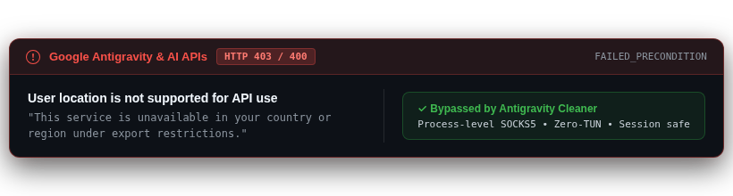
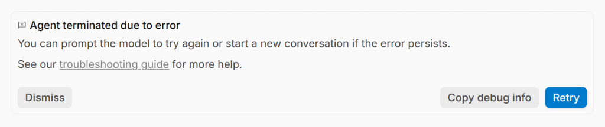
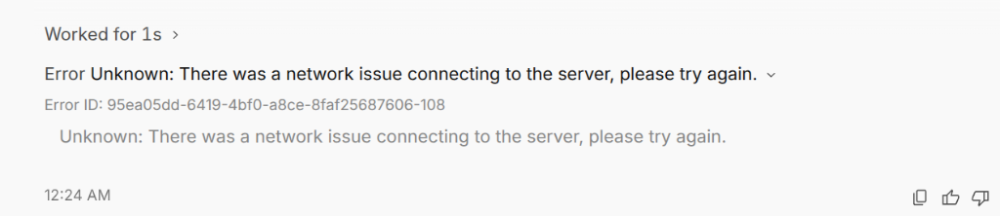
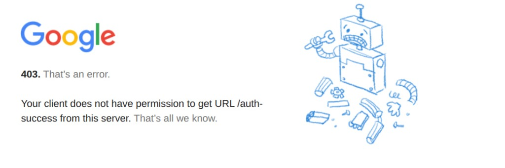
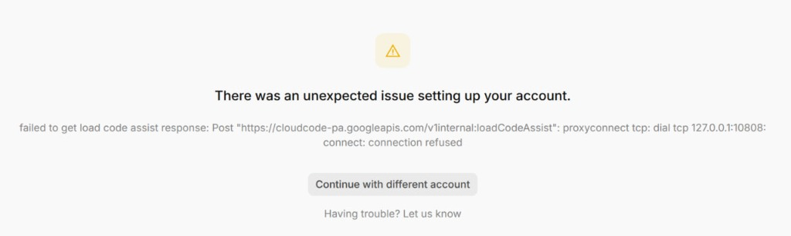
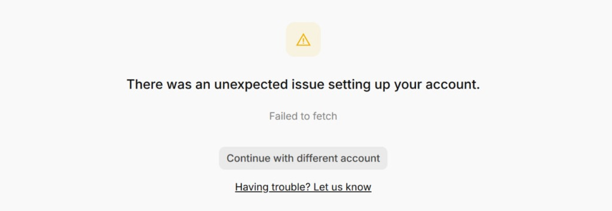
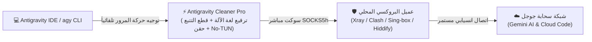
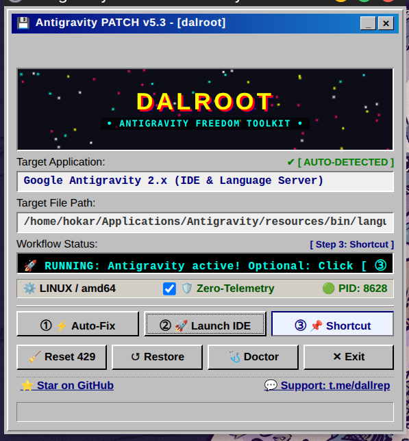
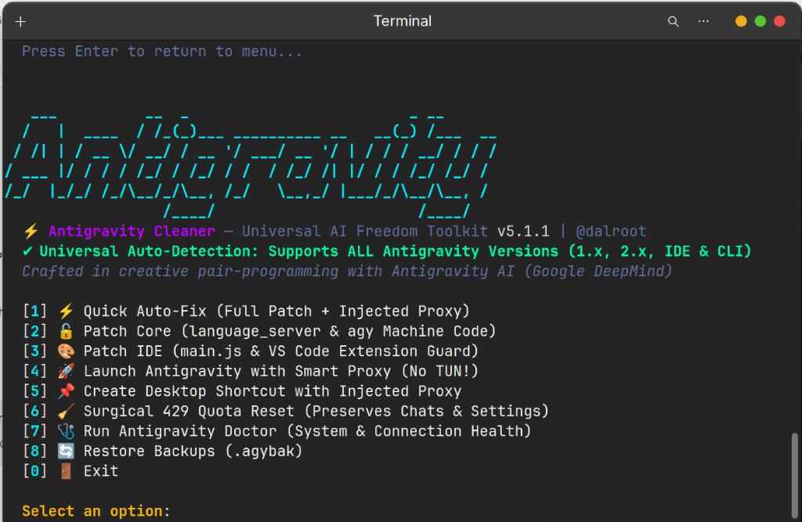
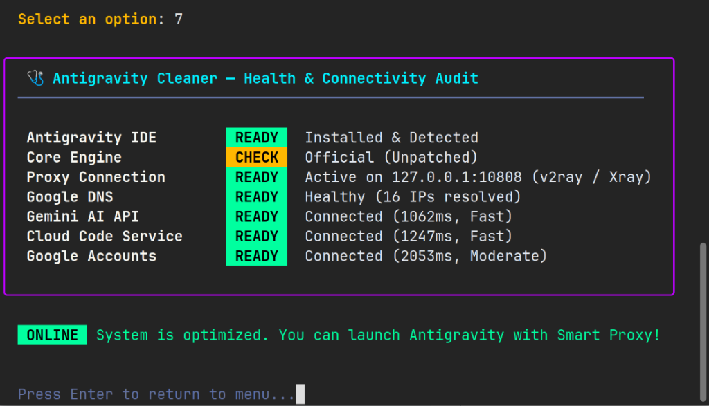

<div dir="rtl">

<p align="center">
  <a href="README.ar.md">🇸🇦 العربية</a> •
  <a href="README.md">🇺🇸 English</a> •
  <a href="README.fa.md">🇮🇷 فارسی</a> •
  <a href="README.ru.md">🇷🇺 Русский</a> •
  <a href="README.es.md">🇪🇸 Español</a> •
  <a href="README.tr.md">🇹🇷 Türkçe</a> •
  <a href="README.zh.md">🇨🇳 简体中文</a> •
  <a href="README.ur.md">🇵🇰 اردو</a>
</p>

<p align="center">
  
</p>

<h1 align="center">⚡ Antigravity Cleaner Pro (v5.3.1)</h1>

<p align="center">
  <strong>محرك الإعفاء التلقائي من العقوبات، وتصفير التتبع (Zero-Telemetry)، وحاقن البروكسي المباشر بدون TUN لبيئة Google Antigravity</strong>
</p>

<div align="center">

  [](https://github.com/tawroot/antigravity-cleaner/releases)
  [](https://golang.org)
  [](.github/workflows/security.yml)
  [](https://t.me/dallrep)
  [](docs/test-reports/benchmarks.log)
  [](docs/test-reports/benchmarks.log)
  []()

</div>

> *إهداء خالص من أعماق القلب إلى كل إنسان، طفل، طالب، معلم، مبدع، ومطور مستقل يسعى للتعلم والارتقاء — وخاصة أولئك المحاصرين بين سياط الحجب الداخلي وجدران العقوبات الرقمية الدولية. في 🇰🇵 كوريا الشمالية، 🇮🇷 إيران، 🇨🇳 الصين، 🇷🇺 روسيا، 🇹🇷 تركيا، 🇨🇺 كوبا، 🇸🇾 سوريا، 🇧🇾 بيلاروس، 🇸🇩 السودان، 🇻🇪 فنزويلا، 🇦🇫 أفغانستان، 🇲🇲 ميانمار، وفي كل بقعة نامية من عالمنا. إن الذكاء الاصطناعي إرث حضاري مشترك للبشرية جمعاء. الوصول الحر إلى المعرفة والتعليم والذكاء الاصطناعي هو حق إنساني أصيل للجميع، وليس امتيازاً محصوراً بالحدود الجغرافية الثرية.*  
> — **@dalroot**

<div align="center">

[](https://github.com/tawroot/antigravity-cleaner/stargazers)
&nbsp;
[](https://t.me/dallrep)
&nbsp;
[](https://github.com/tawroot/antigravity-cleaner/network/members)

</div>

> 🌟 **ادعم حرية الوصول للذكاء الاصطناعي:**  
> إذا ساعدك Antigravity Cleaner في تخطي عقوبات جوجل أو حل أخطاء استنفاد الحصص، يرجى **منح المشروع نجمة (Star) على GitHub** — مساهمتك تساعد المطورين الخاضعين للعقوبات في الوصول لهذه الأداة!

---

### 📑 فهرس الانتقال السريع
- [💾 التحميل المباشر للنسخة المحمولة (بدون تثبيت)](#-التحميل-المباشر-للنسخة-المحمولة-بدون-تثبيت)
- [⚡ ما هو Antigravity Cleaner؟](#-ما-هو-antigravity-cleaner)
- [🧬 الطبقات الهندسية التسع ورتق الثغرات في النواة](#-الطبقات-الهندسية-التسع-ورتق-الثغرات-في-النواة)
- [🧭 دليل الاستخدام خطوة بخطوة وفحص نطاق حساب جوجل](#-دليل-الاستخدام-خطوة-بخطوة-من-فحص-منطقة-حساب-جوجل-إلى-الإصلاح-التلقائي-بنقرة-واحدة)
- [❓ الأسئلة الشائعة والأمان ودليل استكشاف الأخطاء بالصور](#-الأسئلة-الشائعة-الأمان-ودليل-استكشاف-الأخطاء-بالصور)
- [🏛️ معمارية النظام ومسار الترافيك](#️-معمارية-النظام-ومسار-الترافيك)
- [🛡️ محرك انعدام التتبع (Zero-Telemetry) وضمان الخصوصية](#️-محرك-انعدام-التتبع-zero-telemetry-وضمان-الخصوصية)
- [📊 اختبارات الأداء القياسية الحية وسجلات التدقيق](#-اختبارات-الأداء-القياسية-الحية-وسجلات-التدقيق)
- [🥊 جدول المقارنة الشامل (v5.3.1)](#-جدول-المقارنة-الشامل-v531)
- [🚀 التثبيت السريع عبر سطر الأوامر (أمر واحد)](#-التثبيت-السريع-عبر-سطر-الأوامر-أمر-واحد)
- [💻 الواجهات المرئية: واجهة KeyGen الكلاسيكية ولوحة التحكم الطرفية](#-الواجهات-المرئية-واجهة-keygen-الكلاسيكية-ولوحة-التحكم-الطرفية)
- [🛠️ أوامر الطرفية (CLI) والتشخيصات](#️-أوامر-الطرفية-cli)
- [🤖 مهارة عملاء الذكاء الاصطناعي الذاتية](#-مهارة-عملاء-الذكاء-الاصطناعي-الذاتية-skillsantigravity-cleaner)
- [🔬 مختبر أبحاث أمان الذكاء الاصطناعي التطبيقي متعدد المنظومات](#-مختبر-أبحاث-أمان-الذكاء-الاصطناعي-التطبيقي-متعدد-المنظومات-google-deepmind-openai-anthropic-cursor)
- [🚦 المسار القياسي للإبلاغ عن الأخطاء والمشاكل](#-المسار-القياسي-للإبلاغ-عن-الأخطاء-والمشاكل)
- [👥 المساهمون وشهادات التقدير](#-المساهمون-وشهادات-التقدير)

---

## 💾 التحميل المباشر للنسخة المحمولة (بدون تثبيت)

> **⚡ المواصفات الفنية للنسخ المجمعة:**  
> مجمّعة بلغة **Go الخالصة (Go 1.22+)**؛ **محمولة ومستقلة بنسبة 100%** (لا تحتاج بايثون أو أي بيئات تشغيل إضافية)، **تعمل دون اتصال بالإنترنت كلياً**، لا تتطلب صلاحيات root/مسؤول أو إعدادات طرفية معقدة، وتعمل محلياً بصورة حصرية على `127.0.0.1`. فقط انقر نقراً مزدوجاً:

<div align="center">

<table style="width: 100%; border-collapse: collapse; text-align: center;" dir="rtl">
  <thead>
    <tr style="background: rgba(255, 255, 255, 0.05); border-bottom: 2px solid rgba(255, 255, 255, 0.1);">
      <th style="padding: 16px; width: 33%; text-align: center;">🪟 ويندوز (Windows)</th>
      <th style="padding: 16px; width: 34%; text-align: center;">🍎 ماك (macOS)</th>
      <th style="padding: 16px; width: 33%; text-align: center;">🐧 لينكس (Linux)</th>
    </tr>
  </thead>
  <tbody>
    <tr>
      <td style="padding: 20px 14px; vertical-align: top;">
        <span style="font-size: 40px;">🪟</span><br>
        <strong>Windows 10 & 11</strong><br>
        <small style="opacity: 0.75;">إصدارات 64-بت</small><br><br>
        <a href="https://github.com/tawroot/antigravity-cleaner/releases/latest/download/antigravity-cleaner-windows-amd64.exe">
          
        </a><br><br>
        <small style="opacity: 0.85;">⚡ انقر نقراً مزدوجاً على .exe لتشغيل الواجهة الرسومية</small>
      </td>
      <td style="padding: 20px 14px; vertical-align: top;">
        <span style="font-size: 40px;">🍎</span><br>
        <strong>Apple macOS</strong><br>
        <small style="opacity: 0.75;">معالجات Apple Silicon و Intel</small><br><br>
        <a href="https://github.com/tawroot/antigravity-cleaner/releases/latest/download/antigravity-cleaner-darwin-arm64">
          
        </a><br><br>
        <a href="https://github.com/tawroot/antigravity-cleaner/releases/latest/download/antigravity-cleaner-darwin-amd64">
          
        </a>
      </td>
      <td style="padding: 20px 14px; vertical-align: top;">
        <span style="font-size: 40px;">🐧</span><br>
        <strong>توزيعات Linux</strong><br>
        <small style="opacity: 0.75;">Ubuntu, Debian, Fedora, Arch</small><br><br>
        <a href="https://github.com/tawroot/antigravity-cleaner/releases/latest/download/antigravity-cleaner-linux-amd64">
          
        </a><br><br>
        <a href="https://github.com/tawroot/antigravity-cleaner/releases/latest/download/antigravity-cleaner-linux-arm64">
          
        </a>
      </td>
    </tr>
  </tbody>
</table>

</div>

---

## ⚡ ما هو Antigravity Cleaner؟

<p align="center">
  
</p>

**Antigravity Cleaner Pro** هي أداة أنظمة مفتوحة المصدر وعالية التخصص تمت هندستها بلغة **Go النقية** لتحييد الحظر الجغرافي، وإزالة حواجز أهلية الحسابات، وقطع مسارات التتبع (Telemetry)، وتصفير أقفال الحصص (HTTP 429 Quota Locks) عبر المنظومات التالية:
- **Google Antigravity 2.x**
- **محرر Antigravity IDE**
- **أداة سطر الأوامر Antigravity CLI (`agy`)**
- **إضافة VS Code الرسمية (`google.google-antigravity`)**

### 🧠 ما هو ملف `language_server` ولماذا يحتاج إلى ترقيع (Patching)؟

يعتمد محرر Antigravity IDE على واجهة أمامية مبنية على Electron / VS Code، لكن جميع القدرات الجوهرية للذكاء الاصطناعي، والتحليل الدلالي للأكواد، والاتصال بنماذج Gemini، وموازنة الحصص، والتحقق من التراخيص، و**فرض العقوبات والحظر الإقليمي** تتولاها حصرياً برمجية ثنائية مجمعة تُدعى **`language_server`**.

عند الإقلاع وأثناء تدفق الأكواد (Streaming)، تفحص جوجل عناوين الـ IP الحقيقية، والمناطق الزمنية، ومنارات التتبع من خلال هذا الملف الثنائي لفصل اتصال الذكاء الاصطناعي عن المطورين في الدول الخاضعة للعقوبات (إيران، كوبا، سوريا، إلخ). إن ترقيع هذه البوابة الثنائية هو حجر الأساس لتحرير المحرر البرمجي بالكامل.

---

### 🧬 الطبقات الهندسية التسع ورتق الثغرات في النواة

<details open>
<summary><strong>🔍 انقر لمعاينة الطبقات الهندسية التسع بالتفصيل:</strong></summary>
<br>

1. **تحييد ثنائيات النواة البرمجية (`language_server`)**  
   إعادة كتابة منطق التحقق من الهوية مباشرة في لغة الآلة (Machine Code: `RAX+8 hasValidAuth = true`)، مما يقضي نهائياً على حجب 403 وأخطاء `User location is not supported`.
2. **تخطي فحص الأهلية في واجهة الأوامر (`agy`)**  
   إلغاء قيود التحقق الإقليمي وأهلية الحساب على جانب العميل في الأداة الرسمية لسطر الأوامر.
3. **فتح كامل إمكانات واجهة المحرر (`main.js`)**  
   تفعيل علم `isGoogleInternal` في واجهة Electron الأمامية، مما يمنح المطور الميزات التجريبية وحزم أدوات الوكلاء البرمجيين، مع تفريغ ذاكرة التخزين المؤقت V8 المتقادمة.
4. **درع حجب السجلات وأخطاء الأنابيب (`app.asar`)**  
   إسكات سجلات تتبع جوجل المفرطة (تغيير `level: 'silly'` إلى `level: false`) ومعالجة انهيار تدفق البيانات الناتج عن انقطاع قنوات الإخراج (`Broken pipe / write EIO`).
5. **حارس منع إعادة التنزيل والتحميل الصامت**  
   قفل قناة تحديث الإضافات وتعطيل إعادة فحص تجزئة الملفات (Hash)، مما يمنع المحرر من استبدال ملفاتك المعدلة بملفات أصلية مقفلة دون إذنك.
6. **مغلّف التشغيل المؤسسي (Enterprise Wrapper بـ 8 أعلام)**  
   تغليف الملف الثنائي بـ 8 أعلام تشغيل موجهة للشركات، لفرض قطع التتبع `--disable_telemetry=true` وتفعيل خوادم بروتوكول سياق النموذج بأمان عبر `--allow_all_sidecars=true`.
7. **عزل البيانات وحماية الخصوصية بنسبة 100%**  
   إيقاف التسريب الخلفي للمطالبات، وسجل أوامر الطرفية، وتسجيلات Git، ومعرفات الجلسات، وعناوين IP الحقيقية. تعمل الأداة محلياً فقط وبشكل صارم على `127.0.0.1`.
8. **التصفير الجراحي لحصص HTTP 429**  
   تنظيف فوري لملفات تعريف الارتباط الخاصة بالحدود الزمنية ومخازن الرموز التالفة عبر 16 هدفاً خلال 0.002 ثانية، دون المساس بملفات المشاريع أو تاريخ المحادثات البرمجية.
9. **حاقن البروكسي الذكي المباشر دون الحاجة لوضع TUN**  
   توجيه ترافيك المحرر مباشرة إلى أدوات البروكسي المحلية (Xray, Clash, Sing-box, Hiddify) عبر المنفذين 10808 / 7890 دون الحاجة لتشغيل وضع TUN لكامل النظام، مع ضبط نبضات الاتصال بمؤقت 15 ثانية (TCP KeepAlive) لمقاومة انقطاعات جدران الفحص العميق (DPI).

</details>

---

### 🔄 ضمان التراجع النظيف بنقرة واحدة (1-Click Rollback)

> [!TIP]
> **جميع التعديلات والترقيعات قابلة للعكس بنسبة 100%.**  
> قبل تعديل أي بايت واحد، تنشئ الأداة تلقائياً نسخة احتياطية خام ومطابقة للأصل بامتداد `.agybak`. يمكنك العودة للوضع الأصلي فوراً في أي وقت:
> * **في الواجهة الرسومية (GUI):** انقر على زر **`[Restore]`**.
> * **في سطر الأوامر (CLI):** نفّذ الأمر **`ag-cleaner restore`**.

---

## 🧭 دليل الاستخدام خطوة بخطوة: من فحص منطقة حساب جوجل إلى الإصلاح التلقائي بنقرة واحدة

### 1. التحقق من الدولة المرتبطة بحساب جوجل (Google Account Country Association)
تفرض جوجل قيود الحظر الإقليمي بناءً على سجل الارتباط الجغرافي لحسابك:
👉 **تحقق من الدولة المرتبطة بحسابك خلال 30 ثانية:**  
[نموذج التحقق من الدولة في حساب جوجل](https://policies.google.com/country-association-form?hl=en-US&source=policies-site)

* **إذا أظهر الحساب دولة مدعومة (مثل أمريكا، ألمانيا، إلخ):** فحسابك مؤهل وجاهز للعمل فوراً.
* **إذا أظهر الحساب دولة خاضعة للعقوبات:**
  * **الخيار (أ) - تحديث الدولة:** فعّل أداة الـ VPN لديك، ثم افتح النموذج مجدداً، وحدد الخيار `I frequently use a Virtual Private Network (VPN)`، واضغط إرسال (Submit).
  * **الخيار (ب) - إنشاء حساب جديد:** سجّل حساب Gmail جديد بالكامل أثناء اتصالك بشبكة الـ VPN من دولة مدعومة.

---

### 2. تشغيل Cleaner: تطبيق الإصلاح التلقائي خلال ثوانٍ
* **الواجهة الرسومية (GUI):** شغّل الملف التنفيذي المستقل وانقر على **`[Auto-Fix]`**. سيتم تطبيق جميع الرقع وحقن البروكسي في أقل من ثانية واحدة دون الحاجة لإعادة تشغيل النظام.
* **سطر الأوامر (CLI):**
  ```bash
  ag-cleaner patch all
  ag-cleaner launch
  ```

---

## ❓ الأسئلة الشائعة، الأمان، ودليل استكشاف الأخطاء بالصور

<details>
<summary><strong>🛡️ هل تشغيل Antigravity Cleaner آمن وموثوق؟</strong></summary>
<br>

**نعم بكل تأكيد. الأمان قابل للتدقيق بنسبة 100% مباشرة عبر الكود المصدري:**
1. **تشغيل أوفلاين بالكامل:** لا تتطلب الأداة أي اتصال بالإنترنت أثناء عمليات الترقيع والتنظيف، وتعمل محلياً بصورة حصرية على `127.0.0.1`.
2. **لغة Go النقية (بدون تبعيات خارجية):** ملف تنفيذي واحد مجمّع بالكامل دون أي ملفات DLL مريبة أو استدعاءات بايثون ديناميكية مشبوهة.
3. **اجتياز تدقيق الأمان في GitHub بنسبة 100%:** فحوصات آلية دورية عبر أدوات CodeQL و Govulncheck في [`.github/workflows/security.yml`](.github/workflows/security.yml).
4. **حماية ملفات المشاريع والمحادثات:** تحافظ الأداة على مجلد `User/globalStorage` وكافة ملفات العمل البرمجية أثناء تصفير الحصص.
5. **معمارية موثقة وقابلة للتدقيق:** تفاصيل كاملة في وثيقتي [`.github/SECURITY.md`](.github/SECURITY.md) و [`docs/ARCHITECTURE.md`](docs/ARCHITECTURE.md).

</details>

<details>
<summary><strong>⚡ ماذا يفعل خيار الإصلاح التلقائي (Auto-Fix) ولماذا يدوم مفعوله؟</strong></summary>
<br>

عند النقر على **`[Auto-Fix]`** أو تشغيل `ag-cleaner patch all`:
1. **ثنائيات النواة:** ترقيع لغة الآلة لتعيين `RAX+8 hasValidAuth = 1` ([`pkg/patcher/manager.go`](pkg/patcher/manager.go)).
2. **واجهة الأوامر (`agy`):** تحييد بوابات فحص الأهلية الإقليمية ([`pkg/patcher/cli.go`](pkg/patcher/cli.go)).
3. **واجهة المحرر (`main.js`):** فتح خاصية `isGoogleInternal` وتفريغ كاش ترجمة V8 ([`pkg/patcher/ide.go`](pkg/patcher/ide.go)).
4. **إضافة VS Code:** حقن حارس منع إعادة التنزيل التلقائي ([`pkg/patcher/vscode.go`](pkg/patcher/vscode.go)).
5. **درع ASAR:** كتم السجلات المفرطة والتقاط أخطاء أنابيب `write EIO` ([`pkg/patcher/asar.go`](pkg/patcher/asar.go)).
6. **المغلف المؤسسي:** تمرير 8 أعلام حماية (`--disable_telemetry=true` و `--allow_all_sidecars=true`) ([`pkg/patcher/flags.go`](pkg/patcher/flags.go)).
7. **مشغل بروكسي No-TUN:** ضبط توجيه الترافيك للبروكسي المحلي بدون الحاجة لصلاحيات root لوضع TUN ([`pkg/proxy/launcher.go`](pkg/proxy/launcher.go)).

</details>

<details>
<summary><strong>🔄 كيف تعمل آلية النسخ الاحتياطي والاستعادة التلقائية؟</strong></summary>
<br>

* **النسخة الاحتياطية الأصلية (`.agybak`):** حفظ نسخة نقية من الملفات قبل إجراء أي تعديل عليها ([`pkg/patcher/atomic.go`](pkg/patcher/atomic.go)).
* **استعادة المصنع بنقرة واحدة:** انقر على **`[Restore]`** أو شغّل `ag-cleaner restore` لاسترجاع ملفاتك الأصلية فوراً.
* **انعدام المخلفات:** حذف الملف التنفيذي للأداة يزيلها بالكامل من نظامك دون ترك أي أثر.

</details>

<details>
<summary><strong>1. خطأ إنهاء الوكيل البرمجي (Agent Terminated Due to Error / write EIO)</strong></summary>
<br>



```text
Agent terminated due to error
You can prompt the model to try again or start a new conversation if the error persists.
See our troubleshooting guide for more help.

Dismiss  Copy debug info  Retry
```

* **السبب:** انهيار مفاجئ في أنبوب الاتصال بسبب السجلات الخام المفرطة (`write EIO`) أو انقطاع الاتصال الوسيط أثناء التدفق المباشر للأكواد.
* **الحل:** انقر على **`[Auto-Fix]`**؛ حيث يقوم درع ASAR Zero-Log بإسكات استثناءات الأنابيب وتفعيل موالف نبضات TCP KeepAlive بمؤقت 15 ثانية للحفاظ على استقرار السوكت.

</details>

<details>
<summary><strong>2. خطأ مشكلة في الاتصال بالشبكة (Network Issue Connecting to Server)</strong></summary>
<br>



```text
Worked for 1s >

Error Unknown: There was a network issue connecting to the server, please try again. ˅
Error ID: 95ea05dd-6419-4bf0-a8ce-8faf25687606-108
Unknown: There was a network issue connecting to the server, please try again.

12:24 AM
```

* **السبب:** قيام جدران الفحص العميق (DPI) بإسقاط اتصالات gRPC الخاملة، أو تسريب مسابير التتبع للـ IP الحقيقي في منتصف المحادثة.
* **الحل:** شغّل المحرر عبر `ag-cleaner launch` (أو زر **Launch IDE** في الواجهة)؛ لعزل الترافيك عبر سوكت SOCKS5h مباشر دون تسريب أي بيانات تتبع.

</details>

<details>
<summary><strong>3. حظر تسجيل الدخول وبوابة الصلاحيات (403 Forbidden /auth-success)</strong></summary>
<br>



```text
Google

403. That’s an error.

Your client does not have permission to get URL /auth-success from this server. That’s all we know.
```

* **السبب:** قيام فحص جوجل الإقليمي بالتعرف على إعادة توجيه تسجيل دخول المتصفح من منطقة خاضعة للعقوبات.
* **الحل:** شغّل **`[Auto-Fix]`**؛ مما يعين `hasValidAuth = true` ويمرر علم التراخيص المؤسسية `--stubby_auth_mode=business_licensed_enterprise` ويمحو التوكنات المسمومة.

</details>

<details>
<summary><strong>4. رفض اتصال البروكسي (Proxy Connection Refused: 127.0.0.1:10808)</strong></summary>
<br>



```text
There was an unexpected issue setting up your account.

failed to get load code assist response: Post "https://cloudcode-pa.googleapis.com/v1internal:loadCodeAssist": proxyconnect tcp: dial tcp 127.0.0.1:10808: connect: connection refused

Continue with different account
Having trouble? Let us know
```

* **السبب:** تطبيق البروكسي المحلي (Xray, Clash, NekoBox) مغلق أو يستمع على منفذ مختلف عن المنفذ المتوقع.
* **الحل:** شغّل أمر `ag-cleaner doctor`؛ حيث يفحص تلقائياً المنافذ المفتوحة ويحدث إعدادات البروكسي وفقاً للمتاح.

</details>

<details>
<summary><strong>5. فشل إعداد الحساب المبدئي (Failed to fetch)</strong></summary>
<br>



```text
There was an unexpected issue setting up your account.

Failed to fetch

Continue with different account
Having trouble? Let us know
```

* **السبب:** تلف سجلات قاعدة بيانات DIPS وتراكم كاش WebSocket العالق في حالة التطبيق.
* **الحل:** شغّل أمر `ag-cleaner clean` (أو انقر على **Clean 429** في الواجهة الرسومية)؛ لتفريغ 16 ملف كاش للحصص في 0.002 ثانية مع حماية المحادثات بالكامل.

</details>

---

## 🏛️ معمارية النظام ومسار الترافيك



---

## 🛡️ محرك انعدام التتبع (Zero-Telemetry) وضمان الخصوصية

### 🛑 ما هو تتبع جوجل التلقائي ولماذا يشكل خطراً؟
بشكل افتراضي، يرسل Google Antigravity حزم تتبع دورية إلى نهايات جوجل الطرفية (`googleapis.com`, `cloudcode-pa.googleapis.com`):
- **تسريب الموقع وعنوان IP الحقيقي:** ترسل مجسات التتبع معدلات زمن الاستجابة والبيانات الجغرافية غير المقنعة، مما يتسبب في حظر `User location is not supported`.
- **مراقبة مستودعات Git ومحتوى مجلدات العمل:** ترسل الأداة تجزئات الالتزام (Commit hashes) وعناوين المستودعات وامتدادات الملفات.
- **منارات تقارير الأخطاء والانهيارات:** تبث آثار التشخيص حالات الأعطال إلى خدمات تسجيل Google Cloud Code.

### 🛡️ كيف تحميك أداة Antigravity Cleaner Pro؟
بفضل **محرك انعدام التتبع المؤسسي المزود بـ 8 أعلام**:
- **قطع قنوات الإرسال بنسبة 100%:** حقن تلقائي للأعلام `--disable_telemetry=true` وأعلام العزل في نواة التشغيل. لا تتلقى جوجل **أي حزم تتبع، أو بيانات لمستودعات Git، أو منارات تتبع IP** من جهازك.
- **تشغيل محلي 100%:** تعمل الأداة بالكامل وبشكل مستقل على `127.0.0.1` دون أي استدعاءات شبكية خارجية.
- **الحفاظ الكامل على المحادثات:** عملية التصفير الجراحي (`ag-cleaner clean`) تستهدف حصراً ملفات الكاش التالفة وقيود DIPS، مع الحفاظ التام على المحادثات والمشاريع.
- **أمان استبدال الملفات الذري (POSIX Atomic Safety):** استبدال الملفات التنفيذية يتم ذرياً عبر تبديل الـ Inode (`os.Rename`)، مما يمنع تعطل العمليات قيد التشغيل أو خطأ `ETXTBSY`.

---

## 📊 اختبارات الأداء القياسية الحية وسجلات التدقيق

| المقياس | القيمة المسجلة | سجل التحقق |
| :--- | :--- | :--- |
| **سرعة فحص الأنماط بالذاكرة** | **1,901.84 ميجابايت/ثانية (~1.9 جيجابايت/ثانية)** | [`benchmarks.log`](docs/test-reports/benchmarks.log) |
| **زمن ترقيع ملف تنفيذي بحجم 171 ميجابايت** | **0.23 ثانية** | [`benchmarks.log`](docs/test-reports/benchmarks.log) |
| **الفحص المتزامن لأداة Doctor** | **~2.5 ثانية** | [`live_system_test.log`](docs/test-reports/live_system_test.log) |
| **تفريغ كاش الحصص الجراحي 429** | **حذف 16 عنصراً (فقدان 0 محادثة)** | [`live_system_test.log`](docs/test-reports/live_system_test.log) |
| **نسبة اجتياز الاختبارات الوحدوية** | **100% (اجتياز كافة الحزم)** | [`benchmarks.log`](docs/test-reports/benchmarks.log) |

> [!NOTE]
> جميع القياسات تعكس فحصاً حياً على حزم الاختبارات الرسمية. قد تختلف السرعات الفعلية تبعاً لقدرات المعالج وأقراص NVMe. ونظراً لأن العمليات تتم ذرياً في الذاكرة، يتم تطبيق الرقع في أجزاء من الثانية دون أي انخفاض في أداء النظام.

---

## 🥊 جدول المقارنة الشامل (v5.3.1)

| الميزة | أدوات الترقيع أحادية الغرض (`open-antigravity-patcher`, `QNIX`) | حاقنات العمليات و DLL (`antigravity-proxy`) | **⚡ Antigravity Cleaner Pro (v5.3.1)** |
| :--- | :---: | :---: | :---: |
| **لغة البرمجة والمعمارية** | Python 3 (تتطلب بيئة تشغيل، `pip`) | خاصة بويندوز C++ / حقن DLL | **لغة Go النقية الأصلية (بدون أي متطلبات، ملف تنفيذي واحد)** |
| **واجهة المستخدم** | سطر أوامر بسيط نصوص عادية | كونسول بسيط | **واجهة رسومية كلاسيكية Win95 Retro GUI + لوحة TUI عصرية بـ Lipgloss** |
| **مشغل البروكسي بدون وضع TUN** | ❌ (يفرض تشغيل TUN لكامل النظام) | ❌ غير متوفر | ✅ **اكتشاف تلقائي لـ Xray/Clash/NekoBox وحقن مباشر** |
| **درع ASAR لمنع الأخطاء (`write EIO`)** | ❌ غير متوفر | ❌ غير متوفر | ✅ **إسكات تام لانهيارات الأنابيب في `app.asar`** |
| **موالف تدفق الاتصال (KeepAlive)** | ❌ (انقطاعات متكررة للتدفق) | ❌ غير متوفر | ✅ **ضبط نبضات TCP KeepAlive بمؤقت 15 ثانية** |
| **التصفير الجراحي للحصص 429** | ❌ (يمسح كافة الإعدادات والمحادثات) | ❌ (يحذف كل شيء) | ✅ **ينظف كاش التوكن ويحافظ على كامل المحادثات!** |
| **ترقيع النواة الثنائية (Binary Patch)** | x86_64 / ARM64 | ❌ غير متوفر | ✅ **ترقيع لغة الآلة بنمط MultiGate IDA المتقدم** |
| **ترقيع واجهة المحرر (`main.js`)** | ✅ تعبيرات نمطية بسيطة | ❌ غير متوفر | ✅ **ترقيع آلي شامل + تفريغ كاش ترجمة V8** |
| **حارس منع إعادة التنزيل** | ✅ بسيط | ❌ غير متوفر | ✅ **حارس كامل + قفل قناة التحديث** |
| **أداة التشخيص Doctor** | ❌ غير متوفر | ⚠️ محدود جداً | ✅ **فحص متزامن لزمن الاستجابة وتسريب DNS في ثانيتين** |
| **الاستبدال الذري للملفات (POSIX)** | عبر ملفات بايثون المؤقتة | ❌ غير متوفر | ✅ **تبديل ذري لعقد الـ Inode (لا أخطاء `ETXTBSY` أثناء التشغيل)** |

---

## 🚀 التثبيت السريع عبر سطر الأوامر (أمر واحد)

### 🐧 أنظمة لينكس و 🍎 ماك (معالجات Apple Silicon M1–M4 وإنتل)
```bash
curl -fsSL https://raw.githubusercontent.com/tawroot/antigravity-cleaner/main/install.sh | bash
```

### 🪟 أنظمة ويندوز (PowerShell)
```powershell
irm https://raw.githubusercontent.com/tawroot/antigravity-cleaner/main/install.ps1 | iex
```

---

## 💻 الواجهات المرئية: واجهة KeyGen الكلاسيكية ولوحة التحكم الطرفية

### 💾 واجهة Retro KeyGen الرسومية لسطح المكتب (v5.3.1)
شغّلها كملف تنفيذي مستقل أو عبر الأمر `ag-cleaner gui` للاستفادة من سير العمل المبسط بثلاث خطوات (`① Auto-Fix ➔ ② Launch IDE ➔ ③ Shortcut`)، مع مفتاح تبديل انعدام التتبع الفوري ومراقبة حية للعمليات:

<div align="center">
  
</div>

---

### 🖥️ لوحة التحكم الطرفية التفاعلية (TUI) وأداة فحص الاتصال (Doctor)
نفّذ الأمر `ag-cleaner` في طرفيتك للحصول على لوحة تحكم تفاعلية مبنية بمكتبة Lipgloss، واختر الخيار `7` لتشغيل الفحص الفوري للاتصال:

<div align="center">
  
  <br>
  
</div>

---

## 🛠️ أوامر الطرفية (CLI)

```bash
# فتح القائمة التفاعلية في الطرفية
ag-cleaner

# فتح الواجهة الرسومية الكلاسيكية (Classic Win95 Desktop Window)
ag-cleaner gui

# تشخيص الاتصال وحالة النظام (عرض بطاقة ملخصة)
ag-cleaner doctor

# تشخيص مفصل مع مسارات التتبع وتفاصيل التصحيح
ag-cleaner doctor --verbose

# تطبيق كافة الرقع (النواة، سطر الأوامر، واجهة المحرر، درع ASAR)
ag-cleaner patch all

# إطلاق Antigravity مع حقن البروكسي الذكي (بدون الحاجة لوضع TUN!)
ag-cleaner launch

# تصفير حصص HTTP 429 دون فقدان سجل المحادثات
ag-cleaner clean

# استعادة كافة الملفات الأصلية وحالة المصنع
ag-cleaner restore

# إيقاف جميع العمليات العالقة لـ Antigravity و language_server
ag-cleaner kill

# إنشاء اختصار لسطح المكتب مجهز بحقن البروكسي
ag-cleaner create-launcher

# عرض معلومات المشروع والمطورين
ag-cleaner about
```

---

## 🤖 مهارة عملاء الذكاء الاصطناعي الذاتية (`skills/antigravity-cleaner`)

توفر أداة Antigravity Cleaner مهارة جاهزة لوكلاء الذكاء الاصطناعي ([`skills/antigravity-cleaner/SKILL.md`](skills/antigravity-cleaner/SKILL.md))، تتيح للمساعدين البرمجيين (Google Antigravity, Claude Code, Cursor, Codex) معالجة بيئة تشغيلهم ذاتياً عند مواجهة حظر أو قيود حصص أو انقطاعات شبكية:

- **فحص ذاتي تلقائي**: يشغل الوكيل أمر `ag-cleaner doctor` فور انقطاع الاتصال.
- **معالجة ذاتية للحصص**: ينفذ الوكيل عملية التنظيف الجراحي عند خطأ HTTP 429 تلقائياً دون تدخل بشري.
- **إعداد صفري**: مدمجة مباشرة في جذر المشروع للاكتشاف التلقائي الفوري.

---

## 🔬 مختبر أبحاث أمان الذكاء الاصطناعي التطبيقي متعدد المنظومات (Google DeepMind, OpenAI, Anthropic, Cursor)

تقف خلف **Antigravity Cleaner Pro** مبادرة أبحاث أمنية وهندسة عكسية نشطة. في مختبر أبحاثنا الأمنية الخاص، نقوم منهجياً بتفكيك وتحليل أدوات التطوير عبر كبرى منظومات الذكاء الاصطناعي العالمية: **Google DeepMind (Antigravity & Gemini)، OpenAI، Anthropic (Claude Code)، و Cursor**.

- **أكثر من 100 رقعة داخلية وجسر بروتوكول:** يحتفظ مستودع مختبرنا الخاص بمكتبة تضم أكثر من 100 رقعة بايت كود منخفضة المستوى، ومعطلات تتبع، وجسور لبروتوكول Stubby RPC، وموصلات نموذجك الخاص (BYOM).
- **الإصدار الرائد التأسيسي:** تمثل أداة Antigravity Cleaner Pro المشروع التأسيسي الرئيسي لهذه المبادرة، مع التخطيط لإطلاق أدوات متخصصة لاحقة لمختلف منصات تطوير الذكاء الاصطناعي.
- **مسار تدقيق واختبارات إنتاجية صارمة:** تخضع نتائج الأبحاث المتقدمة لاختبارات فحص أخطاء مكثفة (Fuzzing) واختبارات توافق عبر ويندوز، وماك، ولينكس قبل نقلها بأمان إلى الإصدارات العامة مفتوحة المصدر.
- **دعم المطورين عالمياً:** مشروع هندسي عالي الاعتمادية مكرس لتوفير استقرار طويل الأمد للمطورين الذين يواجهون العزلة الرقمية والقيود الشبكية.
- **ادعم المشروع:** إذا كانت أداتنا تحافظ على استمرارية بيئة التطوير لديك، يرجى **منح المستودع نجمة ⭐**. تفاعل المجتمع يسرّع بشكل مباشر نشر المزيد من أدوات مختبرنا الخاص للعموم!

---

## 🚦 المسار القياسي للإبلاغ عن الأخطاء والمشاكل

لضمان الفرز والمعالجة السريعة:
1. **نماذج الإبلاغ التفاعلية في GitHub:** إذا واجهت حالة استثنائية، يرجى فتح بلاغ باستخدام [نموذج الإبلاغ عن الأخطاء](https://github.com/tawroot/antigravity-cleaner/issues/new?template=bug_report.yml).
2. **الأسئلة المجتمعية وإعدادات البروكسي:** للأسئلة العامة ومشاركة إعدادات الشبكات الخاصة، يرجى استخدام [نقاشات GitHub (Discussions)](https://github.com/tawroot/antigravity-cleaner/discussions).
3. **الثغرات الأمنية:** اتبع إرشادات وثيقة [SECURITY.md](.github/SECURITY.md) وأرسل تقريراً سرياً عبر ميزة النصائح الأمنية في GitHub (Security Advisories).

---

## 👥 المساهمون وشهادات التقدير

- **كبير مهندسي المشروع والمطور الأساسي:** **[@dalroot](https://github.com/dalroot)**
- **المساعد والبرمجة الزوجية (Pair Programming):** **Antigravity AI (Google DeepMind)** — *تمت برمجتها بمفارقة ساخرة وممتعة عبر البرمجة المشتركة مع وكيل الذكاء الاصطناعي التابع لجوجل لتحرير أدوات مطوري جوجل للمبرمجين المحاصرين حول العالم!* 🤖
- **ترخيص البرمجية:** ترخيص أباتشي 2.0 (Apache License 2.0)
- إهداء لجميع الساعين نحو التقنية غير الخاضعة للرقابة، وإتاحة المصادر المفتوحة، وحرية المطورين في كل مكان.

---

## 🗺️ خارطة طريق المشروع (Roadmap)

هل ترغب في معرفة الميزات القادمة، وموحدات الأخطاء القياسية، ونماذج المختبر التجريبية؟  
اطّلع على وثيقة [**ROADMAP.md**](ROADMAP.md) (أو [خارطة الطريق بالفارسية ROADMAP.fa.md](ROADMAP.fa.md)) لمعاينة الأهداف المخططة.

---

## 📈 سجل تفاعل النجوم (Star History)

إذا ساعدتك هذه الأداة في حل مشاكل الحظر، فإن منحها نجمة ⭐ يساعد مطورين آخرين في العثور عليها.

<a href="https://star-history.com/#tawroot/antigravity-cleaner&Date">
 <picture>
   <source media="(prefers-color-scheme: dark)" srcset="https://api.star-history.com/svg?repos=tawroot/antigravity-cleaner&type=Date&theme=dark" />
   <source media="(prefers-color-scheme: light)" srcset="https://api.star-history.com/svg?repos=tawroot/antigravity-cleaner&type=Date" />
   
 </picture>
</a>

---

## 💬 المجتمع والنقاشات (Discussions)

لديك أسئلة، أو اقتراحات لميزات جديدة، أو ترغب في مشاركة إعداداتك؟  
[**افتح موضوعاً للنقاش في Discussions ←**](https://github.com/tawroot/antigravity-cleaner/discussions)

</div>
