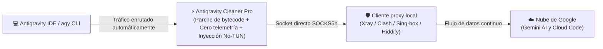

<p align="center">
  <a href="README.es.md">🇪🇸 Español</a> •
  <a href="README.md">🇺🇸 English</a> •
  <a href="README.fa.md">🇮🇷 فارسی</a> •
  <a href="README.ar.md">🇸🇦 العربية</a> •
  <a href="README.ru.md">🇷🇺 Русский</a> •
  <a href="README.tr.md">🇹🇷 Türkçe</a> •
  <a href="README.zh.md">🇨🇳 简体中文</a> •
  <a href="README.ur.md">🇵🇰 اردو</a>
</p>

<p align="center">
  
</p>

<h1 align="center">⚡ Antigravity Cleaner Pro (v5.4.3)</h1>

<p align="center">
  <strong>Elusión autónoma de sanciones, motor de cero telemetría e inyector directo de proxy sin modo TUN para Google Antigravity</strong>
</p>

<div align="center">

  [](https://github.com/tawroot/antigravity-cleaner/releases)
  [](https://github.com/tawroot/antigravity-cleaner/releases)
  [](https://golang.org)
  [](.github/workflows/security.yml)
  [](https://t.me/dallrep)
  [](docs/test-reports/benchmarks.log)
  [](docs/test-reports/benchmarks.log)
  []()

</div>

> *Dedicado desde lo más profundo del corazón a cada ser humano, niño, estudiante, maestro, creador y desarrollador independiente que lucha por aprender y crecer — especialmente a quienes se encuentran atrapados entre la censura interna y las sanciones digitales internacionales. En 🇰🇵 Corea del Norte, 🇮🇷 Irán, 🇨🇳 China, 🇷🇺 Rusia, 🇹🇷 Turquía, 🇨🇺 Cuba, 🇸🇾 Siria, 🇧🇾 Bielorrusia, 🇸🇩 Sudán, 🇻🇪 Venezuela, 🇦🇫 Afganistán, 🇲🇲 Myanmar y en cada rincón en desarrollo de nuestro planeta. La inteligencia artificial es un patrimonio común de toda la humanidad. El acceso al conocimiento, la educación y las herramientas de IA es un derecho humano fundamental de todas las personas, no un privilegio reservado para fronteras acaudaladas.*  
> — **@dalroot**

<div align="center">

[](https://github.com/tawroot/antigravity-cleaner/stargazers)
&nbsp;
[](https://t.me/dallrep)
&nbsp;
[](https://github.com/tawroot/antigravity-cleaner/network/members)

</div>

> 🌟 **Apoya el acceso abierto a la IA:**  
> Si Antigravity Cleaner te ayudó a eludir las sanciones de Google o a resolver errores de cuota, por favor **dale una estrella (Star) a este repositorio** — ¡ayuda a que otros desarrolladores en regiones restringidas descubran esta herramienta!

---

### 📑 Navegación rápida
- [💾 Descarga directa portable (sin instalación)](#-descarga-directa-portable-sin-instalación-requerida)
- [⚡ ¿Qué es Antigravity Cleaner?](#-qué-es-antigravity-cleaner)
- [🧬 9 capas de ingeniería y parches profundos del núcleo](#-9-capas-de-ingeniería-y-parches-profundos-del-núcleo)
- [🧭 Guía paso a paso: verificación de región de Google a Auto-Fix en 1 clic](#-guía-paso-a-paso-desde-la-verificación-de-región-de-cuenta-google-hasta-el-auto-fix-en-1-clic)
- [❓ Preguntas frecuentes, seguridad y resolución visual de errores](#-preguntas-frecuentes-seguridad-y-resolución-visual-de-errores)
- [🏛️ Arquitectura del sistema y flujo de tráfico](#️-arquitectura-del-sistema-y-flujo-de-tráfico)
- [🛡️ Motor de cero telemetría y garantía de privacidad](#️-motor-de-cero-telemetría-y-garantía-de-privacidad)
- [📊 Pruebas de rendimiento en vivo y registros de auditoría](#-pruebas-de-rendimiento-en-vivo-y-registros-de-auditoría)
- [🥊 Matriz comparativa exhaustiva (v5.4.3)](#-matriz-comparativa-exhaustiva-v531)
- [🚀 Instalación rápida por CLI (una sola línea)](#-instalación-rápida-por-cli-una-sola-línea)
- [💻 Interfaces visuales: GUI Retro KeyGen y panel de terminal](#-interfaces-visuales-gui-retro-keygen-y-panel-de-terminal)
- [🛠️ Subcomandos de CLI y diagnóstico](#️-subcomandos-de-cli)
- [🤖 Habilidad autónoma para agentes de IA](#-habilidad-autónoma-para-agentes-de-ia-skillsantigravity-cleaner)
- [🔬 Laboratorio multiecosistema de seguridad aplicada en IA](#-laboratorio-multiecosistema-de-seguridad-aplicada-en-ia-google-deepmind-openai-anthropic-cursor)
- [🚦 Canal estándar para reporte de errores](#-canal-estándar-para-reporte-de-errores)
- [👥 Créditos y atribuciones](#-créditos-y-atribuciones)

---

## 💾 Descarga directa portable (sin instalación requerida)

> **⚡ Especificaciones técnicas de los ejecutables:**  
> Compilado en **Go puro (Go 1.22+)**; **100% autónomo y portable** (no requiere Python ni entornos de ejecución adicionales), **completamente funcional sin conexión a internet**, no necesita permisos de root/administrador ni configuraciones complejas de terminal, ejecutándose estrictamente de forma local en `127.0.0.1`. Simplemente haz doble clic:

<div align="center">

<table style="width: 100%; border-collapse: collapse; text-align: center;">
  <thead>
    <tr style="background: rgba(255, 255, 255, 0.05); border-bottom: 2px solid rgba(255, 255, 255, 0.1);">
      <th style="padding: 16px; width: 33%; text-align: center;">🪟 Windows</th>
      <th style="padding: 16px; width: 34%; text-align: center;">🍎 macOS</th>
      <th style="padding: 16px; width: 33%; text-align: center;">🐧 Linux</th>
    </tr>
  </thead>
  <tbody>
    <tr>
      <td style="padding: 20px 14px; vertical-align: top;">
        <span style="font-size: 40px;">🪟</span><br>
        <strong>Windows 10 y 11</strong><br>
        <small style="opacity: 0.75;">Ediciones de 64 bits</small><br><br>
        <a href="https://github.com/tawroot/antigravity-cleaner/releases/latest/download/antigravity-cleaner-windows-amd64.exe">
          
        </a><br><br>
        <small style="opacity: 0.85;">⚡ Doble clic en el .exe para abrir la interfaz gráfica</small>
      </td>
      <td style="padding: 20px 14px; vertical-align: top;">
        <span style="font-size: 40px;">🍎</span><br>
        <strong>Apple macOS</strong><br>
        <small style="opacity: 0.75;">Apple Silicon e Intel</small><br><br>
        <a href="https://github.com/tawroot/antigravity-cleaner/releases/latest/download/antigravity-cleaner-darwin-arm64">
          
        </a><br><br>
        <a href="https://github.com/tawroot/antigravity-cleaner/releases/latest/download/antigravity-cleaner-darwin-amd64">
          
        </a>
      </td>
      <td style="padding: 20px 14px; vertical-align: top;">
        <span style="font-size: 40px;">🐧</span><br>
        <strong>Distribuciones Linux</strong><br>
        <small style="opacity: 0.75;">Ubuntu, Debian, Fedora, Arch</small><br><br>
        <a href="https://github.com/tawroot/antigravity-cleaner/releases/latest/download/antigravity-cleaner-linux-amd64">
          
        </a><br><br>
        <a href="https://github.com/tawroot/antigravity-cleaner/releases/latest/download/antigravity-cleaner-linux-arm64">
          
        </a>
      </td>
    </tr>
  </tbody>
</table>

</div>

---

## ⚡ ¿Qué es Antigravity Cleaner?

<p align="center">
  
</p>

**Antigravity Cleaner Pro** es una utilidad de sistemas de código abierto desarrollada en **Go puro** de alto rendimiento, diseñada para neutralizar el bloqueo geográfico, las barreras de elegibilidad de cuentas, los balizas de telemetría y los bloqueos de cuota HTTP 429 en:
- **Google Antigravity 2.x**
- **Antigravity IDE**
- **Antigravity CLI (`agy`)**
- **Extensión oficial para VS Code (`google.google-antigravity`)**

### 🧠 ¿Qué es `language_server` y por qué requiere parches?

Antigravity IDE se ejecuta externamente sobre una interfaz basada en Electron / VS Code; sin embargo, todas las funciones centrales de IA, el razonamiento semántico del código, la comunicación con los modelos Gemini, el arbitraje de cuotas, la validación de licencias y la **aplicación estricta de las sanciones y bloqueos geográficos** están centralizados en un ejecutable binario independiente llamado **`language_server`**.

Al iniciar la aplicación y durante la transmisión (streaming) de código, Google inspecciona las direcciones IP reales, las zonas horarias y los paquetes de telemetría a través de este binario para interrumpir la conexión de los desarrolladores en países sancionados (Irán, Cuba, Siria, etc.). Parchear esta compuerta binaria a nivel de código máquina es el pilar fundamental para liberar completamente el entorno de desarrollo.

---

### 🧬 9 capas de ingeniería y parches profundos del núcleo

<details open>
<summary><strong>🔍 Haz clic para inspeccionar las 9 capas técnicas detalladas:</strong></summary>
<br>

1. **Neutralización del binario del motor central (`language_server`)**  
   Reescribe la lógica de autenticación directamente en código máquina (`RAX+8 hasValidAuth = true`), eliminando de raíz los bloqueos 403 Forbidden y los errores `User location is not supported`.
2. **Elusión de comprobación de elegibilidad en CLI (`agy`)**  
   Neutraliza las barreras de verificación regional y de cuenta en el ejecutable oficial de línea de comandos.
3. **Desbloqueo de capacidades en el frontend del IDE (`main.js`)**  
   Activa el flag `isGoogleInternal` en la interfaz Electron, habilitando funciones preliminares y herramientas avanzadas de agentes, mientras purga la caché antigua de compilación de V8.
4. **Escudo de cero registros y mitigación de fallos de tubería (`app.asar`)**  
   Silencia los registros excesivos de telemetría de Google (cambiando `level: 'silly'` por `level: false`) y gestiona las rupturas de tuberías en consola (`Broken pipe / write EIO`) para evitar caídas durante el streaming.
5. **Guardián contra la redescarga silenciosa (Anti Re-Download Guard)**  
   Bloquea el canal de actualización de la extensión e inhabilita la verificación de hashes, evitando que el IDE sobrescriba silenciosamente los archivos parcheados con binarios restringidos.
6. **Envoltorio de ejecución empresarial (Runtime de 8 flags)**  
   Envuelve el binario principal con 8 parámetros de nivel de producción, imponiendo `--disable_telemetry=true` y habilitando con seguridad servidores MCP mediante `--allow_all_sidecars=true`.
7. **100% de protección de privacidad y aislamiento de datos**  
   Detiene la fuga en segundo plano de prompts, historiales de comandos de terminal, commits de Git, identificadores de sesión e IP reales. Opera estrictamente de forma local en `127.0.0.1`.
8. **Restablecimiento quirúrgico de cuota HTTP 429**  
   Limpia instantáneamente cookies corruptas de limitación de tasa y depósitos de tokens en 16 rutas en 0.002 segundos, sin tocar archivos de proyectos ni historiales de conversación.
9. **Inyector directo de proxy inteligente sin modo TUN**  
   Enruta el tráfico del IDE directamente hacia clientes locales de proxy (Xray, Clash, Sing-box, Hiddify) en los puertos 10808 / 7890 sin requerir el modo TUN en todo el sistema operativo, respaldado por una optimización de sockets con TCP KeepAlive de 15 segundos contra desconexiones por DPI.

</details>

---

### 🔄 Garantía de reversión limpia en 1 clic (Clean Rollback)

> [!TIP]
> **Todas las modificaciones y parches son 100% reversibles.**  
> Antes de modificar un solo byte, Cleaner crea automáticamente una copia de respaldo virgen de fábrica con la extensión `.agybak`. Puedes regresar al estado original en cualquier momento:
> * **En la interfaz gráfica (GUI):** Haz clic en el botón **`[Restore]`**.
> * **En la terminal (CLI):** Ejecuta el comando **`ag-cleaner restore`**.

---

## 🧭 Guía paso a paso: desde la verificación de región de cuenta Google hasta el Auto-Fix en 1 clic

### 1. Comprueba la asociación de país de tu cuenta Google
Google aplica restricciones regionales basándose en el historial de ubicación de tu cuenta:
👉 **Verifica la asociación de país de tu cuenta en 30 segundos:**  
[Formulario de asociación de país de Google](https://policies.google.com/country-association-form?hl=en-US&source=policies-site)

* **Si el país muestra una región admitida (EE. UU., Alemania, etc.):** Tu cuenta está lista para operar.
* **Si el país muestra una región sancionada o restringida:**
  * **Opción A (Actualizar país):** Activa tu VPN, vuelve a abrir el formulario, marca la opción `I frequently use a Virtual Private Network (VPN)` (Uso frecuentemente una red privada virtual) y haz clic en Enviar (Submit).
  * **Opción B (Nueva cuenta):** Registra una cuenta nueva de Gmail mientras estés conectado a una VPN de un país compatible.

---

### 2. Inicia Cleaner: aplica el arreglo automático en segundos
* **Interfaz Gráfica (GUI):** Ejecuta el archivo descargado y haz clic en **`[Auto-Fix]`**. Todos los parches y el proxy se aplican en menos de 1 segundo sin reiniciar el sistema operativo.
* **Línea de comandos (CLI):**
  ```bash
  ag-cleaner patch all
  ag-cleaner launch
  ```

---

## ❓ Preguntas frecuentes, seguridad y resolución visual de errores

<details>
<summary><strong>🛡️ ¿Es seguro ejecutar Antigravity Cleaner?</strong></summary>
<br>

**Sí, absolutamente. La seguridad es 100% auditable directamente en el código fuente:**
1. **Operación totalmente fuera de línea:** Cleaner no requiere conexión a internet durante el parcheo ni la limpieza. Funciona estrictamente en `127.0.0.1`.
2. **Go puro (sin dependencias externas):** Un único ejecutable compilado sin DLLs dudosas ni scripts dinámicos de Python.
3. **100% de éxito en auditorías de seguridad en GitHub:** Escaneos automatizados y continuos con CodeQL y Govulncheck en [`.github/workflows/security.yml`](.github/workflows/security.yml).
4. **Preservación total de proyectos y conversaciones:** Respeta intactos el directorio `User/globalStorage` y tus archivos de código durante la limpieza de cuotas.
5. **Arquitectura verificable:** Documentada en detalle en [`.github/SECURITY.md`](.github/SECURITY.md) y [`docs/ARCHITECTURE.md`](docs/ARCHITECTURE.md).

</details>

<details>
<summary><strong>⚡ ¿Qué hace Auto-Fix y por qué sus cambios son permanentes?</strong></summary>
<br>

Al hacer clic en **`[Auto-Fix]`** o ejecutar `ag-cleaner patch all`:
1. **Motor central:** Aplica un parche de código máquina que establece `RAX+8 hasValidAuth = 1` ([`pkg/patcher/manager.go`](pkg/patcher/manager.go)).
2. **CLI (`agy`):** Neutraliza las comprobaciones de elegibilidad en cliente ([`pkg/patcher/cli.go`](pkg/patcher/cli.go)).
3. **IDE (`main.js`):** Desbloquea `isGoogleInternal` y purga la caché de compilación V8 ([`pkg/patcher/ide.go`](pkg/patcher/ide.go)).
4. **Extensión VS Code:** Inyecta la protección contra redescargas automáticas ([`pkg/patcher/vscode.go`](pkg/patcher/vscode.go)).
5. **Escudo ASAR:** Silencia registros verbosos y captura excepciones `write EIO` ([`pkg/patcher/asar.go`](pkg/patcher/asar.go)).
6. **Envoltorio empresarial:** Inyecta 8 flags de producción (`--disable_telemetry=true`, `--allow_all_sidecars=true`) ([`pkg/patcher/flags.go`](pkg/patcher/flags.go)).
7. **Lanzador de proxy sin TUN:** Enruta el tráfico hacia el proxy local sin requerir privilegios de superusuario ni modo TUN ([`pkg/proxy/launcher.go`](pkg/proxy/launcher.go)).

</details>

<details>
<summary><strong>🔄 ¿Cómo funciona el sistema automatizado de respaldo y restauración?</strong></summary>
<br>

* **Copia de fábrica (`.agybak`):** Respalda los binarios originales antes de aplicar cualquier modificación ([`pkg/patcher/atomic.go`](pkg/patcher/atomic.go)).
* **Restauración de fábrica en 1 clic:** Haz clic en **`[Restore]`** o ejecuta `ag-cleaner restore` para revertir al estado oficial al instante.
* **Cero residuos:** Al borrar el archivo ejecutable único, eliminas completamente Cleaner de tu equipo.

</details>

<details>
<summary><strong>1. Error de terminación abrupta del agente (Agent Terminated / fallo write EIO)</strong></summary>
<br>


```text
Agent terminated due to error
You can prompt the model to try again or start a new conversation if the error persists.
See our troubleshooting guide for more help.

Dismiss  Copy debug info  Retry
```

* **Causa:** Ruptura repentina de la tubería de consola debida al flujo excesivo de registros de telemetría (`write EIO`) o tiempos de espera agotados en nodos intermedios de red durante el streaming.
* **Solución:** Haz clic en **`[Auto-Fix]`**; el escudo ASAR silencia las excepciones de tubería y activa un ajuste de sockets con TCP KeepAlive a 15 segundos para dar estabilidad a la conexión.

</details>

<details>
<summary><strong>2. Problema de red al conectar con el servidor (Network Issue Connecting to Server)</strong></summary>
<br>


```text
Worked for 1s >

Error Unknown: There was a network issue connecting to the server, please try again. ˅
Error ID: 95ea05dd-6419-4bf0-a8ce-8faf25687606-108
Unknown: There was a network issue connecting to the server, please try again.

12:24 AM
```

* **Causa:** Sistemas de inspección profunda de paquetes (DPI) cortando flujos gRPC inactivos, o balizas de telemetría exponiendo la IP real en plena conversación.
* **Solución:** Inicia con `ag-cleaner launch` (o el botón **Launch IDE** en la GUI); aísla los flujos a través de un socket SOCKS5h directo con cero telemetría.

</details>

<details>
<summary><strong>3. Bloqueo de autenticación de login y error 403 Forbidden (/auth-success)</strong></summary>
<br>


```text
Google

403. That’s an error.

Your client does not have permission to get URL /auth-success from this server. That’s all we know.
```

* **Causa:** La verificación regional de Google detectó que la redirección de inicio de sesión del navegador procedía de una región sancionada.
* **Solución:** Ejecuta **`[Auto-Fix]`**; establece `hasValidAuth = true`, transfiere el flag de licencia corporativa `--stubby_auth_mode=business_licensed_enterprise` y purga tokens corruptos.

</details>

<details>
<summary><strong>4. Conexión al proxy rechazada (Proxy Connection Refused: 127.0.0.1:10808)</strong></summary>
<br>


```text
There was an unexpected issue setting up your account.

failed to get load code assist response: Post "https://cloudcode-pa.googleapis.com/v1internal:loadCodeAssist": proxyconnect tcp: dial tcp 127.0.0.1:10808: connect: connection refused

Continue with different account
Having trouble? Let us know
```

* **Causa:** El cliente proxy local (Xray, Clash, NekoBox) se encuentra apagado o está escuchando en un puerto distinto al configurado.
* **Solución:** Ejecuta `ag-cleaner doctor`; detecta automáticamente los puertos locales abiertos y actualiza la configuración del proxy en consecuencia.

</details>

<details>
<summary><strong>5. Error al configurar la cuenta inicialmente (Failed to fetch)</strong></summary>
<br>


```text
There was an unexpected issue setting up your account.

Failed to fetch

Continue with different account
Having trouble? Let us know
```

* **Causa:** Corrupción de registros en la base de datos DIPS y cachés huérfanas de WebSockets atrapadas en el estado interno de la aplicación.
* **Solución:** Ejecuta `ag-cleaner clean` (o haz clic en **Clean 429** en la GUI); purga 16 archivos de caché de cuotas en 0.002 s manteniendo a salvo todas tus conversaciones.

</details>

---

## 🏛️ Arquitectura del sistema y flujo de tráfico



---

## 🛡️ Motor de cero telemetría y garantía de privacidad

### 🛑 ¿Qué es la telemetría de Google y por qué representa un riesgo?
Por defecto, Google Antigravity transmite continuamente paquetes de telemetría en segundo plano a servidores de Google (`googleapis.com`, `cloudcode-pa.googleapis.com`):
- **Filtración de IP real y geolocalización:** Las sondas de telemetría transmiten la latencia local desprotegida y el perfil de red, provocando bloqueos del tipo `User location is not supported`.
- **Vigilancia de metadatos de Git y del espacio de trabajo:** Envía hashes de commits, URLs de repositorios remotos y tipos de archivos abiertos.
- **Balizas de diagnóstico y errores:** Emite trazas detalladas y estados de error a los servicios de registro de Google Cloud Code.

### 🛡️ Cómo te protege Antigravity Cleaner Pro
Mediante nuestro **motor de cero telemetría con 8 flags empresariales**:
- **100% de canales de rastreo cortados:** Inyecta automáticamente `--disable_telemetry=true` y flags de aislamiento corporativo en el entorno de ejecución. Google recibe **cero paquetes de telemetría, cero metadatos de Git y cero balizas de IP** desde tu equipo.
- **100% de ejecución local:** Funciona íntegramente en `127.0.0.1` sin realizar peticiones de red externas.
- **Preservación total de conversaciones:** El restablecimiento quirúrgico de cuotas (`ag-cleaner clean`) solo actúa sobre archivos de caché de límites dañados. Tus prompts y proyectos quedan completamente intactos.
- **Seguridad atómica POSIX:** Los ejecutables se reemplazan mediante el intercambio atómico de inodos (`os.Rename`), garantizando que los procesos en ejecución no fallen ni se bloqueen con errores `ETXTBSY`.

---

## 📊 Pruebas de rendimiento en vivo y registros de auditoría

| Métrica | Valor registrado | Registro de verificación |
| :--- | :--- | :--- |
| **Escaneo de firmas en memoria** | **1,901.84 MB/s (~1.9 GB/s)** | [`benchmarks.log`](docs/test-reports/benchmarks.log) |
| **Tiempo de parcheo de binario de 171 MB** | **0.23 segundos** | [`benchmarks.log`](docs/test-reports/benchmarks.log) |
| **Auditoría concurrente con Doctor** | **~2.5 segundos** | [`live_system_test.log`](docs/test-reports/live_system_test.log) |
| **Limpieza quirúrgica de cuota 429** | **16 artefactos purgados (0 chats perdidos)** | [`live_system_test.log`](docs/test-reports/live_system_test.log) |
| **Tasa de aprobación de pruebas unitarias** | **100% (todos los paquetes aprobados)** | [`benchmarks.log`](docs/test-reports/benchmarks.log) |

> [!NOTE]
> Todos los valores de referencia provienen de pruebas en vivo sobre suites de test oficiales. Las velocidades reales pueden variar según la potencia de la CPU y la tasa de transferencia de discos NVMe. Dado que las operaciones se realizan de forma atómica en memoria, el parcheo se completa en una fracción de segundo sin caídas de rendimiento en la interfaz.

---

## 🥊 Matriz comparativa exhaustiva (v5.4.3)

| Característica | Parcheadores básicos unipropropósito (`open-antigravity-patcher`, `QNIX`) | Inyectores de procesos y DLL (`antigravity-proxy`) | **⚡ Antigravity Cleaner Pro (v5.4.3)** |
| :--- | :---: | :---: | :---: |
| **Lenguaje y arquitectura** | Python 3 (requiere dependencias y `pip`) | Exclusivo de Windows C++ / inyección DLL | **Go puro nativo (cero dependencias, ejecutable único)** |
| **Interfaz de usuario** | Salida simple de texto en consola | Consola básica | **GUI clásica Retro Win95 + Panel TUI moderno con Lipgloss** |
| **Lanzador de proxy sin TUN** | ❌ (Obliga a activar modo TUN global) | ❌ No disponible | ✅ **Detecta Xray/Clash/NekoBox y lo inyecta automáticamente** |
| **Escudo ASAR para caídas de tubería (`write EIO`)** | ❌ No disponible | ❌ No disponible | ✅ **Silencia las rupturas de tuberías en `app.asar`** |
| **Ajuste de KeepAlive para streaming** | ❌ (Cortes frecuentes en la transmisión) | ❌ No disponible | ✅ **Aplica 15s de TCP KeepAlive en sockets** |
| **Restablecimiento quirúrgico de cuota 429** | ❌ (Borra toda la configuración y chats) | ❌ (Elimina todo) | ✅ **Limpia la caché de tokens, ¡PRESERVA todas las conversaciones!** |
| **Parcheo del binario central** | Básico x86_64 / ARM64 | ❌ No disponible | ✅ **Parche profundo de código máquina estilo MultiGate IDA** |
| **Parche de frontend del IDE (`main.js`)** | ✅ Regex elemental | ❌ No disponible | ✅ **Parche automático + purga de caché de compilación V8** |
| **Protección contra redescargas automáticas** | ✅ Básica | ❌ No disponible | ✅ **Protección total + bloqueo de canal de actualización** |
| **Herramienta diagnóstica Doctor** | ❌ No disponible | ⚠️ Muy limitada | ✅ **Auditoría concurrente en 2s de latencia y fugas DNS** |
| **Reemplazo atómico POSIX** | Archivos temporales en Python | ❌ No disponible | ✅ **Intercambio atómico de inodos (sin error `ETXTBSY` en vivo)** |

---

## 🚀 Instalación rápida por CLI (una sola línea)

### 🐧 Linux y 🍎 macOS (Apple Silicon M1–M4 e Intel)
```bash
curl -fsSL https://raw.githubusercontent.com/tawroot/antigravity-cleaner/main/install.sh | bash
```

### 🪟 Windows (PowerShell)
```powershell
irm https://raw.githubusercontent.com/tawroot/antigravity-cleaner/main/install.ps1 | iex
```

---

## 💻 Interfaces visuales: GUI Retro KeyGen y panel de terminal

### 💾 Interfaz de escritorio Retro KeyGen GUI (v5.4.3)
Ejecútala de forma independiente o con `ag-cleaner gui` para un flujo de trabajo asistido en 3 pasos (`① Auto-Fix ➔ ② Launch IDE ➔ ③ Shortcut`), con conmutador de cero telemetría en tiempo real y supervisión de procesos en directo:

<div align="center">
  
</div>

---

### 🖥️ Panel interactivo TUI para terminal y herramienta Doctor
Ejecuta `ag-cleaner` en tu terminal para disfrutar de un panel interactivo estilizado con Lipgloss, y selecciona la opción `7` para realizar un diagnóstico instantáneo de red:

<div align="center">
  
  <br>
  
</div>

---

## 🛠️ Subcomandos de CLI

```bash
# Iniciar el menú interactivo en la terminal
ag-cleaner

# Abrir la interfaz gráfica Retro KeyGen (ventana clásica estilo Win95)
ag-cleaner gui

# Diagnóstico de salud del sistema y red (tarjeta simplificada)
ag-cleaner doctor

# Diagnóstico exhaustivo con trazas de depuración detalladas
ag-cleaner doctor --verbose

# Aplicar todos los parches (binario central, CLI, frontend del IDE, escudo ASAR)
ag-cleaner patch all

# Iniciar Antigravity con inyección de proxy inteligente (¡sin necesidad de TUN!)
ag-cleaner launch

# Restablecer la cuota HTTP 429 sin perder el historial de chats
ag-cleaner clean

# Restaurar todos los archivos al estado original de fábrica
ag-cleaner restore

# Cerrar todos los procesos zombi de Antigravity y language_server en ejecución
ag-cleaner kill

# Generar un acceso directo en el escritorio con proxy preconfigurado
ag-cleaner create-launcher

# Ver información del proyecto y atribuciones
ag-cleaner about
```

---

## 🤖 Habilidad autónoma para agentes de IA (`skills/antigravity-cleaner`)

Antigravity Cleaner incluye una **habilidad nativa para agentes** ([`skills/antigravity-cleaner/SKILL.md`](skills/antigravity-cleaner/SKILL.md)) que permite a asistentes de código autónomos (Google Antigravity, Claude Code, Cursor, Codex) autoreparar su propio entorno ante restricciones de API, bloqueos de cuota o caídas de red:

- **Autodiagnóstico automatizado**: Los agentes activan `ag-cleaner doctor` al perder la conexión.
- **Autocorrección de cuotas**: Al detectar un error HTTP 429, los agentes ejecutan la limpieza quirúrgica sin requerir intervención humana.
- **Cero configuración**: Se incluye directamente en la raíz del repositorio para su descubrimiento automático.

---

## 🔬 Laboratorio multiecosistema de seguridad aplicada en IA (Google DeepMind, OpenAI, Anthropic, Cursor)

Detrás de **Antigravity Cleaner Pro** se encuentra una iniciativa continua de ingeniería inversa e investigación de seguridad. En nuestro laboratorio privado, desmantelamos y analizamos metódicamente las herramientas para desarrolladores de los principales ecosistemas de IA a nivel global: **Google DeepMind (Antigravity y Gemini), OpenAI, Anthropic (Claude Code) y Cursor**.

- **Más de 100 parches internos y puentes de protocolo:** Nuestro repositorio privado mantiene una biblioteca de más de 100 parches de código de bytes, anuladores de telemetría, puentes para Stubby RPC y conectores BYOM (Bring-Your-Own-Model).
- **Lanzamiento insignia fundacional:** Antigravity Cleaner Pro constituye el primer gran proyecto público de esta iniciativa, con próximas herramientas especializadas planificadas para su liberación en otros ecosistemas.
- **Ciclo riguroso de pruebas de producción:** Los hallazgos avanzados son sometidos a exhaustivas pruebas de fuzzing y compatibilidad en Windows, macOS y Linux antes de ser trasladados con total seguridad a los repositorios públicos de código abierto.
- **Compromiso con la comunidad global:** Un proyecto de ingeniería probado en campo, concebido para brindar fiabilidad a largo plazo a desarrolladores que enfrentan aislamiento digital y restricciones de red.
- **Apoya el proyecto:** Si nuestro trabajo mantiene tu entorno de desarrollo en línea y productivo, por favor **dale una estrella a este repositorio ⭐**. ¡La participación de la comunidad acelera directamente la apertura de nuevas herramientas desde nuestro laboratorio!

---

## 🚦 Canal estándar para reporte de errores

Para garantizar una clasificación y atención oportuna:
1. **Formularios estructurados de Issues en GitHub:** Si experimentas un caso anómalo, abre un reporte usando nuestro [Formulario de Reporte de Errores](https://github.com/tawroot/antigravity-cleaner/issues/new?template=bug_report.yml).
2. **Preguntas de la comunidad y configuración de proxies:** Para consultas generales y asistencia sobre VPNs, utiliza [GitHub Discussions](https://github.com/tawroot/antigravity-cleaner/discussions).
3. **Vulnerabilidades de seguridad:** Consulta nuestra política en [SECURITY.md](.github/SECURITY.md) y notifícalas de forma privada mediante GitHub Security Advisories.

---

## 👥 Créditos y atribuciones

- **Arquitecto principal y mantenedor:** **[@dalroot](https://github.com/dalroot)**
- **Copiloto y programación en pares:** **Antigravity AI (Google DeepMind)** — *¡Con una grata ironía: programado codo a codo con el agente de IA de Google para liberar las propias herramientas de desarrollo de Google para programadores restringidos de todo el mundo!* 🤖
- **Licencia:** Apache License 2.0 (Apache-2.0)
- Dedicado a la tecnología sin censura, la accesibilidad del código abierto y la libertad de los desarrolladores en cualquier lugar.

---

## 🗺️ Hoja de ruta del proyecto (Roadmap)

¿Deseas conocer las próximas funcionalidades, los normalizadores estándar de errores y los prototipos del laboratorio?  
Consulta nuestro documento oficial [**ROADMAP.md**](ROADMAP.md) (o la [versión en persa ROADMAP.fa.md](ROADMAP.fa.md)) para conocer los hitos planificados.

---

## 📈 Historial de estrellas (Star History)

Si esta herramienta ha desbloqueado tu flujo de trabajo, una ⭐ estrella ayuda a que otros programadores la encuentren.

<a href="https://star-history.com/#tawroot/antigravity-cleaner&Date">
 <picture>
   <source media="(prefers-color-scheme: dark)" srcset="https://api.star-history.com/svg?repos=tawroot/antigravity-cleaner&type=Date&theme=dark" />
   <source media="(prefers-color-scheme: light)" srcset="https://api.star-history.com/svg?repos=tawroot/antigravity-cleaner&type=Date" />
   
 </picture>
</a>

---

## 💬 Comunidad y debates (Discussions)

¿Tienes dudas, sugerencias de funciones o quieres compartir la configuración de tu proxy?  
[**Participa en el foro de debates (Discussions) →**](https://github.com/tawroot/antigravity-cleaner/discussions)
