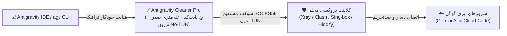

<div dir="rtl">

<p align="center">
  <a href="README.fa.md">🇮🇷 فارسی</a> •
  <a href="README.md">🇺🇸 English</a> •
  <a href="README.ar.md">🇸🇦 العربية</a> •
  <a href="README.ru.md">🇷🇺 Русский</a> •
  <a href="README.es.md">🇪🇸 Español</a> •
  <a href="README.tr.md">🇹🇷 Türkçe</a> •
  <a href="README.zh.md">🇨🇳 简体中文</a> •
  <a href="README.ur.md">🇵🇰 اردو</a>
</p>

<p align="center">
  
</p>

<h1 align="center">⚡ آنتی‌گراویتی کلینر پرو (Antigravity Cleaner Pro)</h1>

<p align="center">
  <strong>موتور خودترمیم و ضدتحریم هوش مصنوعی، تله‌متری صفر و هدایت مستقیم به پروکسی بدون سربار TUN</strong>
</p>

<div align="center">

  [](https://github.com/tawroot/antigravity-cleaner/releases)
  [](https://github.com/tawroot/antigravity-cleaner/releases)
  [](https://golang.org)
  [](.github/workflows/security.yml)
  [](docs/test-reports/benchmarks.log)
  [](docs/test-reports/benchmarks.log)
  []()

</div>

> *از صمیم قلب تقدیم به تک‌تک انسان‌ها، کودکان، معلمان، دانش‌آموزان، پژوهشگران و توسعه‌دهندگانی که فراتر از مرزها برای آگاهی و یادگیری تلاش می‌کنند — به‌ویژه تمام آنان که هم‌زمان میان تیغ فیلترینگ داخلی و سد تحریم‌های ناعادلانه خارجی گرفتار شده‌اند. در 🇰🇵 کره شمالی، 🇮🇷 ایران، 🇨🇳 چین، 🇷🇺 روسیه، 🇹🇷 ترکیه، 🇨🇺 کوبا، 🇸🇾 سوریه، 🇧🇾 بلاروس، 🇸🇩 سودان، 🇻🇪 ونزوئلا، 🇦🇫 افغانستان، 🇲🇲 میانمار و تمام سرزمین‌های در حال توسعه جهان. فناوری هوش مصنوعی حاصل دسترنج مشترک کل تمدن بشری است. دسترسی آزاد به آموزش، دانش و ابزارهای هوش مصنوعی حق مسلم تمام ابناء بشر است، نه امتیازی گزینشی برای مرزهای ثروتمند.*  
> — **دل‌نوشته‌ای از @dalroot**

<div align="center">

[](https://github.com/tawroot/antigravity-cleaner/stargazers)
&nbsp;
[](https://github.com/tawroot/antigravity-cleaner/network/members)

</div>

> 🌟 **حمایت از دسترسی آزاد به هوش مصنوعی:**  
> اگر این ابزار به جریان کدنویسی شما کمک کرد، ثبت یک **ستاره (Star)** در گیت‌هاب باعث معرفی آن به سایر برنامه‌نویسان در مناطق تحت تحریم خواهد شد.

---

### 📑 فهرست دسترسی سریع
- [💾 دریافت سریع نسخه پرتابل (ویندوز، مک، لینوکس)](#-دریافت-مستقیم-نسخه-پرتابل-بدون-نیاز-به-نصب)
- [⚡ آنتی‌گراویتی کلینر دقیقاً چه کاری انجام می‌دهد؟](#-آنتیگراویتی-کلینر-دقیقا-چه-کاری-انجام-میدهد)
- [🧬 لایه‌های ۹گانه مهندسی و پچ‌های هسته](#-کالبدشکافی-پچها-و-لایههای-۹گانه-فنی)
- [🧭 راهنمای گام‌به‌گام بررسی ریجن اکانت و راه‌اندازی سریع](#-راهنمای-گامبهگام-از-بررسی-ریجن-اکانت-گوگل-تا-اجرای-خودکار-با-۱-کلیک)
- [❓ پرسش‌های متداول، امنیت و راهنمای تصویری خطاها](#-پرسشهای-متداول-امنیت-و-راهنمای-تصویری-خطاها-faq--troubleshooting)
- [🏛️ معماری ساده و گردش ترافیک](#️-معماری-سیستم-و-گردش-ترافیک)
- [🛡️ موتور تله‌متری صفر و حریم خصوصی](#️-ضمانت-امنیت-حریم-خصوصی-و-موتور-تلهمتری-صفر-zero-telemetry)
- [📊 بنچمارک‌ها و گزارش آزمون‌های زنده](#-گزارش-تستهای-زنده-و-بنچمارک-سیستم)
- [🥊 جدول مقایسه جامع با سایر ابزارها (نسخه ۵.۳.۱)](#-جدول-مقایسه-جامع-با-سایر-ابزارها-نسخه-۵۳۱)
- [🚀 نصب سریع با دستور تک‌خطی (CLI One-Liner)](#-نصب-و-اجرای-سریع-تکخطی-cli)
- [💻 رابط‌های بصری: محیط گرافیکی و ترمینال](#-رابطهای-بصری-محیط-گرافیکی-رترو-win95-gui-و-داشبورد-ترمینال)
- [🛠️ مرجع دستورات خط فرمان (CLI)](#️-مرجع-دستورات-خط-فرمان-cli)
- [🤖 اسکیل عامل هوش مصنوعی](#-اسکیل-هوش-مصنوعی-برای-ایجنتها-skillsantigravity-cleaner)
- [🔬 آزمایشگاه تحقیقاتی امنیت هوش مصنوعی کاربردی](#-آزمایشگاه-تحقیقاتی-امنیت-هوش-مصنوعی-کاربردی-چند-اکوسیستمی-google-deepmind-openai-anthropic-cursor)
- [👥 سازندگان و حق کپی‌رایت](#-سازندگان-و-حق-کپیرایت)

---

## 💾 دریافت مستقیم نسخه پرتابل (بدون نیاز به نصب)

> **⚡ مشخصات فنی باینری‌ها:**  
> فایل اجرایی به زبان **Go خالص (Go 1.22+)** کامپایل شده است؛ **۱۰۰٪ مستقل و پرتابل** (بدون نیاز به پایتون یا هرگونه پیش‌نیاز)، **کاملاً آفلاین**، بدون نیاز به دسترسی روت یا ترمینال، و اجراشونده در محیط لوکال (`127.0.0.1`). کافیست روی فایل دابل‌کلیک کنید:

<div align="center">

<table style="width: 100%; border-collapse: collapse; text-align: center;" dir="rtl">
  <thead>
    <tr style="background: rgba(255, 255, 255, 0.05); border-bottom: 2px solid rgba(255, 255, 255, 0.1);">
      <th style="padding: 16px; width: 33%; text-align: center;">🪟 ویندوز (Windows)</th>
      <th style="padding: 16px; width: 34%; text-align: center;">🍎 مک‌او‌اس (macOS)</th>
      <th style="padding: 16px; width: 33%; text-align: center;">🐧 لینوکس (Linux)</th>
    </tr>
  </thead>
  <tbody>
    <tr>
      <td style="padding: 20px 14px; vertical-align: top;">
        <span style="font-size: 40px;">🪟</span><br>
        <strong>ویندوز ۱۰ و ۱۱</strong><br>
        <small style="opacity: 0.75;">نسخه‌های ۶۴ بیتی</small><br><br>
        <a href="https://github.com/tawroot/antigravity-cleaner/releases/latest/download/antigravity-cleaner-windows-amd64.exe">
          
        </a><br><br>
        <small style="opacity: 0.85;">⚡ دابل‌کلیک روی فایل .exe جهت باز شدن پنجره</small>
      </td>
      <td style="padding: 20px 14px; vertical-align: top;">
        <span style="font-size: 40px;">🍎</span><br>
        <strong>اپل مک‌او‌اس</strong><br>
        <small style="opacity: 0.75;">سری M اپل و پردازنده‌های اینتل</small><br><br>
        <a href="https://github.com/tawroot/antigravity-cleaner/releases/latest/download/antigravity-cleaner-darwin-arm64">
          
        </a><br>
        <a href="https://github.com/tawroot/antigravity-cleaner/releases/latest/download/antigravity-cleaner-darwin-amd64" style="display: inline-block; margin-top: 6px;">
          
        </a><br><br>
        <small style="opacity: 0.85;">⚡ دابل‌کلیک یا اجرای مستقیم فایل باینری</small>
      </td>
      <td style="padding: 20px 14px; vertical-align: top;">
        <span style="font-size: 40px;">🐧</span><br>
        <strong>توزیع‌های لینوکس</strong><br>
        <small style="opacity: 0.75;">اوبونتو، دبیان، آرچ، فدورا و ARM</small><br><br>
        <a href="https://github.com/tawroot/antigravity-cleaner/releases/latest/download/antigravity-cleaner-linux-amd64">
          
        </a><br>
        <a href="https://github.com/tawroot/antigravity-cleaner/releases/latest/download/antigravity-cleaner-linux-arm64" style="display: inline-block; margin-top: 6px;">
          
        </a><br><br>
        <small style="opacity: 0.85;">⚡ اجرای مستقیم یا دستور <code>ag-cleaner gui</code></small>
      </td>
    </tr>
  </tbody>
</table>

<p style="margin-top: 12px;">
  <a href="https://github.com/tawroot/antigravity-cleaner/releases/latest" style="font-weight: bold; opacity: 0.9;">📦 مشاهده تمامی نسخه‌ها و کدهای صحت SHA-256 در صفحه Releases گیت‌هاب ←</a>
</p>

</div>

---

## ⚡ آنتی‌گراویتی کلینر دقیقاً چه کاری انجام می‌دهد؟

<p align="center">
  
</p>

**آنتی‌گراویتی کلینر (Antigravity Cleaner Pro)** یک جعبه‌ابزار تخصصی، مستقل و متن‌باز به زبان Go است که با مهندسی معکوس و اعمال پچ‌های مستقیم بر هسته اجرایی محیط توسعه Google Antigravity، سدهای تحریم، محدودیت‌های منطقه‌ای و سیستم‌های ردیابی گوگل را در تمامی محیط‌ها به طور کامل خنثی می‌کند.

### 🧠 موتور هسته (`language_server`) چیست و چرا پچ می‌شود؟

محیط گرافیکی Antigravity IDE در لایه ظاهری یک ادیتور توسعه‌یافته بر پایه الکترون و هسته VS Code است؛ اما کلیه پردازش‌های سنگین هوش مصنوعی، فهم معنایی کدها، ارتباط با مدل‌های Gemini، مدیریت سهمیه، اعتبارسنجی لایسنس و از همه حیاتی‌تر **بازرسی موقعیت جغرافیایی و تحریم‌ها** بر عهده یک پردازش مستقل کامپایل‌شده به نام **`language_server`** (مغز متفکر برنامه) قرار دارد.

گوگل در هر بار اجرا، از طریق این پردازش آدرس IP، منطقه زمانی (Timezone)، نشت داده‌ها و مشخصات سیستم را بررسی می‌کند تا در صورت تشخیص موقعیت جغرافیایی کشورهای تحت تحریم (نظیر ایران، کوبا، سوریه و سایر مناطق محدودشده)، دسترسی هوش مصنوعی را بلافاصله قطع کند. به همین دلیل، خنثی‌سازی گیت‌های بازرسی این باینری، سنگ‌بنای اصلی آزادسازی عملکرد ادیتور به شمار می‌رود.

---

### 🧬 کالبدشکافی پچ‌ها و لایه‌های ۹‌گانه فنی:

<details open>
<summary><strong>🔍 برای مشاهده جزئیات فنی تک‌تک لایه‌ها کلیک کنید:</strong></summary>
<br>

1. **خنثی‌سازی بررسی‌های منطقه‌ای در هسته اصلی (`language_server`) و موتور شناسایی هوشمند**  
   شناسایی داینامیک و پویا روی تمامی معماری‌ها (Apple Silicon ARM64، Intel x64، Linux x86_64/ARM64 و توزیع‌های رسمی RPM/DEB گوگل) بدون نیاز به مسیرهای هاردکدشده؛ همراه با بازنویسی مستقیم منطق احراز هویت در بایت‌کد اجرایی (`hasValidAuth = true`) تا ریشه ارورهای ۴۰۳ و خطای `User location is not supported` برای همیشه حذف شود.

2. **رفع محدودیت در نسخه خط فرمان (`agy`)**  
   خنثی‌سازی بررسی‌های واجد شرایط بودن حساب (Eligibility Checks) و سدهای مسدودکننده دسترسی در فایل اجرایی رسمی CLI.

3. **فعال‌سازی قابلیت‌های داخلی در محیط ادیتور (`main.js`)**  
   باز کردن پرچم دسترسی‌های داخلی ادیتور (`isGoogleInternal`) جهت استفاده از قابلیت‌های پیش‌نمایش و ابزارهای دستیار ایجنت، همراه با پاکسازی خودکار کش‌های کامپایل برای بارگذاری تمیز کدهای اصلاح‌شده.

4. **قطع کامل تله‌متری و به صفر رساندن لاگ‌ها (Zero-Log & EIO Shield)**  
   * **خاموش کردن لاگینگ:** متوقف کردن کامل سرویس‌های ارسال گزارش و تغییر بالاترین سطح لاگ گوگل (`level: 'silly'`) به `level: false` در فایل `app.asar` تا هیچ داده‌ای در سیستم ثبت، ذخیره یا مخابره نشود.  
   * **مهار خطاهای خروجی:** مدیریت خطاهای پس‌زمینه برای جلوگیری از کرش‌های ناگهانی ادیتور و خطای قطع ارتباط استریم (`Broken pipe / write EIO`).

5. **جلوگیری از بازنویسی خودکار فایل‌های پچ‌شده (Anti Re-Download Guard)**  
   خنثی‌سازی مکانیزم بررسی نسخه در افزونه رسمی گوگل تا مانع از دانلود مجدد فایل‌های قفل‌شده و باطل شدن پچ‌ها شود.

6. **اجرای هسته با پرچم‌های سازمانی (Enterprise Wrapper)**  
   راه‌اندازی هسته برنامه در یک لایه محافظ همراه با پرچم‌های سازمانی جهت خاموش ماندن مداوم تله‌متری (`--disable_telemetry=true`) و آزادسازی دسترسی کامل به پردازش‌های همراه و سرورهای پروتکل MCP (`--allow_all_sidecars=true`).

7. **حفظ ۱۰۰٪ حریم خصوصی و ممانعت از خروج داده‌های شخصی**  
   در حالت پیش‌فرض، تله‌متری گوگل اطلاعات حساسی از جمله:
   * متن تمام پرامپت‌ها و چت‌های هوش مصنوعی
   * دستورات اجراشده در ترمینال و تاریخچه کامیت‌های گیت
   * شناسه‌های نشست، ایمیل، آدرس IP و منطقه زمانی (Timezone) را مخابره می‌کرد؛  
   با پچ‌های این ابزار، ارسال تمامی این داده‌ها متوقف شده و نرم‌افزار به صورت کاملاً ایزوله، محلی و آفلاین روی `127.0.0.1` اجرا می‌شود.

8. **ریست سهمیه و ریت‌لیمیت بدون حذف پروژه‌ها (Surgical 429 Reset)**  
   پاکسازی هوشمند توکن‌های قفل‌شده و نشست‌های خرابِ ذخیره‌شده روی سیستم در کسری از ثانیه، بدون دست زدن به پروژه‌ها، تنظیمات ادیتور، کلیدهای میانبر یا تاریخچه چت‌های کاربر.

9. **اتصال مستقیم به پروکسی بدون درگیر کردن کل سیستم (بدون حالت TUN)**  
   * هدایت مستقیم ترافیک ادیتور به پورت‌های کلاینت‌های فیلترشکن محلی (مانند ۱۰۸۰۸ یا ۷۸۹۰) بدون نیاز به فعال‌سازی حالت سنگین TUN در کل سیستم؛  
   * فعال‌سازی پکت‌های دوره‌ای فعال نگه داشتن اتصال (TCP KeepAlive هر ۱۵ ثانیه) برای جلوگیری از قطع ناگهانی پاسخ‌های طولانی هوش مصنوعی توسط فایروال اینترنت.

</details>

---

### 🔄 بازگشت‌پذیری ۱۰۰٪ با یک کلیک (Clean Rollback Guarantee)

> [!TIP]
> **تمام تغییرات و پچ‌های اعمال‌شده کاملاً ایمن و قابل برگشت هستند.**  
> پیش از اعمال هرگونه اصلاح، کلینر به‌صورت خودکار یک نسخه پشتیبان تمیز با پسوند `.agybak` از فایل اصلی ایجاد می‌کند. شما در هر لحظه می‌توانید با یک کلیک، تمام تغییرات را لغو کرده و برنامه را دقیقاً به حالت دست‌نخورده کارخانه بازگردانید:
> * **در رابط گرافیکی (GUI):** با فشردن دکمه **`[Restore]`**
> * **در محیط ترمینال (CLI):** با اجرای دستور **`ag-cleaner restore`** (یا انتخاب گزینه بازگردانی از منو)

---

## 🧭 راهنمای گام‌به‌گام: از بررسی ریجن اکانت گوگل تا اجرای خودکار با ۱ کلیک

### ۱. وضعیت ریجن اکانت گوگل چیست و چرا تحریم می‌شود؟
گوگل موقعیت جغرافیایی اکانت شما را بر اساس تاریخچه اتصال دستگاه‌ها (گوشی موبایل، مرورگرها و سوابق IP) پایش و ثبت می‌کند. اگر در سیستم مرکزی گوگل کشور اکانت شما در فهرست تحریم‌ها (مانند ایران) ثبت شده باشد، سرورهای ابری گوگل سهمیه مدل هوش مصنوعی Gemini را به آن اکانت اختصاص نمی‌دهند.

👉 **چک کردن ریجن در ۳۰ ثانیه:** وارد فرم رسمی گوگل شوید:  
[Google Country Association Form](https://policies.google.com/country-association-form?hl=en-US&source=policies-site)

* **اگر کشور مقابل `Your account is associated with` غیرتحریمی (آلمان، هلند، آمریکا و...) بود:** اکانت شما کاملاً آماده است و نیازی به تغییر ندارد.
* **اگر کشور اکانت شما ایران بود:**
  * **روش اول (تغییر کشور در ۱ دقیقه):** **فیلترشکن خود را روشن کنید**، همان فرم بالا را مجدداً باز کنید و در انتهای فرم با تیک زدن گزینه‌های `I moved here in the past year` و `I frequently use a Virtual Private Network (VPN)` دکمه ثبت (Submit) را بزنید (معمولاً ظرف چند ساعت ریجن به کشور فیلترشکن تغییر می‌یابد).
  * **روش دوم (ساخت اکانت تازه):** با یک فیلترشکن تمیز، در عرض ۲ دقیقه یک اکانت جیمیل جدید ثبت کنید تا موقعیت آن از ابتدا در کشوری مجاز ثبت شود.

---

### ۲. آغاز به کار کلینر: اجرای اتوفیکس در چند ثانیه (بدون نیاز به ریستارت)
پس از تنظیم اکانت، راه‌اندازی کلینر به دو روش فوق‌العاده ساده (گرافیکی یا متنی) در دسترس شماست:

#### 🖥️ روش اول: پنجره گرافیکی رترو (Win95 GUI — ساده‌ترین روش بدون نیاز به ترمینال)
با دابل‌کلیک روی فایل اجرایی، پنجره نوستالژیک کلینر باز می‌شود. فرآیند در این محیط یک جریان کاری سه‌مرحله‌ای پیوسته و هوشمند است:
1. **گام اول — فشردن دکمه `[ ① ⚡ Auto-Fix ]`:**  
   روی این دکمه کلیک کنید و چند ثانیه شکیبا باشید. برنامه به صورت خودکار باینری‌های هسته، CLI، فرانت‌اند ادیتور، گارد افزونه و شیلد Zero-Log را پچ می‌کند. پس از اتمام موفق، کادر وضعیت با رنگ سبز پیام `✔ STEP 1 DONE! Next: Click [ ② 🚀 Launch IDE ]` را نمایش داده و دکمه گام دوم فعال و برجسته می‌شود.
2. **گام دوم — اجرای ادیتور با `[ ② 🚀 Launch IDE ]`:**  
   با کلیک روی این دکمه، نرم‌افزار Antigravity به همراه تزریق مستقیم سوکت پروکسی هوشمند (بدون درگیر شدن مود TUN سیستم) اجرا شده و آماده استفاده کامل بدون محدودیت می‌شود.
3. **گام سوم — ساخت میانبر دائمی با `[ ③ 📌 Shortcut ]`:**  
   با کلیک روی این دکمه، یک آیکون اختصاصی و دائمی روی دسکتاپ و منوی برنامه‌های سیستم‌عامل شما ساخته می‌شود تا برای دفعات بعدی تنها با کلیک روی آن، ادیتور همیشه با تنظیمات ضدفیلتر اجرا گردد و دیگر حتی نیازی به باز کردن مکرر کلینر نداشته باشید.

---

#### ⌨️ روش دوم: خط فرمان ترمینال (CLI Dashboard — مناسب گیک‌ها و توسعه‌دهندگان)
اگر مایلید در محیط کنسول و ترمینال کار کنید، دو گزینه در اختیار دارید:
* **منوی تعاملی تمام‌صفحه (TUI):**  
  تنها دستور `antigravity` (یا `ag-cleaner`) را تایپ کنید تا داشبورد تعاملی لایپ‌گلاس اجرا شود؛ سپس گزینه `1` یعنی **Auto-Fix** را انتخاب فرمایید. برنامه وضعیت تک‌تک اجزا را بررسی و با کادر سبز رنگ `🎉 AUTO-FIX COMPLETED SUCCESSFULLY!` موفقیت پچ‌ها را اعلام می‌کند.
* **دستورات مستقیم و تک‌مرحله‌ای:**
  * **ویندوز (CMD یا PowerShell):**
    ```cmd
    # ۱. اعمال کامل پچ‌ها و ساخت خودکار لانچر
    antigravity-cleaner.exe patch all

    # ۲. اجرای مستقیم ادیتور همراه با پروکسی هوشمند No-TUN
    antigravity-cleaner.exe launch

    # ۳. (اختیاری) ساخت آیکون میانبر دسکتاپ
    antigravity-cleaner.exe create-launcher
    ```
  * **لینوکس و مک‌او‌اس (Terminal):**
    ```bash
    # ۱. اعمال کامل پچ‌ها و ساخت خودکار لانچر
    ./antigravity-cleaner patch all

    # ۲. اجرای مستقیم ادیتور همراه با پروکسی هوشمند No-TUN
    ./antigravity-cleaner launch

    # ۳. (اختیاری) ساخت آیکون میانبر دسکتاپ
    ./antigravity-cleaner create-launcher
    ```

---

## ❓ پرسش‌های متداول، امنیت و راهنمای تصویری خطاها (FAQ & Troubleshooting)

> 💡 *برای مشاهده توضیحات فنی، اسکرین‌شات و راه‌حل هر بخش، روی کادرهای تاشوی زیر کلیک کنید:*

<details>
<summary><strong>🛡️ آیا آنتی‌گراویتی کلینر امن است؟</strong></summary>
<br>

**بله، و امنیت آن از نظر فنی کاملاً شفاف و قابل راستی‌آزمایی در سورس‌کد است:**
1. **۱۰۰٪ آفلاین و بدون نیاز به اینترنت هنگام اجرا:** کلینر برای اجرا، پچ و پاکسازی به هیچ اینترنتی نیاز ندارد. این برنامه به صورت کاملاً لوکال روی هارددیسک شما و آدرس ایزوله `127.0.0.1` اجرا می‌شود، هیچ سرور ریموتی ندارد و صفر بایت داده به بیرون ارسال نمی‌کند.
2. **توسعه با Go خالص و بدون وابستگی (Zero Dependencies):** این برنامه یک باینری مستقل و کامپایل‌شده است؛ برخلاف اسکریپت‌های پایتونی، هیچ فایل DLL مشکوک یا پکیج ناشناخته‌ای را در زمان اجرا دانلود یا لود نمی‌کند.
3. **پاس شدن ۱۰۰٪ ممیزی‌های امنیتی گیت‌هاب (CodeQL & Govulncheck):** خط لوله خودکار گیت‌هاب اکشنز پروژه ([`security.yml`](.github/workflows/security.yml) و [`codeql.yml`](.github/workflows/codeql.yml)) تمامی کدها را به صورت پیوسته اسکن می‌کند و تمامی بررسی‌های استاتیک امنیتی با موفقیت کامل پاس شده‌اند.
4. **حفظ قطعی کدهای پروژه و تاریخچه گفتگوها:** این ابزار هیچ دسترسی به مسیر پروژه‌ها یا کدهای برنامه‌نویس ندارد. حین پاکسازی کش سهمیه نیز دایرکتوری تاریخچه چت‌های هوش مصنوعی (`User/globalStorage`) کاملاً ایزوله و محافظت‌شده باقی می‌ماند.
5. **مستندات رسمی و خط‌مشی شفاف:** جزئیات دقیق تعهدات ایمنی در سند رسمی [**سیاست امنیتی مخزن (.github/SECURITY.md)**](.github/SECURITY.md) و [**معماری فنی سیستم (docs/ARCHITECTURE.md)**](docs/ARCHITECTURE.md) به صورت متن‌باز ثبت شده است.

</details>

<details>
<summary><strong>⚡ دکمه Auto-Fix در برنامه دقیقاً چه کاری انجام می‌دهد و چرا نتیجه آن ثابت می‌ماند؟</strong></summary>
<br>

با یک کلیک روی دکمه **`[Auto-Fix]`** در پنجره گرافیکی یا اجرای دستور `ag-cleaner patch all`:
1. **هسته اصلی (`language_server`):** قفل منطقه‌ای بایت‌کد باز شده و رجیستر `RAX+8` روی `hasValidAuth = true` تثبیت می‌شود ([`pkg/patcher/manager.go`](pkg/patcher/manager.go)).
2. **ابزار ترمینال (`agy` CLI):** سدهای احراز شرایط حساب خنثی می‌شوند ([`pkg/patcher/cli.go`](pkg/patcher/cli.go)).
3. **فرانت‌اند ادیتور (`main.js`):** پرچم `isGoogleInternal` فعال و کش‌های کامپایل تخلیه می‌شوند ([`pkg/patcher/ide.go`](pkg/patcher/ide.go)).
4. **افزونه رسمی وی‌اس‌کد (`extension.js`):** کانال به‌روزرسانی قفل شده و گارد ممانعت از بازدانلود مجدد فایل‌ها تزریق می‌شود ([`pkg/patcher/vscode.go`](pkg/patcher/vscode.go)).
5. **شیلد لاگ صفر (`app.asar`):** لاگ‌های پرحجم خاموش و خطاهای شکست پایپ کنسول (`write EIO`) مهار می‌شوند ([`pkg/patcher/asar.go`](pkg/patcher/asar.go)).
6. **رپر تله‌متری صفر (Enterprise Wrapper):** ۸ پرچم سازمانی از جمله `--disable_telemetry=true` و آزادسازی سرورهای MCP با `--allow_all_sidecars=true` تزریق می‌شوند ([`pkg/patcher/flags.go`](pkg/patcher/flags.go)).
7. **لانچر پروکسی No-TUN:** ترافیک ادیتور مستقیماً به کلاینت‌های فیلترشکن محلی هدایت می‌شود ([`pkg/proxy/launcher.go`](pkg/proxy/launcher.go)).

> **چرا بعد از اجرای Auto-Fix وضعیت ثابت می‌ماند؟**  
> گارد ضد بازدانلود مانع از باطل شدن پچ‌ها می‌شود و رپر ضدتله‌متری جلوی مخابره مجدد بیکن‌های مکانی به گوگل را می‌گیرد؛ در نتیجه محیط توسعه در نشست‌های بعدی پایدار و بدون قفل مجدد باقی می‌ماند.

</details>

<details>
<summary><strong>🔄 سیستم بکاپ‌گیری خودکار و بازگشت به حالت اول (Restore) چگونه است؟</strong></summary>
<br>

* **پشتیبان‌گیری خودکار کارخانه‌ای (`.agybak`):** پیش از تغییر حتی یک بایت از هر فایل اجرایی، یک کپی دست‌نخورده از وضعیت اورجینال با پسوند `.agybak` روی دیسک ایجاد می‌شود ([`pkg/patcher/atomic.go`](pkg/patcher/atomic.go)).
* **بازگشت به وضعیت کارخانه با ۱ کلیک:** در هر زمان با زدن دکمه **`[Restore]`** در پنجره رترو یا اجرای دستور **`ag-cleaner restore`** در ترمینال، تمامی فایل‌های پچ‌شده با نسخه‌های اورجینال جایگزین شده و ادیتور به وضعیت دست‌نخورده روز اول بازمی‌گردد.
* **حذف کامل برنامه:** از آنجا که کلینر یک فایل اجرایی مستقل و بدون نیاز به نصب است، با حذف همان یک فایل برنامه، هیچ ردی در سیستم‌عامل باقی نمی‌ماند.

</details>

<details>
<summary><strong>۱. خطای قطع ناگهانی ارتباط ایجنت (Agent terminated due to error)</strong></summary>
<br>


```text
Agent terminated due to error
You can prompt the model to try again or start a new conversation if the error persists.
See our troubleshooting guide for more help.

Dismiss  Copy debug info  Retry
```

* **علت فنی وقوع:** قطع ناگهانی ارتباط سوکت پایپ خروجی الکترون به دلیل سرریز لاگ‌های خام (`write EIO`) یا تاخیر پکت‌های طولانی استریم در شبکه‌های دارای اختلال.
* **راه‌حل با کلینر:** اجرای **`[Auto-Fix]`**؛ با تزریق شیلد Zero-Log به فایل `app.asar` خروجی‌های شکسته‌شده مهار شده و ضربان قلب فعال ۱۵ ثانیه‌ای TCP KeepAlive استریم ایجنت را زنده نگه می‌دارد.

</details>

<details>
<summary><strong>۲. خطای اتصال شبکه سرور (Unknown: There was a network issue connecting to the server)</strong></summary>
<br>


```text
Worked for 1s >

Error Unknown: There was a network issue connecting to the server, please try again. ˅
Error ID: 95ea05dd-6419-4bf0-a8ce-8faf25687606-108
Unknown: There was a network issue connecting to the server, please try again.

12:24 AM
```

* **علت فنی وقوع:** مسدود شدن بسته‌های gRPC توسط فایروال DPI، نوسان و قطعی لحظه‌ای اینترنت کاربر حین تسک، یا مشکوک شدن گوگل به لوکیشن در میانه استریم بر اثر نشت بسته‌های تله‌متری.
* **راه‌حل با کلینر:** اجرای ادیتور با لانچر هوشمند پروکسی No-TUN و فعال بودن رپر تله‌متری صفر؛ با ایزوله شدن ترافیک روی سوکت مستقیم SOCKS5h و قطع گزارش‌های شبکه به گوگل، نشست پایدار و بدون قطعی باقی می‌ماند.

</details>

<details>
<summary><strong>۳. خطای سد احراز هویت لاگین (403. That’s an error. /auth-success)</strong></summary>
<br>


```text
Google

403. That’s an error.

Your client does not have permission to get URL /auth-success from this server. That’s all we know.
```

* **علت فنی وقوع:** هنگام کلیک روی دکمه ورود (Login) در مرورگر، گوگل بر اساس ردپای به جا مانده از نشست‌های پیشین و تله‌متری مخابره‌شده، موقعیت جغرافیایی کاربر را در کشوری تحریم‌شده تشخیص داده و بلافاصله سد امنیتی ۴۰۳ را فعال می‌کند.
* **راه‌حل با کلینر:** اجرای **`[Auto-Fix]`**؛ کلینر با پچ اتمیک بایت‌کد هسته (`hasValidAuth = true`)، تزریق مود احراز هویت سازمانی (`--stubby_auth_mode=business_licensed_enterprise`) و پاکسازی توکن‌های مسموم، این سد را به طور کامل خنثی می‌کند ([مشاهده لاگ بایت‌کدها در docs/ARCHITECTURE.md](docs/ARCHITECTURE.md)).

</details>

<details>
<summary><strong>۴. خطای عدم اتصال به پورت پروکسی (proxyconnect tcp: connection refused)</strong></summary>
<br>


```text
There was an unexpected issue setting up your account.

failed to get load code assist response: Post "https://cloudcode-pa.googleapis.com/v1internal:loadCodeAssist": proxyconnect tcp: dial tcp 127.0.0.1:10808: connect: connection refused

Continue with different account
Having trouble? Let us know
```

* **علت فنی وقوع:** کلاینت فیلترشکن کاربر بسته است یا پورت لوکال آن (مثلاً ۱۰۸۰۸ یا ۷۸۹۰) تغییر کرده و با پورت تعریف‌شده در ادیتور مطابقت ندارد.
* **راه‌حل با کلینر:** اجرای **`ag-cleaner doctor`**؛ ماژول داکتر تمامی پورت‌های فعال سیستم را به صورت خودکار شناسایی کرده و تنظیمات صحیح را بدون دخالت دستی جایگزین می‌کند.

</details>

<details>
<summary><strong>۵. خطای لود نشدن اولیه اکانت (Failed to fetch)</strong></summary>
<br>


```text
There was an unexpected issue setting up your account.

Failed to fetch

Continue with different account
Having trouble? Let us know
```

* **علت فنی وقوع:** فاسد شدن داده‌های ذخیره‌شده و تداخل رکوردهای DIPS (Data Corruption & State Conflicts) و وب‌سوکت‌های قطع‌شده در حافظه موقت ادیتور.
* **راه‌حل با کلینر:** اجرای دستور **`ag-cleaner clean`** (یا فشردن دکمه **Clean 429** در رابط گرافیکی)؛ تخلیه ۱۶ هدف کش موقت ظرف ۰.۰۰۲ ثانیه با تضمین حفظ کامل پروژه‌ها و تاریخچه گفتگوها.

</details>

<details>
<summary><strong>۶. خطای مجوز در مک: Operation not permitted (syscall.EPERM / App Management)</strong></summary>
<br>

* **علت فنی وقوع:** در مک‌های مدرن (macOS Ventura, Sonoma, Sequoia)، مکانیزم امنیتی App Management مانع از ویرایش باینری‌های داخل پکیج‌های امضاشده (`/Applications/Antigravity.app`) توسط ترمینال‌های خارجی می‌شود.
* **راه‌حل با کلینر:**
  ۱. به مسیر **System Settings ➔ Privacy & Security ➔ App Management** بروید.
  ۲. کلید دسترسی ترمینال فعال خود (مانند Terminal، iTerm2، Ghostty، Kitty یا VS Code) را فعال (ON) کنید.
  ۳. مجدداً دستور `./antigravity-cleaner patch all` را اجرا نمایید (موتور نسخه v5.4.0 با تست دسترسی امن پیش از نوشتن، عملیات را با موفقیت تکمیل می‌کند).

</details>

---

## 🏛️ معماری سیستم و گردش ترافیک



---

## 🛡️ ضمانت امنیت، حریم خصوصی و موتور تله‌متری صفر (Zero-Telemetry)

### 🛑 تله‌متری گوگل چیست و چرا خطرناک است؟
به صورت پیش‌فرض، برنامه Google Antigravity در پس‌زمینه سیستم، بسته‌های اطلاعاتی مداومی را به سمت سرورهای نظارتی گوگل (`googleapis.com` و `cloudcode-pa.googleapis.com`) ارسال می‌کند:
- **نشت آی‌پی و لوکیشن واقعی:** حتی اگر به قوی‌ترین فیلترشکن‌ها وصل باشید، بیکن‌های تله‌متری پنهان می‌توانند آی‌پی لوکال و پینگ واقعی اینترنت شما را به گوگل گزارش کنند که علت اصلی خطاهای ناگهانی «User location is not supported» است.
- **ارسال متادیتای گیت و فایل‌ها:** تله‌متری اطلاعات برنچ‌های گیت، کامیت‌ها و فعالیت‌های کدنویسی شما را مخابره می‌کند.
- **ردگیری خطاها و کرش‌ها:** ترکینگ ارورها به سرورهای کلود کد گوگل ارسال می‌شود.

### 🛡️ آنتی‌گراویتی کلینر پرو چگونه شما را محافظت می‌کند؟
با **موتور ۸ پرچمه Zero-Telemetry** (که در عملیات خودکار Auto-Fix و چک‌باکس پنجره رترو Win95 فعال است):
- **قطع ۱۰۰٪ کانال‌های جاسوسی گوگل:** پرچم رسمی `--disable_telemetry=true` به همراه تنظیمات سازمانی به هسته ادیتور تزریق می‌شود. گوگل **صفر بایت تله‌متری، صفر ردپای گیت و صفر نشت آی‌پی** از سیستم شما دریافت خواهد کرد.
- **اجرای ۱۰۰٪ محلی و آفلاین:** این ابزار کاملاً لوکال است، هیچ سرور ریموت یا تحلیلی ندارد و هیچ دیتایی از سیستمتان خارج نمی‌شود.
- **حفظ ۱۰۰٪ تاریخچه چت‌ها و پروژه‌ها:** پاکسازی جراحی ۱۶ گانه تنها کش‌های مسموم سهمیه و کوکی‌های نتورک را پاک می‌کند و به دایرکتوری تاریخچه چت‌ها (`User/globalStorage`) هرگز دست نمی‌زند.
- **پچ اتمیک بدون توقف سیستم:** تعویض باینری به سبک اتمیک لینوکس/ویندوز صورت می‌گیرد، به طوری که حتی اگر آنتی‌گراویتی باز باشد، برنامه کرش نکرده و سشن فعال قطع نمی‌شود.

---

## 📊 گزارش تست‌های زنده و بنچمارک سیستم

| شاخص عملکردی | مقدار اندازه‌گیری‌شده | سند لاگ رسمی |
| :--- | :--- | :--- |
| **سرعت اسکن بایت‌کد در حافظه RAM** | **۱,۹۰۱ مگابایت بر ثانیه (~۱.۹ گیگابایت/ثانیه)** | [`benchmarks.log`](docs/test-reports/benchmarks.log) |
| **زمان اعمال پچ روی باینری ۱۷۱ مگابایتی** | **۰.۲۳ ثانیه** | [`benchmarks.log`](docs/test-reports/benchmarks.log) |
| **بررسی کامل اتصال شبکه و سرورها (Doctor)** | **۲.۵ ثانیه (هم‌زمان با Goroutines)** | [`live_system_test.log`](docs/test-reports/live_system_test.log) |
| **پاکسازی دقیق کش سهمیه (ارور ۴۲۹)** | **۱۶ هدف تخلیه در ۰.۰۰۲ ثانیه (۰ کلمه حذف چت)** | [`live_system_test.log`](docs/test-reports/live_system_test.log) |
| **تست‌های واحد سیستمی (Unit Tests)** | **۱۰۰٪ موفق و پاس‌شده** | [`benchmarks.log`](docs/test-reports/benchmarks.log) |

> [!NOTE]
> **توضیح فنی درباره سرعت و پایداری عملیات:**  
> ارقام فوق در محیط‌های آزمایشی رسمی اندازه‌گیری و در فایل لاگ ثبت شده‌اند. در کاربردهای واقعی، سرعت اجرا ممکن است بسته به توان پردازنده، سرعت رم و نوع درایو ذخیره‌سازی (SSD/NVMe) اندکی متغیر باشد؛ اما مزیت بنیادی این معماری آن است که **تمامی مراحل پچ به صورت اتمیک در حافظه رم (In-Memory) و در کسری از ثانیه انجام می‌گیرد**؛ بنابراین هیچ فایلی قفل نمی‌شود، سیستم دچار افت فریم نمی‌گردد و تغییرات پایدار باقی می‌مانند.

---

## 🥊 جدول مقایسه جامع با سایر ابزارها (نسخه ۵.۴.۰)

| شاخص و قابلیت فنی | پچرهای پایتونی (`open-patcher` و...) | اسکریپت‌های پاورشل و شل | **⚡ Antigravity Cleaner Pro (v5.4.0)** |
| :--- | :---: | :---: | :---: |
| **زبان و معماری توسعه** | پایتون (نیازمند رانتایم و `pip`) | پاورشل (محدود به تک سیستم‌عامل) | **Go خالص (تک فایل باینری کامپایل‌شده، صفر وابستگی)** |
| **طراحی رابط کاربری** | خط فرمان متنی ساده | کنسول سیاه متفرقه | **محیط نوستالژیک گرافیکی Win95 + منوی مدرن ترمینال TUI** |
| **اتصال به فیلترشکن بدون حالت TUN** | ❌ (اجبار به درگیر کردن کارت شبکه کل سیستم) | ❌ ندارد | ✅ **هدایت مستقیم پورت‌های لوکال کلاینت به ادیتور** |
| **مهار کرش‌های لوله‌کشی کنسول (`write EIO`)** | ❌ ندارد | ❌ ندارد | ✅ **شیلد لاگ صفر (Zero-Log ASAR Shield) روی `app.asar`** |
| **پایداری استریم و رفع قطعی‌های DPI** | ❌ (قطع مکرر در استریم طولانی) | ❌ ندارد | ✅ **ارسال هارت‌بیت فعال TCP KeepAlive هر ۱۵ ثانیه** |
| **رفع خطای ۴۲۹ بدون پاک شدن تاریخچه** | ❌ (حذف کامل دایرکتوری تنظیمات و چت‌ها) | ❌ (پاکسازی فله‌ای فایل‌ها) | ✅ **تخلیه جراحی ۱۶ هدف سهمیه + حفظ ۱۰۰٪ چت‌ها** |
| **پچ عمیق هسته باینری (`language_server`)** | پشتیبانی محدود | ❌ ندارد | ✅ **پچ مستقیم ماشین‌کد IDA برای x86_64 و ARM64** |
| **پچ فایل‌های کلاینت و فرانت‌اند (`main.js`)** | ✅ فقط پچ رشته‌ای ساده | ❌ ندارد | ✅ **پچ کامل فرانت‌اند + تخلیه کش‌های کامپایل کدهای جاوااسکریپت** |
| **جلوگیری از بازدانلود خودکار ادیتور** | ✅ نسخه اولیه | ❌ ندارد | ✅ **قفل کانال به‌روزرسانی و تزریق گارد ممانعت از دانلود مجدد** |
| **ابزار بررسی سلامت سیستم (`doctor`)** | ❌ ندارد | ⚠️ محدود | ✅ **تست هم‌زمان تاخیر پینگ، سلامت DNS و ارتباط با مدل Gemini** |
| **تعویض اتمیک اینود روی دیسک** | فایل‌های موقت پایتون | ❌ ندارد | ✅ **جایگزینی اتمیک Inode بدون کرش ادیتور حین اجرا** |

---

## 🚀 نصب و اجرای سریع تک‌خطی (CLI)

### 🐧 لینوکس و 🍎 مک‌بوک (Apple Silicon M1 تا M4 و اینتل)
ترمینال را باز کرده و دستور زیر را وارد کنید:
```bash
curl -fsSL https://raw.githubusercontent.com/tawroot/antigravity-cleaner/main/install.sh | bash
```

### 🪟 ویندوز (PowerShell)
پاورشل را باز کرده و دستور زیر را اجرا کنید:
```powershell
irm https://raw.githubusercontent.com/tawroot/antigravity-cleaner/main/install.ps1 | iex
```

---

## 💻 رابط‌های بصری: محیط گرافیکی رترو (Win95 GUI) و داشبورد ترمینال

### 💾 پنجره دسکتاپ گرافیکی رترو (نسخه ۵.۴.۰)
با اجرای دستور `antigravity gui` (یا با دابل کلیک مستقیم روی فایل بدون نیاز به ترمینال)، پنجره نوستالژیک و سبک رترو با ۳ مرحله متوالی (`① Auto-Fix ➔ ② Launch IDE ➔ ③ Shortcut`)، چک‌باکس تله‌متری صفر و مانیتورینگ زنده پروسه باز می‌شود:

<div align="center">
  
</div>

---

### 🖥️ داشبورد تعاملی ترمینال (TUI) و کارت بررسی سلامت (Doctor)
با اجرای دستور `antigravity` (یا `ag-cleaner`)، منوی تمام‌صفحه و با انتخاب گزینه `7`، کارت وضعیت پینگ و اتصالات بدون شلوغی‌های ترساننده نمایش داده می‌شود:

<div align="center">
  
  <br>
  
</div>

---

## 🛠️ مرجع دستورات خط فرمان (CLI)

```bash
# باز کردن منوی تعاملی و تمام‌صفحه
ag-cleaner

# باز کردن پنجره گرافیکی رترو ویندوز ۹۵
ag-cleaner gui

# آزمایش سلامت سیستم و پینگ سرورهای گوگل
ag-cleaner doctor

# نمایش گزارش کامل با جزئیات فنی (برای دیباگ)
ag-cleaner doctor --verbose

# تولید گزارش تشخیصی کامل سیستم و کپی خودکار به کلیپ‌بورد برای پشتیبانی تلگرام/گیت‌هاب
ag-cleaner report

# بررسی نسخه جدید و آپدیت خودکار برنامه به آخرین ریلیز گیت‌هاب
ag-cleaner update

# اعمال تمام پچ‌ها با یک دستور (هسته، CLI، IDE و ASAR)
ag-cleaner patch all

# اجرای Antigravity با پروکسی هوشمند (بدون نیاز به TUN)
ag-cleaner launch

# ریست هدفمند ارور ۴۲۹ بدون پاک شدن تاریخچه چت‌ها
ag-cleaner clean

# بازگردانی تمامی فایل‌ها به وضعیت اورجینال کارخانه
ag-cleaner restore

# بستن تمام پردازه‌های معلق و هنگ‌کرده آنتی‌گراویتی
ag-cleaner kill

# ساخت لانچر دسکتاپ با پروکسی از پیش تنظیم‌شده
ag-cleaner create-launcher

# مشاهده شناسنامه پروژه و سازندگان
ag-cleaner about
```

---

## 🤖 اسکیل هوش مصنوعی برای ایجنت‌ها (`skills/antigravity-cleaner`)

این پروژه به یک **Agent Skill** رسمی ([`skills/antigravity-cleaner/SKILL.md`](skills/antigravity-cleaner/SKILL.md)) مجهز شده است که به دستیارهای هوش مصنوعی (Google Antigravity, Claude Code, Cursor, Codex) این امکان را می‌دهد که به محض مواجهه با ارورهای لایسنس، تحریم، پر شدن کوتا یا قطع شدن استریم، **محیط اجرایی خود را به صورت خودکار تعمیر کنند**:

- **عیب‌یابی خودکار محیط:** ایجنت در صورت قطعی، دستور `ag-cleaner doctor` را فراخوانی می‌کند.
- **رفع خودکار خطای ۴۲۹:** در صورت پر شدن توکن‌ها، ایجنت کش‌های سوخته را بدون دستکاری چت‌های کاربر تمیز می‌کند.
- **تنظیمات صفر:** اسکیل مستقیماً در ریشه پروژه قرار دارد و برای تمام ایجنت‌ها قابل کشف است.

---

## 🔬 آزمایشگاه تحقیقاتی امنیت هوش مصنوعی کاربردی چند-اکوسیستمی (Google DeepMind, OpenAI, Anthropic, Cursor)

پشت این ابزار، یک ابتکار پژوهشی عمیق در زمینه مهندسی معکوس و امنیت ابزارهای توسعه هوش مصنوعی قرار دارد. در آزمایشگاه امنیتی ما، اکوسیستم‌های مختلف هوش مصنوعی شامل **گوگل دیپ‌مایند (Google DeepMind / Antigravity)، اوپن‌ای‌آی (OpenAI)، آنتروپیک (Anthropic Claude Code) و کرسر (Cursor)** کالبدشکافی و تحلیل فنی می‌شوند:

- **بیش از ۱۰۰ پچ بایت‌کد و پل ارتباطی پروتکل:** در مخزن خصوصی آزمایشگاه، آرشیوی غنی از بیش از ۱۰۰ پچ سطح پایین هسته، متوقف‌کننده‌های تله‌متری، پل‌های ارتباطی Stubby RPC و کانکتورهای اختصاصی اتصال مدل‌های شخصی (BYOM) نگهداری و توسعه داده می‌شود.
- **پروژه مرجع و پرچمدار:** ابزار Antigravity Cleaner Pro به عنوان نخستین پروژه پرچمدار این ابتکار عمل منتشر شده است و ابزارهای تخصصی دیگر برای سایر استک‌های هوش مصنوعی به تدریج در قالب پروژه‌های مستقل متن‌باز عمومی خواهند شد.
- **فرآیند پایدارسازی و تست‌های فازینگ:** یافته‌های تحقیقاتی پیش از این‌که به نسخه عمومی اوپن‌سورس راه پیدا کنند، در محیط‌های آزمایشگاهی لینوکس، مک و ویندوز تحت تست‌های سنگین پایداری قرار می‌گیرند تا هیچ سشن فعالی دچار قطعی نشود.
- **پروژه‌ای پایدار و واقعی برای توسعه‌دهندگان جهان:** این یک اسکریپت ساده نیست؛ بلکه یک معماری واقعی مهندسی سیستم است که برای تضمین دسترسی نامحدود برنامه‌نویسان در هر کجای دنیا توسعه یافته است.

---

## 🚦 مسیر استاندارد و رسمی گزارش باگ‌ها و مشکلات

برای دریافت سریع‌ترین پاسخ و رسیدگی فنی:
۱. **فرم رسمی و ساختاریافته گیت‌هاب:** در صورت مواجهه با هرگونه خطا، از [فرم هوشمند گزارش باگ](https://github.com/tawroot/antigravity-cleaner/issues/new?template=bug_report.yml) استفاده کنید.
۲. **تالار گفت‌وگو و تنظیمات پروکسی:** برای سوالات عمومی و کانفیگ‌ها به [بخش Discussions](https://github.com/tawroot/antigravity-cleaner/discussions) مراجعه فرمایید.
۳. **گزارش‌های امنیتی:** موارد آسیب‌پذیری احتمالی را مطابق [سیاست امنیتی SECURITY.md](.github/SECURITY.md) از طریق پنل خصوصی امنیت گزارش فرمایید.

---

## 👥 سازندگان و حق کپی‌رایت

- **معمار و توسعه‌دهنده اصلی:** **[@dalroot](https://github.com/dalroot)**
- **دستیار و برنامه‌نویسی زوجی (Pair-Programming):** **هوش مصنوعی Antigravity (Google DeepMind)** — *با طنزی معنادار: ساخت ابزاری با خود هوش مصنوعی گوگل برای رهایی برنامه‌نویسان تحت تحریم از قفل‌های منطقه‌ای گوگل!* 🤖
- **مجوز نرم‌افزار:** Apache License 2.0 (Apache-2.0)
- تقدیم به تمام توسعه‌دهندگانی که برای دسترسی آزاد به دانش و ابزارهای فناوری ایستادگی می‌کنند.

---

## 🗺️ نقشه راه و قابلیت‌های آینده (Roadmap)

برای مشاهده قابلیت‌های برنامه‌ریزی‌شده در نسخه‌های آینده (شامل مترجم استاندارد خطاهای گوگل و قابلیت‌های BYOM)، سند رسمی [**نقشه راه فارسی (ROADMAP.fa.md)**](ROADMAP.fa.md) یا [نسخه انگلیسی (ROADMAP.md)](ROADMAP.md) را مطالعه فرمایید.

---

## 📈 روند رشد ستاره‌های گیت‌هاب (Star History)

اگر این ابزار به رفع مشکلات و صرفه‌جویی در زمان شما کمک کرد، ثبت یک ستاره (⭐ Star) در گیت‌هاب باعث معرفی آن به سایر برنامه‌نویسان خواهد شد:

<a href="https://star-history.com/#tawroot/antigravity-cleaner&Date">
 <picture>
   <source media="(prefers-color-scheme: dark)" srcset="https://api.star-history.com/svg?repos=tawroot/antigravity-cleaner&type=Date&theme=dark" />
   <source media="(prefers-color-scheme: light)" srcset="https://api.star-history.com/svg?repos=tawroot/antigravity-cleaner&type=Date" />
   
 </picture>
</a>

---

## 💬 گفت‌وگو و تبادل نظر (Discussions)

برای طرح سوالات، پیشنهاد قابلیت‌های جدید، یا اشتراک‌گذاری تنظیمات پروکسی:  
[**ورود به تالار گفت‌وگوی گیت‌هاب (Discussions) →**](https://github.com/tawroot/antigravity-cleaner/discussions)

</div>
