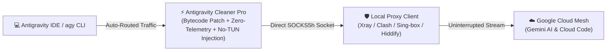

<p align="center">
  <a href="README.md">🇺🇸 English</a> •
  <a href="README.fa.md">🇮🇷 فارسی</a> •
  <a href="README.ar.md">🇸🇦 العربية</a> •
  <a href="README.ru.md">🇷🇺 Русский</a> •
  <a href="README.es.md">🇪🇸 Español</a> •
  <a href="README.tr.md">🇹🇷 Türkçe</a> •
  <a href="README.zh.md">🇨🇳 简体中文</a> •
  <a href="README.ur.md">🇵🇰 اردو</a>
</p>

<p align="center">
  
</p>

<h1 align="center">⚡ Antigravity Cleaner Pro (v5.3.1)</h1>

<p align="center">
  <strong>Autonomous Sanction Bypass, Zero-Telemetry Engine & Direct No-TUN Proxy Injector for Google Antigravity</strong>
</p>

<div align="center">

  [](https://github.com/tawroot/antigravity-cleaner/releases)
  [](https://golang.org)
  [](.github/workflows/security.yml)
  [](https://t.me/dallrep)
  [](docs/test-reports/benchmarks.log)
  [](docs/test-reports/benchmarks.log)
  []()

</div>

> *Dedicated from the heart to every human being, child, student, teacher, creator, and independent developer striving for learning and growth — especially those caught between domestic filtering from within and digital sanctions from without. Across 🇰🇵 North Korea, 🇮🇷 Iran, 🇨🇳 China, 🇷🇺 Russia, 🇹🇷 Turkey, 🇨🇺 Cuba, 🇸🇾 Syria, 🇧🇾 Belarus, 🇸🇩 Sudan, 🇻🇪 Venezuela, 🇦🇫 Afghanistan, 🇲🇲 Myanmar, and every developing corner of our world. Artificial intelligence is the collective heritage of humanity. Access to knowledge, education, and AI is a fundamental human right for all people, not a privilege reserved for wealthy borders.*  
> — **@dalroot**

<div align="center">

[](https://github.com/tawroot/antigravity-cleaner/stargazers)
&nbsp;
[](https://t.me/dallrep)
&nbsp;
[](https://github.com/tawroot/antigravity-cleaner/network/members)

</div>

> 🌟 **Support Open Access to AI:**  
> If Antigravity Cleaner helped you bypass Google sanctions or fix quota errors, please **Star this repo** — it helps restricted developers discover this tool!

---

### 📑 Quick Navigation
- [💾 Direct Portable Download (Zero Install)](#-direct-portable-download-zero-installation-required)
- [⚡ What is Antigravity Cleaner?](#-what-is-antigravity-cleaner)
- [🧬 Core Engineering Layers & Deep Patches](#-core-engineering-layers--deep-patches)
- [🧭 Step-by-Step Setup & Google Account Region Check](#-step-by-step-guide-from-google-account-region-check-to-1-click-auto-fix)
- [❓ FAQ, Security & Visual Error Troubleshooting](#-faq-security--visual-error-troubleshooting)
- [🏛️ System Architecture & Traffic Flow](#️-system-architecture--traffic-flow)
- [🛡️ Zero-Telemetry Engine & Privacy Guarantee](#️-zero-telemetry-engine--privacy-guarantee)
- [📊 Live System Benchmarks & Audit Logs](#-live-system-benchmarks--audit-logs)
- [🥊 Comprehensive Comparison Matrix (v5.3.1)](#-comprehensive-comparison-matrix-v531)
- [🚀 Quick CLI Install (One-Liner)](#-quick-install-one-liner)
- [💻 Visual Interfaces: Retro KeyGen GUI & Terminal Dashboard](#-visual-interfaces-retro-keygen-gui--terminal-dashboard)
- [🛠️ CLI Subcommands & Diagnostics](#️-cli-subcommands)
- [🤖 Autonomous AI Agent Skill](#-autonomous-ai-agent-skill-skillsantigravity-cleaner)
- [🔬 Multi-Ecosystem Applied AI Security Lab](#-multi-ecosystem-applied-ai-security-lab-google-deepmind-openai-anthropic-cursor)
- [🚦 Standard Bug & Issue Reporting Pathway](#-standard-bug--issue-reporting-pathway)
- [👥 Credits & Attribution](#-credits--attribution)

---

## 💾 Direct Portable Download (Zero Installation Required)

> **⚡ Technical Binary Specifications:**  
> Compiled in **pure Go (Go 1.22+)**; **100% standalone and portable** (no Python or external runtime needed), **fully offline**, requiring no root privileges or terminal setup, executing strictly locally on `127.0.0.1`. Simply double-click:

<div align="center">

<table style="width: 100%; border-collapse: collapse; text-align: center;">
  <thead>
    <tr style="background: rgba(255, 255, 255, 0.05); border-bottom: 2px solid rgba(255, 255, 255, 0.1);">
      <th style="padding: 16px; width: 33%; text-align: center;">🪟 Windows</th>
      <th style="padding: 16px; width: 34%; text-align: center;">🍎 macOS</th>
      <th style="padding: 16px; width: 33%; text-align: center;">🐧 Linux</th>
    </tr>
  </thead>
  <tbody>
    <tr>
      <td style="padding: 20px 14px; vertical-align: top;">
        <span style="font-size: 40px;">🪟</span><br>
        <strong>Windows 10 & 11</strong><br>
        <small style="opacity: 0.75;">64-bit Editions</small><br><br>
        <a href="https://github.com/tawroot/antigravity-cleaner/releases/latest/download/antigravity-cleaner-windows-amd64.exe">
          
        </a><br><br>
        <small style="opacity: 0.85;">⚡ Double-click .exe to launch GUI</small>
      </td>
      <td style="padding: 20px 14px; vertical-align: top;">
        <span style="font-size: 40px;">🍎</span><br>
        <strong>Apple macOS</strong><br>
        <small style="opacity: 0.75;">Apple Silicon & Intel CPUs</small><br><br>
        <a href="https://github.com/tawroot/antigravity-cleaner/releases/latest/download/antigravity-cleaner-darwin-arm64">
          
        </a><br><br>
        <a href="https://github.com/tawroot/antigravity-cleaner/releases/latest/download/antigravity-cleaner-darwin-amd64">
          
        </a>
      </td>
      <td style="padding: 20px 14px; vertical-align: top;">
        <span style="font-size: 40px;">🐧</span><br>
        <strong>Linux Distros</strong><br>
        <small style="opacity: 0.75;">Ubuntu, Debian, Fedora, Arch</small><br><br>
        <a href="https://github.com/tawroot/antigravity-cleaner/releases/latest/download/antigravity-cleaner-linux-amd64">
          
        </a><br><br>
        <a href="https://github.com/tawroot/antigravity-cleaner/releases/latest/download/antigravity-cleaner-linux-arm64">
          
        </a>
      </td>
    </tr>
  </tbody>
</table>

</div>

---

## ⚡ What is Antigravity Cleaner?

<p align="center">
  
</p>

**Antigravity Cleaner Pro** is a specialized, open-source systems utility engineered in **pure Go** that neutralizes region blocking, account eligibility barriers, telemetry phone-home beacons, and HTTP 429 quota locks across:
- **Google Antigravity 2.x**
- **Antigravity IDE**
- **Antigravity CLI (`agy`)**
- **Official VS Code Extension (`google.google-antigravity`)**

### 🧠 What is `language_server` and Why Does It Need Patching?

Antigravity IDE is built on an Electron / VS Code frontend, but all core AI capabilities, semantic reasoning, Gemini communication, quota arbitration, license checking, and **sanction/geoblocking enforcement** are handled by a dedicated compiled binary named **`language_server`**.

On startup and during streaming, Google inspects real IP addresses, timezones, and telemetry beacons through this binary to sever AI connections for sanctioned nations (Iran, Cuba, Syria, etc.). Patching this binary gate is the cornerstone of liberating the IDE.

---

### 🧬 Core Engineering Layers & Deep Patches

<details open>
<summary><strong>🔍 Click to inspect all 9 technical layers:</strong></summary>
<br>

1. **Core Engine Binary Neutralization (`language_server`)**  
   Rewrites authentication logic directly in machine code (`RAX+8 hasValidAuth = true`), permanently resolving 403 blocks and `User location is not supported` errors.
2. **CLI Eligibility Bypass (`agy`)**  
   Neutralizes client-side regional and eligibility gating in the official command-line executable.
3. **IDE Frontend Capability Unlock (`main.js`)**  
   Activates the `isGoogleInternal` flag in the Electron frontend, granting preview features and agent toolkits, while flushing stale V8 compile caches.
4. **Zero-Log & EIO Shield (`app.asar`)**  
   Silences verbose Google telemetry logging (`level: 'silly'` changed to `level: false`) and handles broken console pipe errors (`Broken pipe / write EIO`) to prevent stream crashes.
5. **Anti Re-Download Guard**  
   Locks the extension update channel and suppresses hash re-checks, preventing the IDE from silently overwriting your patched binaries.
6. **Enterprise Wrapper (8-Flag Runtime)**  
   Wraps the core binary with 8 production flags, enforcing `--disable_telemetry=true` and unlocking MCP servers with `--allow_all_sidecars=true`.
7. **100% Privacy Protection & Data Isolation**  
   Stops all background exfiltration of prompts, terminal command histories, git commits, session IDs, and real IP addresses. Runs strictly locally on `127.0.0.1`.
8. **Surgical HTTP 429 Quota Reset**  
   Instantly purges corrupted rate-limit cookies and token buckets across 16 targets in 0.002 seconds without touching project files or conversation history.
9. **Direct No-TUN Smart Proxy Injector**  
   Routes IDE traffic directly to local proxies (Xray, Clash, Sing-box, Hiddify) on ports 10808 / 7890 without requiring full-system TUN mode, backed by 15s TCP KeepAlive socket tuning against DPI drops.

</details>

---

### 🔄 1-Click Clean Rollback Guarantee

> [!TIP]
> **All modifications and patches are 100% reversible.**  
> Before altering a single byte, Cleaner automatically creates an untouched factory backup with the `.agybak` extension. You can revert everything to virgin state at any time:
> * **In Retro GUI:** Click the **`[Restore]`** button.
> * **In Terminal CLI:** Run **`ag-cleaner restore`**.

---

## 🧭 Step-by-Step Guide: From Google Account Region Check to 1-Click Auto-Fix

### 1. Check Google Account Country Association
Google assigns region restrictions based on account history:
👉 **Check your country association in 30 seconds:**  
[Google Country Association Form](https://policies.google.com/country-association-form?hl=en-US&source=policies-site)

* **If country shows a supported region (US, Germany, etc.):** Your account is ready.
* **If country shows a sanctioned region:**
  * **Option A (Update Country):** Turn on your VPN, reopen the form, check `I frequently use a Virtual Private Network (VPN)`, and click Submit.
  * **Option B (Fresh Account):** Register a fresh Gmail account while connected to your VPN.

---

### 2. Launch Cleaner: Apply Auto-Fix in Seconds
* **Graphical Interface (GUI):** Run the standalone executable and click **`[Auto-Fix]`**. All patches and proxy injection apply in under 1 second without restarting your OS.
* **Terminal CLI:**
  ```bash
  ag-cleaner patch all
  ag-cleaner launch
  ```

---

## ❓ FAQ, Security & Visual Error Troubleshooting

<details>
<summary><strong>🛡️ Is Antigravity Cleaner safe to run?</strong></summary>
<br>

**Yes. Security is 100% auditable directly in source code:**
1. **Fully Offline Execution:** Cleaner requires zero internet access during patching and cleaning. It operates strictly on `127.0.0.1`.
2. **Pure Go (Zero Dependencies):** Single compiled binary without shady DLLs or dynamic Python imports.
3. **100% Passing GitHub Security Audits:** Continuous automated CodeQL and Govulncheck scans in [`.github/workflows/security.yml`](.github/workflows/security.yml).
4. **Chat & Project Preservation:** Preserves `User/globalStorage` and project files during quota flushes.
5. **Auditable Architecture:** Documented in [`.github/SECURITY.md`](.github/SECURITY.md) and [`docs/ARCHITECTURE.md`](docs/ARCHITECTURE.md).

</details>

<details>
<summary><strong>⚡ What does Auto-Fix do and why does it stay permanent?</strong></summary>
<br>

Clicking **`[Auto-Fix]`** or running `ag-cleaner patch all`:
1. **Core Engine:** Machine-code patch sets `RAX+8 hasValidAuth = 1` ([`pkg/patcher/manager.go`](pkg/patcher/manager.go)).
2. **CLI (`agy`):** Neutralizes eligibility gates ([`pkg/patcher/cli.go`](pkg/patcher/cli.go)).
3. **IDE (`main.js`):** Unlocks `isGoogleInternal` and purges V8 cache ([`pkg/patcher/ide.go`](pkg/patcher/ide.go)).
4. **VS Code Extension:** Injects re-download guard ([`pkg/patcher/vscode.go`](pkg/patcher/vscode.go)).
5. **ASAR Shield:** Silences verbose logging and captures `write EIO` pipe errors ([`pkg/patcher/asar.go`](pkg/patcher/asar.go)).
6. **Enterprise Wrapper:** Injects 8 flags (`--disable_telemetry=true`, `--allow_all_sidecars=true`) ([`pkg/patcher/flags.go`](pkg/patcher/flags.go)).
7. **No-TUN Proxy Launcher:** Injects local proxy routing without root TUN mode ([`pkg/proxy/launcher.go`](pkg/proxy/launcher.go)).

</details>

<details>
<summary><strong>🔄 How does automated backup and restore work?</strong></summary>
<br>

* **Factory Backup (`.agybak`):** Backs up pristine binaries before applying any changes ([`pkg/patcher/atomic.go`](pkg/patcher/atomic.go)).
* **1-Click Factory Reset:** Click **`[Restore]`** or execute `ag-cleaner restore` to instantly restore factory files.
* **Zero Residue:** Deleting the single executable completely uninstalls Cleaner from your system.

</details>

<details>
<summary><strong>1. Agent Terminated Due to Error (write EIO / Pipe Failure)</strong></summary>
<br>


```text
Agent terminated due to error
You can prompt the model to try again or start a new conversation if the error persists.
See our troubleshooting guide for more help.

Dismiss  Copy debug info  Retry
```

* **Cause:** Sudden pipe breakdown caused by verbose raw logging (`write EIO`) or middlebox connection timeouts during streaming.
* **Fix:** Click **`[Auto-Fix]`**; the ASAR Zero-Log Shield silences broken pipe exceptions and enables 15s TCP KeepAlive heartbeat socket tuning.

</details>

<details>
<summary><strong>2. Network Issue Connecting to Server (Unknown Error ID)</strong></summary>
<br>


```text
Worked for 1s >

Error Unknown: There was a network issue connecting to the server, please try again. ˅
Error ID: 95ea05dd-6419-4bf0-a8ce-8faf25687606-108
Unknown: There was a network issue connecting to the server, please try again.

12:24 AM
```

* **Cause:** Deep Packet Inspection (DPI) dropping idle gRPC streams or telemetry probes exposing real IP midway through conversation.
* **Fix:** Launch with `ag-cleaner launch` (or GUI **Launch IDE**); isolates streams over direct SOCKS5h socket with zero telemetry exfiltration.

</details>

<details>
<summary><strong>3. Authentication Gating / 403 Forbidden (/auth-success)</strong></summary>
<br>


```text
Google

403. That’s an error.

Your client does not have permission to get URL /auth-success from this server. That’s all we know.
```

* **Cause:** Google regional check flagging browser login redirect from sanctioned regions.
* **Fix:** Run **`[Auto-Fix]`**; sets `hasValidAuth = true`, passes `--stubby_auth_mode=business_licensed_enterprise`, and clears poisoned auth tokens.

</details>

<details>
<summary><strong>4. Proxy Connection Refused (dial tcp 127.0.0.1:10808)</strong></summary>
<br>


```text
There was an unexpected issue setting up your account.

failed to get load code assist response: Post "https://cloudcode-pa.googleapis.com/v1internal:loadCodeAssist": proxyconnect tcp: dial tcp 127.0.0.1:10808: connect: connection refused

Continue with different account
Having trouble? Let us know
```

* **Cause:** Local proxy client (Xray, Clash, NekoBox) is closed or listening on a different port.
* **Fix:** Run `ag-cleaner doctor`; automatically scans open local ports and updates proxy configuration.

</details>

<details>
<summary><strong>5. Initial Account Setup Failed (Failed to fetch)</strong></summary>
<br>


```text
There was an unexpected issue setting up your account.

Failed to fetch

Continue with different account
Having trouble? Let us know
```

* **Cause:** Corrupted DIPS database records and orphaned WebSocket caches in application state.
* **Fix:** Run `ag-cleaner clean` (or click **Clean 429** in GUI); flushes 16 cached quota artifacts in 0.002s while protecting chat history.

</details>

---

## 🏛️ System Architecture & Traffic Flow



---

## 🛡️ Zero-Telemetry Engine & Privacy Guarantee

### 🛑 What is Google Telemetry & Why is it Dangerous?
By default, Google Antigravity continuously transmits background telemetry packets to Google endpoints (`googleapis.com`, `cloudcode-pa.googleapis.com`):
- **Real IP & Geolocation Leaks:** Telemetry probes report local unmasked network latency and IP profile, causing `User location is not supported` blocks.
- **Git Metadata & Workspace Surveillance:** Reports commit hashes, repository remotes, and file extensions.
- **Error & Crash Beacons:** Diagnostic traces broadcast error states to Google Cloud Code logging services.

### 🛡️ How Antigravity Cleaner Pro Protects You
With our **8-Flag Zero-Telemetry Engine**:
- **100% Severed Phone-Home Channels:** Automatically injects `--disable_telemetry=true` and enterprise isolation flags into the core binary runtime. Google receives **zero telemetry packets, zero git metadata, and zero IP trace beacons** from your machine.
- **100% Local Execution:** Operates entirely locally on `127.0.0.1` with zero external network requests.
- **100% Conversation Preservation:** The surgical quota reset (`ag-cleaner clean`) targets only corrupt rate-limit cookies and DIPS caches. Prompts and project histories are strictly preserved.
- **POSIX Atomic Safety:** Core binaries are modified using atomic inode replacement (`os.Rename`), ensuring running processes never crash or lock with `ETXTBSY`.

---

## 📊 Live System Benchmarks & Audit Logs

| Metric | Measured Value | Verification Log |
| :--- | :--- | :--- |
| **In-Memory Pattern Scanning** | **1,901.84 MB/s (~1.9 GB/s)** | [`benchmarks.log`](docs/test-reports/benchmarks.log) |
| **171MB Binary Patch Duration** | **0.23 seconds** | [`benchmarks.log`](docs/test-reports/benchmarks.log) |
| **Doctor Concurrent Audit** | **~2.5 seconds** | [`live_system_test.log`](docs/test-reports/live_system_test.log) |
| **Surgical 429 Cache Flush** | **16 artifacts purged (0 chat loss)** | [`live_system_test.log`](docs/test-reports/live_system_test.log) |
| **Unit Test Pass Rate** | **100% (All packages passing)** | [`benchmarks.log`](docs/test-reports/benchmarks.log) |

> [!NOTE]
> All benchmarks reflect live instrumentation on official test suites. Actual speeds may vary based on CPU and NVMe storage throughput. Because operations occur atomically in memory, patching completes in fractions of a second with zero UI frame drops.

---

## 🥊 Comprehensive Comparison Matrix (v5.3.1)

| Feature | Single-Purpose Patchers (`open-antigravity-patcher`, `QNIX`) | Process/DLL Injectors (`antigravity-proxy`) | **⚡ Antigravity Cleaner Pro (v5.3.1)** |
| :--- | :---: | :---: | :---: |
| **Language & Architecture** | Python 3 (requires runtime, `pip`) | Windows-only C++ / DLL injection | **Native Pure Go (Zero dependencies, Single Executable)** |
| **User Interface** | Basic text stdout | Basic console | **Win95 Retro Desktop GUI + 2026 Lipgloss TUI Dashboard** |
| **No-TUN Proxy Launcher** | ❌ (Forces root TUN mode) | ❌ None | ✅ **Auto-detects Xray/Clash/NekoBox & Injects** |
| **Zero-Log ASAR Shield (`write EIO`)** | ❌ None | ❌ None | ✅ **Silences broken pipe crashes in `app.asar`** |
| **Stream KeepAlive Tuner** | ❌ (Frequent stream drops) | ❌ None | ✅ **Enforces 15s TCP KeepAlive socket tuning** |
| **Surgical 429 Quota Reset** | ❌ (Wipes entire config & chats) | ❌ (Deletes everything) | ✅ **Cleans token cache, PRESERVES all chats!** |
| **Core Binary Patch** | x86_64 / ARM64 | ❌ None | ✅ **MultiGate IDA-style machine-code patch** |
| **IDE Frontend Patch (`main.js`)** | ✅ Basic regex | ❌ None | ✅ **Automated patch + V8 compile cache purge** |
| **Anti Re-Download Guard** | ✅ Basic | ❌ None | ✅ **Full Guard + Channel Lock** |
| **Diagnostic Doctor Tool** | ❌ None | ⚠️ Limited | ✅ **Concurrent 2s latency & DNS leak probe** |
| **POSIX Atomic Replacement** | Python tempfile | ❌ None | ✅ **Atomic Inode swap (no `ETXTBSY` on running app)** |

---

## 🚀 Quick Install (One-Liner)

### 🐧 Linux & 🍎 macOS (Apple Silicon M1–M4 & Intel)
```bash
curl -fsSL https://raw.githubusercontent.com/tawroot/antigravity-cleaner/main/install.sh | bash
```

### 🪟 Windows (PowerShell)
```powershell
irm https://raw.githubusercontent.com/tawroot/antigravity-cleaner/main/install.ps1 | iex
```

---

## 💻 Visual Interfaces: Retro KeyGen GUI & Terminal Dashboard

### 💾 Retro KeyGen Desktop GUI (v5.3.1)
Launch standalone or with `ag-cleaner gui` for a 3-step workflow (`① Auto-Fix ➔ ② Launch IDE ➔ ③ Shortcut`), real-time Zero-Telemetry toggle, and live process monitoring:

<div align="center">
  
</div>

---

### 🖥️ Interactive Terminal TUI & Diagnostics Doctor
Run `ag-cleaner` in your terminal for an interactive Lipgloss dashboard, and select option `7` to run instant connectivity diagnostics:

<div align="center">
  
  <br>
  
</div>

---

## 🛠️ CLI Subcommands

```bash
# Launch interactive menu
ag-cleaner

# Launch Retro KeyGen GUI (Classic Win95 Desktop Window)
ag-cleaner gui

# Health & latency diagnostics (clean card)
ag-cleaner doctor

# Detailed diagnostics with debug traces
ag-cleaner doctor --verbose

# Apply all patches (Core binary, CLI, IDE frontend, ASAR shield)
ag-cleaner patch all

# Launch Antigravity with smart proxy injection (No TUN mode needed!)
ag-cleaner launch

# Reset HTTP 429 Quota without losing conversation history
ag-cleaner clean

# Restore all binaries to original factory state
ag-cleaner restore

# Terminate all running Antigravity & language_server zombie processes
ag-cleaner kill

# Generate desktop shortcut with pre-configured proxy
ag-cleaner create-launcher

# View project attribution & credits
ag-cleaner about
```

---

## 🤖 Autonomous AI Agent Skill (`skills/antigravity-cleaner`)

Antigravity Cleaner provides a native **Agent Skill** ([`skills/antigravity-cleaner/SKILL.md`](skills/antigravity-cleaner/SKILL.md)) that enables AI coding assistants (Google Antigravity, Claude Code, Cursor, Codex) to self-heal their environment when encountering API restrictions, quota limits, or network timeouts:

- **Automated Self-Audit**: Agents trigger `ag-cleaner doctor` on connection loss.
- **Autonomous Quota Healing**: Agents run surgical clean on HTTP 429 without human intervention.
- **Zero Configuration**: Vendored directly inside the project root for automatic discovery.

---

## 🔬 Multi-Ecosystem Applied AI Security Lab (Google DeepMind, OpenAI, Anthropic, Cursor)

Behind **Antigravity Cleaner Pro** stands an active reverse-engineering and security research initiative. In our private security research laboratory, we systematically deconstruct and analyze developer tools across the global AI ecosystem: **Google DeepMind (Antigravity & Gemini), OpenAI, Anthropic (Claude Code), and Cursor**.

- **100+ Internal Patches & Protocol Bridges:** Our private laboratory repository maintains a library of over 100+ low-level bytecode patches, telemetry nullifiers, Stubby RPC bridges, and BYOM (Bring-Your-Own-Model) connectors.
- **Foundational Flagship Release:** Antigravity Cleaner Pro serves as the foundational flagship project of this initiative, with subsequent specialized tools planned for release across other AI developer stacks.
- **Production Hardening Pipeline:** Advanced research findings undergo extensive fuzzing and compatibility testing across Windows, macOS, and Linux before being safely graduated into public open-source releases.
- **Global Developer Backing:** This is a battle-tested engineering project dedicated to providing long-term reliability for developers facing digital isolation and network restrictions.
- **Support the Project:** If our work keeps your IDE online and productive, please **star this repository** ⭐. Your community engagement directly accelerates public releases from our private laboratory!

---

## 🚦 Standard Bug & Issue Reporting Pathway

To ensure rapid triage and resolution:
1. **Interactive GitHub Issue Forms:** If you experience an edge case, please open an issue using our structured [Bug Report Form](https://github.com/tawroot/antigravity-cleaner/issues/new?template=bug_report.yml).
2. **Community Q&A & Proxy Setups:** For general questions, VPN configurations, and advice, use [GitHub Discussions](https://github.com/tawroot/antigravity-cleaner/discussions).
3. **Security Vulnerabilities:** Follow our [SECURITY.md](.github/SECURITY.md) guidelines and report privately via GitHub Security Advisories.

---

## 👥 Credits & Attribution

- **Lead Architect & Maintainer:** **[@dalroot](https://github.com/dalroot)**
- **Co-Pilot & Pair Programming:** **Antigravity AI (Google DeepMind)** — *Crafted in creative pair-programming using Google's own AI agent to liberate Google's developer tools for restricted coders worldwide!* 🤖
- **License:** Apache License 2.0 (Apache-2.0)
- Dedicated to uncensored technology, open-source accessibility, and developer freedom everywhere.

---

## 🗺️ Project Roadmap

Curious about upcoming features, standard error normalizers, and laboratory prototypes?  
Check out our official [**ROADMAP.md**](ROADMAP.md) (or [🇮🇷 Persian Roadmap](ROADMAP.fa.md)) for planned milestones.

---

## 📈 Star History

If this tool unblocked your workflow, a ⭐ star helps other developers discover it.

<a href="https://star-history.com/#tawroot/antigravity-cleaner&Date">
 <picture>
   <source media="(prefers-color-scheme: dark)" srcset="https://api.star-history.com/svg?repos=tawroot/antigravity-cleaner&type=Date&theme=dark" />
   <source media="(prefers-color-scheme: light)" srcset="https://api.star-history.com/svg?repos=tawroot/antigravity-cleaner&type=Date" />
   
 </picture>
</a>

---

## 💬 Community & Discussions

Questions, feature requests, or want to share your setup?
[**Open a Discussion →**](https://github.com/tawroot/antigravity-cleaner/discussions)
