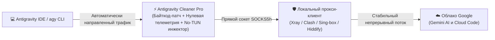

<p align="center">
  <a href="README.ru.md">🇷🇺 Русский</a> •
  <a href="README.md">🇺🇸 English</a> •
  <a href="README.fa.md">🇮🇷 فارسی</a> •
  <a href="README.ar.md">🇸🇦 العربية</a> •
  <a href="README.es.md">🇪🇸 Español</a> •
  <a href="README.tr.md">🇹🇷 Türkçe</a> •
  <a href="README.zh.md">🇨🇳 简体中文</a> •
  <a href="README.ur.md">🇵🇰 اردو</a>
</p>

<p align="center">
  
</p>

<h1 align="center">⚡ Antigravity Cleaner Pro (v5.4.0)</h1>

<p align="center">
  <strong>Автономный обход санкций, движок нулевой телеметрии и прямой No-TUN прокси-инжектор для Google Antigravity</strong>
</p>

<div align="center">

  [](https://github.com/tawroot/antigravity-cleaner/releases)
  [](https://github.com/tawroot/antigravity-cleaner/releases)
  [](https://golang.org)
  [](.github/workflows/security.yml)
  [](https://t.me/dallrep)
  [](docs/test-reports/benchmarks.log)
  [](docs/test-reports/benchmarks.log)
  []()

</div>

> *От всего сердца посвящается каждому человеку, ребёнку, студенту, преподавателю, создателю и независимому разработчику, стремящемуся к знаниям и развитию — особенно тем, кто оказался зажат между внутренними блокировками и внешними цифровыми санкциями. В 🇰🇵 Северной Корее, 🇮🇷 Иране, 🇨🇳 Китае, 🇷🇺 России, 🇹🇷 Турции, 🇨🇺 Кубе, 🇸🇾 Сирии, 🇧🇾 Беларуси, 🇸🇩 Судане, 🇻🇪 Венесуэле, 🇦🇫 Афганистане, 🇲🇲 Мьянме и в каждом развивающемся уголке нашей планеты. Искусственный интеллект — это общее достояние человечества. Доступ к знаниям, образованию и инструментам ИИ является фундаментальным правом каждого человека, а не привилегией, ограниченной богатыми странами.*  
> — **@dalroot**

<div align="center">

[](https://github.com/tawroot/antigravity-cleaner/stargazers)
&nbsp;
[](https://t.me/dallrep)
&nbsp;
[](https://github.com/tawroot/antigravity-cleaner/network/members)

</div>

> 🌟 **Поддержите свободный доступ к ИИ:**  
> Если Antigravity Cleaner помог вам обойти региональные блокировки Google или устранить ошибки исчерпания квот, пожалуйста, **поставьте звезду (Star) этому репозиторию** — это помогает другим разработчикам под ограничениями найти инструмент!

---

### 📑 Быстрая навигация
- [💾 Прямая загрузка Portable-версии (без установки)](#-прямая-загрузка-portable-версии-без-установки)
- [⚡ Что такое Antigravity Cleaner?](#-что-такое-antigravity-cleaner)
- [🧬 9 инженерных уровней и низкоуровневые патчи](#-9-инженерных-уровней-и-низкоуровневые-патчи)
- [🧭 Пошаговое руководство: от проверки региона Google до авто-фикса в 1 клик](#-пошаговое-руководство-от-проверки-региона-аккаунта-google-до-авто-фикса-в-1-клик)
- [❓ FAQ, безопасность и визуальная диагностика ошибок](#-faq-безопасность-и-визуальная-диагностика-ошибок)
- [🏛️ Архитектура системы и маршрутизация трафика](#️-архитектура-системы-и-маршрутизация-трафика)
- [🛡️ Движок нулевой телеметрии и гарантия приватности](#️-движок-нулевой-телеметрии-и-гарантия-приватности)
- [📊 Бенчмарки производительности и журналы аудита](#-бенчмарки-производительности-и-журналы-аудита)
- [🥊 Сравнительная таблица решений (v5.4.0)](#-сравнительная-таблица-решений-v540)
- [🚀 Быстрая установка через CLI (одной строкой)](#-быстрая-установка-через-cli-одной-строкой)
- [💻 Визуальные интерфейсы: ретро-GUI KeyGen и терминальный дашборд](#-визуальные-интерфейсы-ретро-gui-keygen-и-терминальный-дашборд)
- [🛠️ Подкоманды CLI и диагностика](#️-подкоманды-cli)
- [🤖 Автономный навык для AI-агентов](#-автономный-навык-для-ai-агентов-skillsantigravity-cleaner)
- [🔬 Лаборатория прикладной безопасности мульти-экосистемного ИИ](#-лаборатория-прикладной-безопасности-мульти-экосистемного-ии-google-deepmind-openai-anthropic-cursor)
- [🚦 Стандартный порядок сообщения об ошибках](#-стандартный-порядок-сообщения-об-ошибках)
- [👥 Авторы и благодарности](#-авторы-и-благодарности)

---

## 💾 Прямая загрузка Portable-версии (без установки)

> **⚡ Технические характеристики бинарных сборок:**  
> Скомпилировано на **чистом Go (Go 1.22+)**; **100% автономный и портативный** исполняемый файл (не требует Python или внешних зависимостей), **полностью офлайновый**, не требует прав суперпользователя (root) или настройки терминала, работает строго локально на `127.0.0.1`. Просто запустите двойным кликом:

<div align="center">

<table style="width: 100%; border-collapse: collapse; text-align: center;">
  <thead>
    <tr style="background: rgba(255, 255, 255, 0.05); border-bottom: 2px solid rgba(255, 255, 255, 0.1);">
      <th style="padding: 16px; width: 33%; text-align: center;">🪟 Windows</th>
      <th style="padding: 16px; width: 34%; text-align: center;">🍎 macOS</th>
      <th style="padding: 16px; width: 33%; text-align: center;">🐧 Linux</th>
    </tr>
  </thead>
  <tbody>
    <tr>
      <td style="padding: 20px 14px; vertical-align: top;">
        <span style="font-size: 40px;">🪟</span><br>
        <strong>Windows 10 и 11</strong><br>
        <small style="opacity: 0.75;">64-битные редакции</small><br><br>
        <a href="https://github.com/tawroot/antigravity-cleaner/releases/latest/download/antigravity-cleaner-windows-amd64.exe">
          
        </a><br><br>
        <small style="opacity: 0.85;">⚡ Двойной клик по .exe для запуска GUI</small>
      </td>
      <td style="padding: 20px 14px; vertical-align: top;">
        <span style="font-size: 40px;">🍎</span><br>
        <strong>Apple macOS</strong><br>
        <small style="opacity: 0.75;">Apple Silicon и Intel CPU</small><br><br>
        <a href="https://github.com/tawroot/antigravity-cleaner/releases/latest/download/antigravity-cleaner-darwin-arm64">
          
        </a><br><br>
        <a href="https://github.com/tawroot/antigravity-cleaner/releases/latest/download/antigravity-cleaner-darwin-amd64">
          
        </a>
      </td>
      <td style="padding: 20px 14px; vertical-align: top;">
        <span style="font-size: 40px;">🐧</span><br>
        <strong>Дистрибутивы Linux</strong><br>
        <small style="opacity: 0.75;">Ubuntu, Debian, Fedora, Arch</small><br><br>
        <a href="https://github.com/tawroot/antigravity-cleaner/releases/latest/download/antigravity-cleaner-linux-amd64">
          
        </a><br><br>
        <a href="https://github.com/tawroot/antigravity-cleaner/releases/latest/download/antigravity-cleaner-linux-arm64">
          
        </a>
      </td>
    </tr>
  </tbody>
</table>

</div>

---

## ⚡ Что такое Antigravity Cleaner?

<p align="center">
  
</p>

**Antigravity Cleaner Pro** — это специализированная утилита системного уровня с открытым исходным кодом, написанная на **чистом Go**. Она нейтрализует региональные блокировки, ограничения доступности аккаунта, маяки фоновой телеметрии и блокировки лимитов HTTP 429 в:
- **Google Antigravity 2.x**
- **Antigravity IDE**
- **Antigravity CLI (`agy`)**
- **Официальном расширении VS Code (`google.google-antigravity`)**

### 🧠 Что такое `language_server` и почему требуется его модификация?

Среда разработки Antigravity IDE построена на фронтенде Electron / VS Code, однако все ключевые возможности искусственного интеллекта, семантический анализ кода, взаимодействие с Gemini, управление квотами, проверка лицензий и **принудительное исполнение санкционных гео-блокировок** возложены на отдельный скомпилированный бинарный файл — **`language_server`**.

При запуске и во время генерации кода Google через этот исполняемый файл анализирует реальные IP-адреса, часовые пояса и телеметрические маяки, блокируя сессии разработчиков из санкционных регионов (Иран, Куба, Сирия, Россия и др.). Патчинг этой бинарной проверки является фундаментальным шагом к полной свободе работы в IDE.

---

### 🧬 9 инженерных уровней и низкоуровневые патчи

<details open>
<summary><strong>🔍 Нажмите для подробного просмотра всех 9 технических уровней:</strong></summary>
<br>

1. **Нейтрализация бинарного ядра (`language_server`) и универсальное динамическое обнаружение**  
   Динамический поиск и анализ целевых исполняемых файлов без жестко заданных путей для всех архитектур (Apple Silicon `arm64`, Intel `x64`, Linux `aarch64`/`amd64` и раскладки Google RPM/DEB). Перезаписывает логику проверки авторизации непосредственно в машинном коде (`RAX+8 hasValidAuth = true`), навсегда устраняя ошибки 403 Forbidden и `User location is not supported`.
2. **Обход проверки региона в CLI (`agy`)**  
   Нейтрализует клиентские региональные ограничения и проверку прав доступа в официальной консольной утилите.
3. **Разблокировка возможностей фронтенда IDE (`main.js`)**  
   Активирует флаг `isGoogleInternal` в среде Electron, открывая доступ к экспериментальным функциям и наборам инструментов агентов, а также сбрасывает устаревший кэш компиляции V8.
4. **ASAR-щит: глушение логов и перехват сбоев каналов (`app.asar`)**  
   Отключает избыточное телеметрическое логирование Google (замена `level: 'silly'` на `level: false`) и перехватывает ошибки оборванных пайпов консоли (`Broken pipe / write EIO`), предотвращая краши стриминга.
5. **Защита от фоновой перезагрузки (Anti Re-Download Guard)**  
   Блокирует канал обновлений расширения и подавляет повторную сверку хэшей, не позволяя IDE скрытно перезаписать модифицированные файлы оригинальными версиями.
6. **Корпоративный рантайм-враппер (8 производственных флагов)**  
   Оборачивает бинарный файл 8 корпоративными флагами запуска, принудительно отключая слежку `--disable_telemetry=true` и безопасно открывая MCP-серверы через `--allow_all_sidecars=true`.
7. **100% изоляция данных и защита приватности**  
   Пресекает фоновую утечку промптов, истории терминальных команд, метаданных Git, идентификаторов сессий и реального IP. Работает строго локально на `127.0.0.1`.
8. **Хирургический сброс квот HTTP 429**  
   Мгновенно очищает поврежденные rate-limit cookies и токены по 16 целевым путям всего за 0.002 секунды, не затрагивая файлы проектов и историю диалогов.
9. **Прямой No-TUN Smart-инжектор прокси**  
   Перенаправляет сетевой трафик IDE напрямую в локальные клиенты прокси (Xray, Clash, Sing-box, Hiddify) на порты 10808 / 7890 без необходимости включения ресурсоемкого системного режима TUN, обеспечивая защиту от разрывов соединений DPI благодаря 15-секундному таймеру TCP KeepAlive.

</details>

---

### 🔄 Гарантия отката в 1 клик (Clean Rollback)

> [!TIP]
> **Все модификации и патчи на 100% обратимы.**  
> Перед изменением хотя бы одного байта Cleaner автоматически создает нетронутую заводскую копию с расширением `.agybak`. Вы можете вернуть файлы в исходное состояние в любой момент:
> * **В графическом интерфейсе (GUI):** Нажмите кнопку **`[Restore]`**.
> * **В терминале (CLI):** Выполните команду **`ag-cleaner restore`**.

---

## 🧭 Пошаговое руководство: от проверки региона аккаунта Google до авто-фикса в 1 клик

### 1. Проверка региональной привязки аккаунта Google
Google применяет региональные санкции на основе исторической геолокации вашего аккаунта:
👉 **Проверьте страну привязки аккаунта за 30 секунд:**  
[Форма ассоциации со страной Google](https://policies.google.com/country-association-form?hl=en-US&source=policies-site)

* **Если указана поддерживаемая страна (США, Германия и т.д.):** Ваш аккаунт полностью готов.
* **Если указана подсанкционная страна:**
  * **Вариант А (Смена страны):** Включите VPN, снова откройте форму, отметьте галочкой пункт `I frequently use a Virtual Private Network (VPN)` и нажмите Отправить (Submit).
  * **Вариант Б (Новый аккаунт):** Зарегистрируйте новый аккаунт Gmail при активном VPN-подключении к поддерживаемой стране.

---

### 2. Запуск Cleaner: применение исправлений за доли секунды
После подтверждения региона вашего аккаунта запуск Cleaner доступен двумя удобными способами (графическое окно или консоль терминала):

#### 🖥️ Вариант 1: Автономный ретро-GUI (в стиле Win95 — проще всего, терминал не нужен)
Просто дважды щелкните по исполняемому файлу, чтобы открыть ностальгическое графическое окно. Рабочий процесс представляет собой интуитивную автоматизированную последовательность из 3 шагов:
1. **Шаг 1 — Нажмите `[ ① ⚡ Auto-Fix ]`:**  
   Нажмите кнопку и подождите пару секунд. Cleaner автоматически пропатчит бинарное ядро, CLI, фронтенд IDE, защиту расширений и щит Zero-Log ASAR. По завершении в поле статуса зеленым цветом отобразится `✔ STEP 1 DONE! Next: Click [ ② 🚀 Launch IDE ]` и станет активна кнопка второго шага.
2. **Шаг 2 — Нажмите `[ ② 🚀 Launch IDE ]`:**  
   Запускает Google Antigravity с интеллектуальной прямой инжекцией прокси (без необходимости переводить всю систему в TUN-режим). Среда разработки мгновенно готова к работе с полным набором функций ИИ.
3. **Шаг 3 — Нажмите `[ ③ 📌 Shortcut ]`:**  
   Создает постоянный ярлык на рабочем столе и в меню приложений с уже преднастроенной маршрутизацией прокси. Для будущих сессий программирования вы сможете запускать Antigravity напрямую через этот ярлык без повторного открытия Cleaner!

---

#### ⌨️ Вариант 2: Консольный CLI-дашборд (для опытных пользователей и разработчиков)
Если вы предпочитаете работать в командной строке:
* **Интерактивный полноэкранный TUI:**  
  Выполните команду `antigravity` (или `ag-cleaner`), чтобы открыть интерактивный дашборд на Lipgloss. Выберите пункт `1` (**Auto-Fix**). Cleaner проверит каждый компонент и подтвердит успех зеленым блоком `🎉 AUTO-FIX COMPLETED SUCCESSFULLY!`.
* **Прямые команды для скриптов и автоматизации:**
  * **Windows (CMD или PowerShell):**
    ```cmd
    # 1. Применить все патчи и автоматически сгенерировать прокси-лаунчер
    antigravity-cleaner.exe patch all

    # 2. Запустить Antigravity напрямую со смарт-прокси без TUN
    antigravity-cleaner.exe launch

    # 3. (Опционально) Создать постоянный ярлык на рабочем столе
    antigravity-cleaner.exe create-launcher
    ```
  * **Linux и macOS (Терминал):**
    ```bash
    # 1. Применить все патчи и автоматически сгенерировать прокси-лаунчер
    ./antigravity-cleaner patch all

    # 2. Запустить Antigravity напрямую со смарт-прокси без TUN
    ./antigravity-cleaner launch

    # 3. (Опционально) Создать постоянный ярлык на рабочем столе
    ./antigravity-cleaner create-launcher
    ```

---

## ❓ FAQ, безопасность и визуальная диагностика ошибок

<details>
<summary><strong>🛡️ Безопасен ли запуск Antigravity Cleaner?</strong></summary>
<br>

**Да, абсолютно. Безопасность на 100% проверяема непосредственно в исходном коде:**
1. **Полностью автономная работа офлайн:** Cleaner не требует интернет-доступа при патчинге и очистке. Все операции выполняются строго на `127.0.0.1`.
2. **Чистый Go (без зависимостей):** Единый скомпилированный бинарный файл без скрытых DLL-библиотек или динамических скриптов Python.
3. **100% успешные проверки безопасности GitHub:** Непрерывное сканирование инструментами CodeQL и Govulncheck в [`.github/workflows/security.yml`](.github/workflows/security.yml).
4. **Сохранение проектов и чатов:** Каталог `User/globalStorage` и проектные файлы остаются нетронутыми при сбросе квот.
5. **Прозрачная архитектура:** Подробно задокументирована в [`.github/SECURITY.md`](.github/SECURITY.md) и [`docs/ARCHITECTURE.md`](docs/ARCHITECTURE.md).

</details>

<details>
<summary><strong>⚡ Что делает Auto-Fix и почему результат перманентен?</strong></summary>
<br>

При нажатии на **`[Auto-Fix]`** или вызове `ag-cleaner patch all`:
1. **Бинарное ядро:** Патч машинного кода прописывает `RAX+8 hasValidAuth = 1` ([`pkg/patcher/manager.go`](pkg/patcher/manager.go)).
2. **CLI (`agy`):** Снимает клиентские проверки региона ([`pkg/patcher/cli.go`](pkg/patcher/cli.go)).
3. **IDE (`main.js`):** Разблокирует `isGoogleInternal` и очищает кэш V8 ([`pkg/patcher/ide.go`](pkg/patcher/ide.go)).
4. **Расширение VS Code:** Внедряет защиту от автоматического обновления ([`pkg/patcher/vscode.go`](pkg/patcher/vscode.go)).
5. **ASAR-щит:** Отключает логи и подавляет исключения `write EIO` ([`pkg/patcher/asar.go`](pkg/patcher/asar.go)).
6. **Корпоративный враппер:** Добавляет 8 флагов запуска (`--disable_telemetry=true`, `--allow_all_sidecars=true`) ([`pkg/patcher/flags.go`](pkg/patcher/flags.go)).
7. **No-TUN лаунчер:** Направляет трафик в локальный прокси без прав суперпользователя и режима TUN ([`pkg/proxy/launcher.go`](pkg/proxy/launcher.go)).

</details>

<details>
<summary><strong>🔄 Как устроен автоматический бэкап и восстановление?</strong></summary>
<br>

* **Заводской бэкап (`.agybak`):** Сохраняет исходные бинарные файлы перед внесением любых правок ([`pkg/patcher/atomic.go`](pkg/patcher/atomic.go)).
* **Сброс к заводскому состоянию в 1 клик:** Нажмите **`[Restore]`** или выполните `ag-cleaner restore` для мгновенного восстановления.
* **Без следов в системе:** Простое удаление бинарного файла утилиты полностью удаляет Cleaner из системы.

</details>

<details>
<summary><strong>1. Ошибка аварийного завершения агента (Agent Terminated / write EIO)</strong></summary>
<br>


```text
Agent terminated due to error
You can prompt the model to try again or start a new conversation if the error persists.
See our troubleshooting guide for more help.

Dismiss  Copy debug info  Retry
```

* **Причина:** Внезапный разрыв системного канала из-за избыточного потока логов (`write EIO`) или таймауты промежуточных сетевых узлов во время стриминга.
* **Решение:** Нажмите **`[Auto-Fix]`**; щит ASAR отключает аварийные логи и активирует 15-секундный TCP KeepAlive для стабилизации сокета.

</details>

<details>
<summary><strong>2. Ошибка сетевого подключения к серверу (Network Issue Connecting to Server)</strong></summary>
<br>


```text
Worked for 1s >

Error Unknown: There was a network issue connecting to the server, please try again. ˅
Error ID: 95ea05dd-6419-4bf0-a8ce-8faf25687606-108
Unknown: There was a network issue connecting to the server, please try again.

12:24 AM
```

* **Причина:** Блокировка неактивных gRPC-соединений системами глубокой фильтрации трафика (DPI) или утечка реального IP-адреса через телеметрию прямо во время сессии.
* **Решение:** Запускайте IDE через команду `ag-cleaner launch` (или кнопку **Launch IDE** в GUI); трафик изолируется в прямом SOCKS5h сокете с полным подавлением телеметрии.

</details>

<details>
<summary><strong>3. Блокировка авторизации и 403 Forbidden (/auth-success)</strong></summary>
<br>


```text
Google

403. That’s an error.

Your client does not have permission to get URL /auth-success from this server. That’s all we know.
```

* **Причина:** Региональный фильтр Google распознал редирект входа в браузер с IP-адреса подсанкционного региона.
* **Решение:** Выполните **`[Auto-Fix]`**; задается флаг `hasValidAuth = true`, передается параметр корпоративной лицензии `--stubby_auth_mode=business_licensed_enterprise` и очищаются токсичные токены сессий.

</details>

<details>
<summary><strong>4. Ошибка отказа в подключении к прокси (Proxy Connection Refused: 127.0.0.1:10808)</strong></summary>
<br>


```text
There was an unexpected issue setting up your account.

failed to get load code assist response: Post "https://cloudcode-pa.googleapis.com/v1internal:loadCodeAssist": proxyconnect tcp: dial tcp 127.0.0.1:10808: connect: connection refused

Continue with different account
Having trouble? Let us know
```

* **Причина:** Локальный прокси-клиент (Xray, Clash, NekoBox) выключен или настроен на прослушивание другого входящего порта.
* **Решение:** Запустите `ag-cleaner doctor`; утилита автоматически просканирует открытые порты в системе и обновит параметры подключения.

</details>

<details>
<summary><strong>5. Ошибка первоначальной настройки аккаунта (Failed to fetch)</strong></summary>
<br>


```text
There was an unexpected issue setting up your account.

Failed to fetch

Continue with different account
Having trouble? Let us know
```

* **Причина:** Повреждение записей базы данных DIPS и зависший кэш WebSocket в состоянии приложения.
* **Решение:** Запустите команду `ag-cleaner clean` (или нажмите **Clean 429** в GUI); утилита мгновенно очистит 16 файлов кэша квот за 0.002 с, полностью сохранив историю переписки.

</details>

<details>
<summary><strong>6. Ошибка доступа в macOS: Operation not permitted (syscall.EPERM / App Management)</strong></summary>
<br>

* **Причина:** Начиная с macOS Ventura, Sonoma и Sequoia внедрена строгая системная защита «App Management» (Управление приложениями), которая блокирует внешним терминальным утилитам прямое изменение бандлов `.app` внутри `/Applications/Antigravity.app`.
* **Решение с помощью Cleaner:**
  1. Откройте **Системные настройки (System Settings) ➔ Конфиденциальность и безопасность (Privacy & Security) ➔ Управление приложениями (App Management)**.
  2. Включите переключатель разрешений для используемого терминала (Terminal, iTerm2, Kitty, Ghostty или VS Code).
  3. Повторно запустите `./antigravity-cleaner patch all` (движок Cleaner v5.4.0 проведет предварительную проверку прав записи и успешно завершит операцию).

</details>

---

## 🏛️ Архитектура системы и маршрутизация трафика



---

## 🛡️ Движок нулевой телеметрии и гарантия приватности

### 🛑 Что такое телеметрия Google и в чем её опасность?
По умолчанию Google Antigravity постоянно передает пакеты фоновой телеметрии на удаленные серверы (`googleapis.com`, `cloudcode-pa.googleapis.com`):
- **Утечка реального IP и геолокации:** Фоновые сетевые зонды фиксируют незамаскированную задержку и сетевые атрибуты, приводя к блокировке `User location is not supported`.
- **Слежка за метаданными Git и структурой проектов:** Передаются хэши коммитов, адреса удаленных репозиториев и типы файлов.
- **Маяки ошибок и сбоев:** Логи и стек-трейсы отправляются в службы мониторинга Google Cloud Code.

### 🛡️ Как Antigravity Cleaner Pro защищает вас
Благодаря нашему **движку нулевой телеметрии с 8 корпоративными флагами**:
- **100% заблокированные каналы слежки:** Автоматическое внедрение флага `--disable_telemetry=true` и параметров изоляции в рантайм. Google получает **ноль телеметрических пакетов, ноль метаданных git и ноль маяков геолокации** с вашей системы.
- **100% локальное исполнение:** Работает строго локально на `127.0.0.1` без внешних обращений к сети.
- **Полная сохранность диалогов:** Хирургическая очистка (`ag-cleaner clean`) затрагивает исключительно файлы сбоя квот и кэш DIPS. Ваши промпты и проектные файлы остаются в полной безопасности.
- **Атомарная надежность POSIX:** Исполняемые файлы заменяются атомарной сменой inode (`os.Rename`), что гарантирует защиту от сбоев `ETXTBSY` в работающих процессах.

---

## 📊 Бенчмарки производительности и журналы аудита

| Метрика | Замеренное значение | Журнал проверки |
| :--- | :--- | :--- |
| **Скорость сканирования сигнатур в ОЗУ** | **1 901.84 МБ/с (~1.9 ГБ/с)** | [`benchmarks.log`](docs/test-reports/benchmarks.log) |
| **Время патчинга бинарного файла 171 МБ** | **0.23 секунды** | [`benchmarks.log`](docs/test-reports/benchmarks.log) |
| **Параллельная диагностика Doctor** | **~2.5 секунды** | [`live_system_test.log`](docs/test-reports/live_system_test.log) |
| **Хирургическая очистка кэша квот 429** | **16 объектов удалено (0 потерянных чатов)** | [`live_system_test.log`](docs/test-reports/live_system_test.log) |
| **Успешность юнит-тестов** | **100% (все тесты пройдены)** | [`benchmarks.log`](docs/test-reports/benchmarks.log) |

> [!NOTE]
> Все показатели зафиксированы в ходе реальных тестов на официальных наборах данных. Фактическая скорость может варьироваться в зависимости от процессора и скорости накопителя NVMe. Поскольку операции выполняются атомарно в памяти, модификация завершается за доли секунды без просадки производительности интерфейса.

---

## 🥊 Сравнительная таблица решений (v5.4.0)

| Функция | Одноцелевые патчеры (`open-antigravity-patcher`, `QNIX`) | Инжекторы процессов и DLL (`antigravity-proxy`) | **⚡ Antigravity Cleaner Pro (v5.4.0)** |
| :--- | :---: | :---: | :---: |
| **Язык и архитектура** | Python 3 (требуется рантайм, `pip`) | Только для Windows C++ / DLL-инжекция | **Нативный чистый Go (без зависимостей, единый бинарник)** |
| **Пользовательский интерфейс** | Простой вывод в консоль | Базовая консоль | **Ретро-интерфейс Win95 KeyGen GUI + современный Lipgloss TUI** |
| **Запуск прокси без режима TUN** | ❌ (Требует полный системный TUN) | ❌ Нет | ✅ **Автоопределение Xray/Clash/NekoBox и прямая инжекция** |
| **ASAR-щит от сбоев пайпов (`write EIO`)** | ❌ Нет | ❌ Нет | ✅ **Блокирует краши пайпов в `app.asar`** |
| **Тюнинг KeepAlive стриминга** | ❌ (Частые обрывы генерации) | ❌ Нет | ✅ **Включает 15-секундный TCP KeepAlive сокетов** |
| **Хирургический сброс квот 429** | ❌ (Стирает все настройки и чаты) | ❌ (Удаляет всё подряд) | ✅ **Сбрасывает кэш токенов, СОХРАНЯЯ все чаты!** |
| **Патчинг бинарного ядра** | Базовый x86_64 / ARM64 | ❌ Нет | ✅ **Глубокий MultiGate IDA-патч машинного кода** |
| **Патч фронтенда IDE (`main.js`)** | ✅ Простой regex | ❌ Нет | ✅ **Полный патч + сброс кэша компиляции V8** |
| **Защита от перезаписи файлов** | ✅ Базовая | ❌ Нет | ✅ **Комплексная защита + блокировка канала обновлений** |
| **Диагностический модуль Doctor** | ❌ Нет | ⚠️ Ограниченный | ✅ **Параллельная проверка задержки и утечек DNS за 2 секунды** |
| **Атомарная замена файлов (POSIX)** | Временные файлы Python | ❌ Нет | ✅ **Атомарный обмен Inode (без ошибки `ETXTBSY` на лету)** |

---

## 🚀 Быстрая установка через CLI (одной строкой)

### 🐧 Linux и 🍎 macOS (Apple Silicon M1–M4 и Intel)
```bash
curl -fsSL https://raw.githubusercontent.com/tawroot/antigravity-cleaner/main/install.sh | bash
```

### 🪟 Windows (PowerShell)
```powershell
irm https://raw.githubusercontent.com/tawroot/antigravity-cleaner/main/install.ps1 | iex
```

---

## 💻 Визуальные интерфейсы: ретро-GUI KeyGen и терминальный дашборд

### 💾 Графический интерфейс Retro KeyGen Desktop GUI (v5.4.0)
Запускайте автономно или через команду `ag-cleaner gui` для пошаговой работы в 3 клика (`① Auto-Fix ➔ ② Launch IDE ➔ ③ Shortcut`), переключения режима нулевой телеметрии и мониторинга процессов в реальном времени:

<div align="center">
  
</div>

---

### 🖥️ Интерактивный терминальный TUI и диагностика Doctor
Запустите `ag-cleaner` в терминале для работы в элегантном интерфейсе Lipgloss, и выберите пункт `7` для запуска экспресс-проверки сетевой доступности:

<div align="center">
  
  <br>
  
</div>

---

## 🛠️ Подкоманды CLI

```bash
# Запуск интерактивного меню
ag-cleaner

# Запуск ретро-GUI окна KeyGen (классический стиль Win95)
ag-cleaner gui

# Экспресс-проверка сети и статуса системы (краткая карточка)
ag-cleaner doctor

# Детальная диагностика с расширенными трейсами
ag-cleaner doctor --verbose

# Сформировать диагностический отчет и скопировать в буфер обмена для поддержки
ag-cleaner report

# Проверить наличие обновлений и выполнить самообновление
ag-cleaner update

# Применение всех патчей (ядро, CLI, фронтенд IDE, ASAR-щит)
ag-cleaner patch all

# Запуск Antigravity с умным инжектором прокси (без режима TUN!)
ag-cleaner launch

# Сброс квоты HTTP 429 без потери истории диалогов
ag-cleaner clean

# Возврат всех бинарных файлов в исходное заводское состояние
ag-cleaner restore

# Завершение зависших процессов Antigravity и language_server
ag-cleaner kill

# Создание ярлыка на рабочем столе с предустановленным прокси
ag-cleaner create-launcher

# Просмотр информации о проекте и авторских прав
ag-cleaner about
```

---

## 🤖 Автономный навык для AI-агентов (`skills/antigravity-cleaner`)

Antigravity Cleaner содержит встроенный **Agent Skill** ([`skills/antigravity-cleaner/SKILL.md`](skills/antigravity-cleaner/SKILL.md)), позволяющий автономным AI-ассистентам разработчика (Google Antigravity, Claude Code, Cursor, Codex) самостоятельно восстанавливать рабочее окружение при блокировках, исчерпании лимитов или сбоях сети:

- **Автоматический самоаудит**: Агент автоматически вызывает `ag-cleaner doctor` при потере соединения.
- **Автономное устранение ошибки 429**: Агент выполняет хирургический сброс квот при возникновении HTTP 429 без участия человека.
- **Нулевая конфигурация**: Размещен прямо в корне репозитория для мгновенного автообнаружения.

---

## 🔬 Лаборатория прикладной безопасности мульти-экосистемного ИИ (Google DeepMind, OpenAI, Anthropic, Cursor)

За созданием **Antigravity Cleaner Pro** стоит команда исследователей безопасности и реверс-инжиниринга. В нашей частной исследовательской лаборатории мы систематически исследуем инструменты разработки ведущих платформ искусственного интеллекта: **Google DeepMind (Antigravity и Gemini), OpenAI, Anthropic (Claude Code) и Cursor**.

- **100+ внутренних патчей и протокольных мостов:** В нашем закрытом репозитории хранится обширная коллекция низкоуровневых байткод-патчей, нейтрализаторов телеметрии, адаптеров Stubby RPC и коннекторов BYOM (Bring-Your-Own-Model).
- **Флагманский общедоступный релиз:** Antigravity Cleaner Pro выступает фундаментальным проектом этой инициативы; релизы специализированных инструментов для других платформ ИИ уже готовятся к выходу.
- **Промышленное тестирование стабильности:** Передовые исследовательские решения проходят строгое стресс-тестирование (фаззинг) на совместимость с Windows, macOS и Linux перед включением в открытый релиз.
- **Поддержка инженеров по всему миру:** Проверенный практикой инженерный проект, созданный для обеспечения долгосрочной стабильности работы разработчиков в условиях цифровой изоляции.
- **Поддержите проект:** Если наша утилита помогает вам беспрепятственно работать в IDE, пожалуйста, **поставьте звезду (Star) этому репозиторию ⭐**. Ваша поддержка ускоряет открытие новых инструментов из нашей лаборатории!

---

## 🚦 Стандартный порядок сообщения об ошибках

Для оперативного рассмотрения вопросов:
1. **Интерактивные формы тикетов в GitHub:** При возникновении нестандартного поведения откройте тикет через структурированную форму [Bug Report Form](https://github.com/tawroot/antigravity-cleaner/issues/new?template=bug_report.yml).
2. **Вопросы сообщества и настройка прокси:** По общим вопросам и конфигурациям VPN обращайтесь в раздел [GitHub Discussions](https://github.com/tawroot/antigravity-cleaner/discussions).
3. **Сообщения об уязвимостях:** Ознакомьтесь с политикой в [SECURITY.md](.github/SECURITY.md) и отправляйте отчеты конфиденциально через GitHub Security Advisories.

---

## 👥 Авторы и благодарности

- **Главный архитектор и мейнтейнер:** **[@dalroot](https://github.com/dalroot)**
- **Ассистент парного программирования:** **Antigravity AI (Google DeepMind)** — *С доброй иронией: мы использовали искусственный интеллект самого Google, чтобы освободить инструменты разработчиков Google от ограничений по всему миру!* 🤖
- **Лицензия:** Apache License 2.0 (Apache-2.0)
- Посвящается свободе доступа к информации, развитию открытого ПО и независимому сообществу разработчиков.

---

## 🗺️ Дорожная карта проекта (Roadmap)

Хотите узнать о планируемых функциях, стандартных нормализаторах ошибок и лабораторных прототипах?  
Ознакомьтесь с документом [**ROADMAP.md**](ROADMAP.md) (или [версией на фарси ROADMAP.fa.md](ROADMAP.fa.md)) для отслеживания этапов разработки.

---

## 📈 История звезд (Star History)

Если инструмент помог вам разблокировать рабочий процесс, звезда ⭐ на GitHub поможет другим разработчикам узнать о нем.

<a href="https://star-history.com/#tawroot/antigravity-cleaner&Date">
 <picture>
   <source media="(prefers-color-scheme: dark)" srcset="https://api.star-history.com/svg?repos=tawroot/antigravity-cleaner&type=Date&theme=dark" />
   <source media="(prefers-color-scheme: light)" srcset="https://api.star-history.com/svg?repos=tawroot/antigravity-cleaner&type=Date" />
   
 </picture>
</a>

---

## 💬 Сообщество и дискуссии

Есть вопросы, идеи по развитию или хотите поделиться вашей конфигурацией прокси?  
[**Присоединяйтесь к обсуждению в Discussions →**](https://github.com/tawroot/antigravity-cleaner/discussions)
