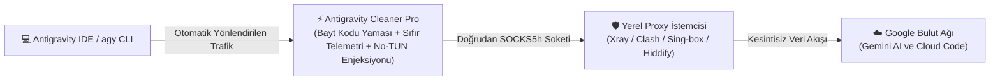

<p align="center">
  <a href="README.tr.md">🇹🇷 Türkçe</a> •
  <a href="README.md">🇺🇸 English</a> •
  <a href="README.fa.md">🇮🇷 فارسی</a> •
  <a href="README.ar.md">🇸🇦 العربية</a> •
  <a href="README.ru.md">🇷🇺 Русский</a> •
  <a href="README.es.md">🇪🇸 Español</a> •
  <a href="README.zh.md">🇨🇳 简体中文</a> •
  <a href="README.ur.md">🇵🇰 اردو</a>
</p>

<p align="center">
  
</p>

<h1 align="center">⚡ Antigravity Cleaner Pro (v5.3.1)</h1>

<p align="center">
  <strong>Google Antigravity İçin Otonom Yaptırım Aşma, Sıfır Telemetri Motoru ve Doğrudan No-TUN Proxy Enjektörü</strong>
</p>

<div align="center">

  [](https://github.com/tawroot/antigravity-cleaner/releases)
  [](https://golang.org)
  [](.github/workflows/security.yml)
  [](https://t.me/dallrep)
  [](docs/test-reports/benchmarks.log)
  [](docs/test-reports/benchmarks.log)
  []()

</div>

> *Öğrenmek, üretmek ve gelişmek için mücadele eden her insana, çocuğa, öğrenciye, öğretmene, yaratıcıya ve bağımsız geliştiriciye — özellikle içerideki internet filtrelemeleri ile dışarıdaki dijital yaptırımların kıskacında sıkışıp kalan tüm emekçilere yürekten adanmıştır. 🇰🇵 Kuzey Kore, 🇮🇷 İran, 🇨🇳 Çin, 🇷🇺 Rusya, 🇹🇷 Türkiye, 🇨🇺 Küba, 🇸🇾 Suriye, 🇧🇾 Belarus, 🇸🇩 Sudan, 🇻🇪 Venezuela, 🇦🇫 Afganistan, 🇲🇲 Myanmar ve dünyamızın gelişmekte olan her köşesinde. Yapay zekâ, tüm insanlığın ortak medeniyet mirasıdır. Bilgiye, eğitime ve yapay zekâ araçlarına serbest erişim, zengin sınırların lütfu değil, her insanın en temel ve evrensel hakkıdır.*  
> — **@dalroot**

<div align="center">

[](https://github.com/tawroot/antigravity-cleaner/stargazers)
&nbsp;
[](https://t.me/dallrep)
&nbsp;
[](https://github.com/tawroot/antigravity-cleaner/network/members)

</div>

> 🌟 **Açık Yapay Zekâ Erişimini Destekleyin:**  
> Antigravity Cleaner, Google yaptırımlarını aşmanıza veya kota hatalarını çözmenize yardımcı olduysa, lütfen bu repoya **Star (Yıldız) verin** — bu, kısıtlamalar altındaki diğer geliştiricilerin aracı keşfetmesini sağlar!

---

### 📑 Hızlı Gezinme
- [💾 Kurulumsuz Doğrudan Taşınabilir (Portable) İndirme](#-kurulumsuz-doğrudan-taşınabilir-portable-indirme)
- [⚡ Antigravity Cleaner Nedir?](#-antigravity-cleaner-nedir)
- [🧬 9 Mühendislik Katmanı ve Derin Çekirdek Yamaları](#-9-mühendislik-katmanı-ve-derin-çekirdek-yamaları)
- [🧭 Adım Adım Kurulum ve Google Hesap Bölgesi Kontrolü](#-adım-adım-kurulum-ve-google-hesap-bölgesi-kontrolü)
- [❓ SSS, Güvenlik ve Görsel Hata Giderme Kılavuzu](#-sss-güvenlik-ve-görsel-hata-giderme-kılavuzu)
- [🏛️ Sistem Mimarisi ve Trafik Akışı](#️-sistem-mimarisi-ve-trafik-akışı)
- [🛡️ Sıfır Telemetri Motoru ve Gizlilik Güvencesi](#️-sıfır-telemetri-motoru-ve-gizlilik-güvencesi)
- [📊 Canlı Sistem Performans Testleri ve Denetim Günlükleri](#-canlı-sistem-performans-testleri-ve-denetim-günlükleri)
- [🥊 Kapsamlı Karşılaştırma Tablosu (v5.3.1)](#-kapsamlı-karşılaştırma-tablosu-v531)
- [🚀 Hızlı CLI Kurulumu (Tek Satır)](#-hızlı-cli-kurulumu-tek-satır)
- [💻 Görsel Arayüzler: Retro KeyGen GUI ve Terminal Paneli](#-görsel-arayüzler-retro-keygen-gui-ve-terminal-paneli)
- [🛠️ CLI Alt Komutları ve Tanılama](#️-cli-alt-komutları)
- [🤖 Otonom AI Ajan Yeteneği](#-otonom-ai-ajan-yeteneği-skillsantigravity-cleaner)
- [🔬 Çoklu Ekosistem Uygulamalı Yapay Zekâ Güvenlik Laboratuvarı](#-çoklu-ekosistem-uygulamalı-yapay-zekâ-güvenlik-laboratuvarı-google-deepmind-openai-anthropic-cursor)
- [🚦 Standart Hata ve Sorun Bildirim Süreci](#-standart-hata-ve-sorun-bildirim-süreci)
- [👥 Katkıda Bulunanlar ve Teşekkür](#-katkıda-bulunanlar-ve-teşekkür)

---

## 💾 Kurulumsuz Doğrudan Taşınabilir (Portable) İndirme

> **⚡ İkili Dosya (Binary) Teknik Özellikleri:**  
> **Saf Go (Go 1.22+)** ile derlenmiştir; **%100 bağımsız ve taşınabilir** (Python veya harici çalışma zamanı gerektirmez), **tamamen çevrimdışı çalışabilir**, root/yönetici yetkisi veya karmaşık terminal yapılandırması gerektirmez, doğrudan yerel `127.0.0.1` üzerinde çalışır. Sadece çift tıklayın:

<div align="center">

<table style="width: 100%; border-collapse: collapse; text-align: center;">
  <thead>
    <tr style="background: rgba(255, 255, 255, 0.05); border-bottom: 2px solid rgba(255, 255, 255, 0.1);">
      <th style="padding: 16px; width: 33%; text-align: center;">🪟 Windows</th>
      <th style="padding: 16px; width: 34%; text-align: center;">🍎 macOS</th>
      <th style="padding: 16px; width: 33%; text-align: center;">🐧 Linux</th>
    </tr>
  </thead>
  <tbody>
    <tr>
      <td style="padding: 20px 14px; vertical-align: top;">
        <span style="font-size: 40px;">🪟</span><br>
        <strong>Windows 10 ve 11</strong><br>
        <small style="opacity: 0.75;">64-bit Sürümler</small><br><br>
        <a href="https://github.com/tawroot/antigravity-cleaner/releases/latest/download/antigravity-cleaner-windows-amd64.exe">
          
        </a><br><br>
        <small style="opacity: 0.85;">⚡ GUI'yi açmak için .exe dosyasına çift tıklayın</small>
      </td>
      <td style="padding: 20px 14px; vertical-align: top;">
        <span style="font-size: 40px;">🍎</span><br>
        <strong>Apple macOS</strong><br>
        <small style="opacity: 0.75;">Apple Silicon ve Intel İşlemciler</small><br><br>
        <a href="https://github.com/tawroot/antigravity-cleaner/releases/latest/download/antigravity-cleaner-darwin-arm64">
          
        </a><br><br>
        <a href="https://github.com/tawroot/antigravity-cleaner/releases/latest/download/antigravity-cleaner-darwin-amd64">
          
        </a>
      </td>
      <td style="padding: 20px 14px; vertical-align: top;">
        <span style="font-size: 40px;">🐧</span><br>
        <strong>Linux Dağıtımları</strong><br>
        <small style="opacity: 0.75;">Ubuntu, Debian, Fedora, Arch</small><br><br>
        <a href="https://github.com/tawroot/antigravity-cleaner/releases/latest/download/antigravity-cleaner-linux-amd64">
          
        </a><br><br>
        <a href="https://github.com/tawroot/antigravity-cleaner/releases/latest/download/antigravity-cleaner-linux-arm64">
          
        </a>
      </td>
    </tr>
  </tbody>
</table>

</div>

---

## ⚡ Antigravity Cleaner Nedir?

<p align="center">
  
</p>

**Antigravity Cleaner Pro**, **saf Go** diliyle geliştirilmiş açık kaynaklı, sistem düzeyinde uzmanlaşmış bir araçtır. Aşağıdaki araçlarda bölgesel engellemeleri, hesap uygunluk bariyerlerini, telemetri takip sinyallerini ve HTTP 429 kota kilitlerini tamamen etkisiz hale getirir:
- **Google Antigravity 2.x**
- **Antigravity IDE**
- **Antigravity CLI (`agy`)**
- **Resmi VS Code Eklentisi (`google.google-antigravity`)**

### 🧠 `language_server` Nedir ve Neden Yamalanması Gerekir?

Antigravity IDE dışarıdan bir Electron / VS Code önyüzü üzerinde çalışır; ancak tüm temel yapay zekâ kabiliyetleri, anlamsal kod analizi, Gemini iletişimi, kota yönetimi, lisans denetimi ve **bölgesel yaptırımların (Geoblocking) uygulanması**, derlenmiş özel bir ikili dosya olan **`language_server`** tarafından yönetilir.

Başlangıçta ve kod akışı (streaming) sırasında Google, bu ikili dosya üzerinden gerçek IP adreslerini, saat dilimlerini ve telemetri sinyallerini tarayarak yaptırım uygulanan ülkelerdeki (İran, Küba, Suriye vb.) geliştiricilerin bağlantısını keser. Bu ikili kapının makine kodu seviyesinde yamalanması, geliştirme ortamını özgürleştirmenin en temel adımıdır.

---

### 🧬 9 Mühendislik Katmanı ve Derin Çekirdek Yamaları

<details open>
<summary><strong>🔍 9 teknik katmanın tamamını incelemek için tıklayın:</strong></summary>
<br>

1. **Çekirdek Motorun Makine Kodu Seviyesinde Etkisizleştirilmesi (`language_server`)**  
   Kimlik doğrulama mantığını doğrudan makine kodunda yeniden yazar (`RAX+8 hasValidAuth = true`), 403 engellerini ve `User location is not supported` hatalarını kalıcı olarak çözer.
2. **CLI Uygunluk Kısıtlamasının Aşılması (`agy`)**  
   Resmi komut satırı aracındaki istemci taraflı bölgesel ve hesap uygunluk kısıtlamalarını etkisiz kılar.
3. **IDE Önyüz Yeteneklerinin Açılması (`main.js`)**  
   Electron önyüzünde `isGoogleInternal` bayrağını etkinleştirerek önizleme özelliklerini ve gelişmiş ajan araç setlerini kullanıma açar, eski V8 derleme önbelleğini temizler.
4. **Sıfır Günlük ve Boru Hattı Çökme Kalkanı (`app.asar`)**  
   Google'ın gereksiz telemetri günlüklerini susturur (`level: 'silly'` değerini `level: false` yaparak) ve konsol boru hattı kopmalarını (`Broken pipe / write EIO`) yakalayarak akış çökmelerini önler.
5. **Otomatik Yeniden İndirmeyi Önleme Kalkanı (Anti Re-Download Guard)**  
   Eklenti güncelleme kanalını kilitler ve karma (hash) kontrollerini engelleyerek, IDE'nin yamalanmış dosyalarınızı sessizce orijinal sürümlerle ezmesini önler.
6. **Kurumsal Çalışma Zamanı Kapsayıcısı (8 Bayraklı Enterprise Wrapper)**  
   Çekirdek ikili dosyayı 8 kurumsal bayrakla sarar, `--disable_telemetry=true` ile telemetriyi kapatır ve `--allow_all_sidecars=true` ile MCP sunucularını güvenle açar.
7. **%100 Gizlilik Koruması ve Veri İzolasyonu**  
   İstemlerin (prompt), terminal komut geçmişinin, Git commit'lerinin, oturum kimliklerinin ve gerçek IP'nin arka planda dışarı sızmasını engeller. Tamamen yerel `127.0.0.1` üzerinde çalışır.
8. **HTTP 429 Kota Cerrahi Sıfırlama**  
   Proje dosyalarına veya sohbet geçmişine asla dokunmadan, 16 hedef noktadaki bozuk oran sınırı çerezlerini ve belirteç önbelleklerini yalnızca 0.002 saniyede temizler.
9. **TUN Gerektirmeyen Doğrudan Akıllı Proxy Enjektörü**  
   Tüm sistemi hantal TUN moduna sokmaya gerek kalmadan, IDE trafiğini doğrudan 10808 / 7890 portlarındaki yerel proxy istemcilerine (Xray, Clash, Sing-box, Hiddify) yönlendirir; DPI kopmalarına karşı 15 saniyelik TCP KeepAlive soket optimizasyonu sağlar.

</details>

---

### 🔄 Tek Tıkla Temiz Geri Alma Güvencesi (1-Click Rollback)

> [!TIP]
> **Tüm değişiklikler ve yamalar %100 geri alınabilirdir.**  
> Cleaner, tek bir baytı bile değiştirmeden önce `.agybak` uzantısıyla orijinal fabrika yedeklerini otomatik olarak oluşturur. İstediğiniz zaman ilk güne dönebilirsiniz:
> * **Retro GUI'de:** **`[Restore]`** butonuna tıklayın.
> * **Terminal CLI'de:** **`ag-cleaner restore`** komutunu çalıştırın.

---

## 🧭 Adım Adım Kurulum ve Google Hesap Bölgesi Kontrolü

### 1. Google Hesabı Ülke Eşleştirmesini Kontrol Edin (Country Association)
Google, hesabınızın geçmiş hareketlerine göre bölgesel kısıtlamalar uygular:
👉 **Hesabınızın bağlı olduğu ülkeyi 30 saniyede kontrol edin:**  
[Google Hesap Ülkesi Formu](https://policies.google.com/country-association-form?hl=en-US&source=policies-site)

* **Ülke desteklenen bir bölge olarak görünüyorsa (ABD, Almanya vb.):** Hesabınız doğrudan kullanıma hazırdır.
* **Ülke kısıtlamalı/yaptırımlı bir bölge olarak görünüyorsa:**
  * **Seçenek A (Ülkeyi Güncelleyin):** VPN'inizi açın, formu tekrar açın, `I frequently use a Virtual Private Network (VPN)` seçeneğini işaretleyin ve Gönder'e (Submit) tıklayın.
  * **Seçenek B (Yeni Hesap Açın):** Desteklenen bir ülkeye bağlı VPN üzerindeyken yeni ve temiz bir Gmail hesabı oluşturun.

---

### 2. Cleaner'ı Çalıştırın: Saniyeler İçinde Otomatik Düzeltme
Hesap bölgeniz doğrulandıktan sonra, Cleaner'ı iki pratik yöntemle (Grafik Arayüz veya Terminal Konsolu) başlatabilirsiniz:

#### 🖥️ Seçenek 1: Bağımsız Retro GUI (Win95 Tarzı — En Kolayı, Sıfır Terminal Gereksinimi)
Nostaljik grafik arayüz penceresini açmak için bağımsız yürütülebilir dosyaya çift tıklamanız yeterlidir. Bu arayüzdeki iş akışı, sezgisel ve otomatik 3 adımlı bir diziden oluşur:
1. **1. Adım — `[ ① ⚡ Auto-Fix ]` Butonuna Tıklayın:**  
   Butona tıklayın ve birkaç saniye bekleyin. Cleaner; çekirdek motoru, CLI'yı, IDE önyüzünü, eklenti korumasını ve Zero-Log ASAR kalkanını otomatik olarak yamalar. İşlem tamamlandığında, durum kutusunda yeşil renkte `✔ STEP 1 DONE! Next: Click [ ② 🚀 Launch IDE ]` mesajı görüntülenir ve ikinci adım butonu aktif hale gelir.
2. **2. Adım — `[ ② 🚀 Launch IDE ]` Butonuna Tıklayın:**  
   Google Antigravity'yi akıllı doğrudan proxy enjeksiyonuyla başlatır (tüm sistemi TUN moduna alma zorunluluğunu ortadan kaldırır). IDE, tam yapay zeka yetenekleriyle anında kullanıma hazır hale gelir.
3. **3. Adım — `[ ③ 📌 Shortcut ]` Butonuna Tıklayın:**  
   Masaüstünüzde ve uygulama menünüzde, proxy yönlendirmesi önceden yapılandırılmış kalıcı bir kısayol oluşturur. Sonraki kodlama oturumlarınızda, Cleaner'ı yeniden açmadan doğrudan bu kısayola tıklayarak Antigravity'yi başlatabilirsiniz!

---

#### ⌨️ Seçenek 2: Terminal CLI Paneli (Gelişmiş Kullanıcılar ve Geliştiriciler İçin)
Komut satırı ortamında çalışmayı tercih ediyorsanız:
* **Etkileşimli Tam Ekran TUI:**  
  Lipgloss etkileşimli kontrol panelini açmak için `antigravity` (veya `ag-cleaner`) komutunu çalıştırın. `1` (**Auto-Fix**) seçeneğini seçin. Cleaner her bir bileşeni doğrulayacak ve yeşil `🎉 AUTO-FIX COMPLETED SUCCESSFULLY!` kutusuyla başarıyı bildirecektir.
* **Doğrudan Betiklenebilir Komutlar:**
  * **Windows (CMD veya PowerShell):**
    ```cmd
    # 1. Tüm yamaları uygulayın ve otomatik proxy başlatıcısını oluşturun
    antigravity-cleaner.exe patch all

    # 2. Akıllı No-TUN proxy ile Antigravity'yi doğrudan başlatın
    antigravity-cleaner.exe launch

    # 3. (İsteğe bağlı) Kalıcı masaüstü kısayolu oluşturun
    antigravity-cleaner.exe create-launcher
    ```
  * **Linux ve macOS (Terminal):**
    ```bash
    # 1. Tüm yamaları uygulayın ve otomatik proxy başlatıcısını oluşturun
    ./antigravity-cleaner patch all

    # 2. Akıllı No-TUN proxy ile Antigravity'yi doğrudan başlatın
    ./antigravity-cleaner launch

    # 3. (İsteğe bağlı) Kalıcı masaüstü kısayolu oluşturun
    ./antigravity-cleaner create-launcher
    ```

---

## ❓ SSS, Güvenlik ve Görsel Hata Giderme Kılavuzu

<details>
<summary><strong>🛡️ Antigravity Cleaner'ı çalıştırmak güvenli midir?</strong></summary>
<br>

**Evet, kesinlikle. Güvenlik doğrudan açık kaynak kod üzerinden %100 denetlenebilir:**
1. **Tamamen Çevrimdışı Çalışma:** Cleaner yama ve temizlik sırasında hiçbir internet bağlantısına ihtiyaç duymaz, kesinlikle `127.0.0.1` üzerinde çalışır.
2. **Saf Go (Sıfır Bağımlılık):** Şüpheli DLL enjeksiyonları veya dinamik Python scriptleri içermeyen tek parça derlenmiş ikili dosya.
3. **GitHub Güvenlik Denetimlerinden %100 Başarıyla Geçiş:** [`.github/workflows/security.yml`](.github/workflows/security.yml) altında otomatik CodeQL ve Govulncheck taramaları.
4. **Sohbet ve Proje Güvenliği:** Kota sıfırlaması sırasında `User/globalStorage` ve proje kodları asla silinmez.
5. **Şeffaf Mimari:** Detaylar [`.github/SECURITY.md`](.github/SECURITY.md) ve [`docs/ARCHITECTURE.md`](docs/ARCHITECTURE.md) belgelerinde açıklanmıştır.

</details>

<details>
<summary><strong>⚡ Auto-Fix ne yapar ve neden kalıcıdır?</strong></summary>
<br>

**`[Auto-Fix]`** butonuna tıklandığında veya `ag-cleaner patch all` çalıştırıldığında:
1. **Çekirdek Motor:** Makine kodunda `RAX+8 hasValidAuth = 1` değerini sabitler ([`pkg/patcher/manager.go`](pkg/patcher/manager.go)).
2. **CLI (`agy`):** İstemci uygunluk kontrollerini devre dışı bırakır ([`pkg/patcher/cli.go`](pkg/patcher/cli.go)).
3. **IDE (`main.js`):** `isGoogleInternal` bayrağını açar ve V8 derleme önbelleğini temizler ([`pkg/patcher/ide.go`](pkg/patcher/ide.go)).
4. **VS Code Eklentisi:** Otomatik yeniden indirmeyi engelleyen koruma kalkanını yerleştirir ([`pkg/patcher/vscode.go`](pkg/patcher/vscode.go)).
5. **ASAR Kalkanı:** Gereksiz günlükleri kapatır ve `write EIO` boru hattı hatalarını bertaraf eder ([`pkg/patcher/asar.go`](pkg/patcher/asar.go)).
6. **Enterprise Kapsayıcı:** 8 koruma parametresi enjekte eder (`--disable_telemetry=true` ve `--allow_all_sidecars=true`) ([`pkg/patcher/flags.go`](pkg/patcher/flags.go)).
7. **No-TUN Proxy Başlatıcı:** Root yetkisi olmadan yerel proxy üzerinden trafiği yönlendirir ([`pkg/proxy/launcher.go`](pkg/proxy/launcher.go)).

</details>

<details>
<summary><strong>🔄 Otomatik yedekleme ve geri yükleme nasıl çalışır?</strong></summary>
<br>

* **Fabrika Yedeği (`.agybak`):** Herhangi bir değişiklik yapılmadan önce orijinal ikili dosyaların temiz kopyasını saklar ([`pkg/patcher/atomic.go`](pkg/patcher/atomic.go)).
* **Tek Tıkla Fabrika Ayarlarına Dönüş:** Dosyaları eski haline döndürmek için **`[Restore]`** butonuna tıklayın veya `ag-cleaner restore` komutunu çalıştırın.
* **Sıfır Kalıntı:** Tek çalıştırılabilir dosyayı silmek, Cleaner'ı sisteminizden tamamen kaldırır.

</details>

<details>
<summary><strong>1. Agent Terminated Due to Error (Boru Hattı Hatası / write EIO)</strong></summary>
<br>


```text
Agent terminated due to error
You can prompt the model to try again or start a new conversation if the error persists.
See our troubleshooting guide for more help.

Dismiss  Copy debug info  Retry
```

* **Nedeni:** Yoğun telemetri günlükleri nedeniyle boru hattının aniden kırılması (`write EIO`) veya kod akışı sırasında ara bağlantı noktalarının zaman aşımına uğraması.
* **Çözümü:** **`[Auto-Fix]`** butonuna tıklayın; ASAR kalkanı boru hattı istisnalarını susturur ve soket kararlılığı için 15 saniyelik TCP KeepAlive optimizasyonunu devreye alır.

</details>

<details>
<summary><strong>2. Sunucuya Bağlantı Ağ Hatası (Network Issue Connecting to Server)</strong></summary>
<br>


```text
Worked for 1s >

Error Unknown: There was a network issue connecting to the server, please try again. ˅
Error ID: 95ea05dd-6419-4bf0-a8ce-8faf25687606-108
Unknown: There was a network issue connecting to the server, please try again.

12:24 AM
```

* **Nedeni:** Derin Paket İnceleme (DPI) sistemlerinin boşta kalan gRPC akışlarını kesmesi veya telemetri sondalarının konuşma ortasında gerçek IP'yi sızdırması.
* **Çözümü:** `ag-cleaner launch` (veya GUI'de **Launch IDE**) ile başlatın; akışları sıfır telemetri sızıntısıyla doğrudan SOCKS5h soketi üzerinden izole eder.

</details>

<details>
<summary><strong>3. Giriş Kimlik Doğrulama Engeli ve 403 Yasak Hatası (403 Forbidden /auth-success)</strong></summary>
<br>


```text
Google

403. That’s an error.

Your client does not have permission to get URL /auth-success from this server. That’s all we know.
```

* **Nedeni:** Google bölgesel kontrol mekanizmasının, tarayıcı giriş yönlendirmesinin yaptırımlı bir bölgeden geldiğini tespit etmesi.
* **Çözümü:** **`[Auto-Fix]`** komutunu çalıştırın; `hasValidAuth = true` olarak atanır, kurumsal lisans parametresi `--stubby_auth_mode=business_licensed_enterprise` iletilir ve kirlenmiş belirteçler temizlenir.

</details>

<details>
<summary><strong>4. Proxy Bağlantısı Reddedildi (Proxy Connection Refused: 127.0.0.1:10808)</strong></summary>
<br>


```text
There was an unexpected issue setting up your account.

failed to get load code assist response: Post "https://cloudcode-pa.googleapis.com/v1internal:loadCodeAssist": proxyconnect tcp: dial tcp 127.0.0.1:10808: connect: connection refused

Continue with different account
Having trouble? Let us know
```

* **Nedeni:** Yerel proxy istemcisi (Xray, Clash, NekoBox) kapalı veya beklenenden farklı bir portu dinliyor.
* **Çözümü:** `ag-cleaner doctor` komutunu çalıştırın; açık olan yerel portları otomatik olarak tarar ve proxy ayarlarını günceller.

</details>

<details>
<summary><strong>5. İlk Hesap Kurulumu Başarısız (Failed to fetch)</strong></summary>
<br>


```text
There was an unexpected issue setting up your account.

Failed to fetch

Continue with different account
Having trouble? Let us know
```

* **Nedeni:** DIPS veritabanı kayıtlarının bozulması ve uygulama durumunda askıda kalan yetim WebSocket önbellekleri.
* **Çözümü:** `ag-cleaner clean` komutunu çalıştırın (veya GUI'de **Clean 429** butonuna tıklayın); sohbet geçmişini koruyarak 16 kota önbellek dosyasını 0.002 saniyede temizler.

</details>

---

## 🏛️ Sistem Mimarisi ve Trafik Akışı



---

## 🛡️ Sıfır Telemetri Motoru ve Gizlilik Güvencesi

### 🛑 Google Telemetrisi Nedir ve Neden Tehlikelidir?
Varsayılan olarak Google Antigravity, arka planda düzenli aralıklarla Google sunucularına (`googleapis.com`, `cloudcode-pa.googleapis.com`) telemetri paketleri gönderir:
- **Gerçek IP ve Coğrafi Konum Sızıntısı:** Telemetri sondaları yerel ağ gecikmesini ve maskelenmemiş IP profilini bildirerek `User location is not supported` engeline yol açar.
- **Git Meta Verileri ve Çalışma Alanı Gözetimi:** Commit hash'lerini, uzak depo URL'lerini ve dosya uzantılarını Google'a iletir.
- **Hata ve Çökme Sinyalleri:** Çalışma zamanı hata kayıtlarını doğrudan Google Cloud Code günlük servislerine yayınlar.

### 🛡️ Antigravity Cleaner Pro Sizi Nasıl Korur?
**8 Bayraklı Sıfır Telemetri Motorumuz** ile:
- **%100 Kesilmiş Takip Kanalları:** Çekirdek çalışma zamanına otomatik olarak `--disable_telemetry=true` ve kurumsal izolasyon bayrakları enjekte edilir. Google, cihazınızdan **sıfır telemetri paketi, sıfır Git meta verisi ve sıfır IP takip sinyali** alır.
- **%100 Yerel Çalışma:** Dış ağ çağrıları yapmadan tamamen yerel `127.0.0.1` üzerinde çalışır.
- **Sohbetlerin Tam Koruması:** Cerrahi kota temizliği (`ag-cleaner clean`) yalnızca bozulmuş hız sınırı çerezlerini hedefler. Kod istemleriniz ve proje geçmişiniz kesinlikle korunur.
- **POSIX Atomik Güvenlik:** İkili dosyalar atomik inode değişimi (`os.Rename`) ile değiştirilir; bu sayede çalışan süreçler çökmez veya `ETXTBSY` kilitlenmesi yaşanmaz.

---

## 📊 Canlı Sistem Performans Testleri ve Denetim Günlükleri

| Metrik | Ölçülen Değer | Doğrulama Günlüğü |
| :--- | :--- | :--- |
| **Bellek İçi Desen Tarama Hızı** | **1.901,84 MB/s (~1.9 GB/s)** | [`benchmarks.log`](docs/test-reports/benchmarks.log) |
| **171 MB İkili Dosya Yama Süresi** | **0.23 saniye** | [`benchmarks.log`](docs/test-reports/benchmarks.log) |
| **Doctor Eşzamanlı Tanılama Süresi** | **~2.5 saniye** | [`live_system_test.log`](docs/test-reports/live_system_test.log) |
| **Cerrahi 429 Kota Önbellek Temizliği** | **16 kayıt temizlendi (0 sohbet kaybı)** | [`live_system_test.log`](docs/test-reports/live_system_test.log) |
| **Birim Test Başarı Oranı** | **%100 (Tüm paketler başarılı)** | [`benchmarks.log`](docs/test-reports/benchmarks.log) |

> [!NOTE]
> Tüm test değerleri resmi test paketleri üzerindeki canlı ölçümleri yansıtır. Gerçek hızlar CPU performansına ve NVMe depolama hızına bağlı olarak değişebilir. İşlemler bellekte atomik olarak yapıldığı için yama işlemi saniyenin onda biri sürede tamamlanır ve arayüzde donma yaşanmaz.

---

## 🥊 Kapsamlı Karşılaştırma Tablosu (v5.3.1)

| Özellik | Tek Amaçlı Yamalayıcılar (`open-antigravity-patcher`, `QNIX`) | Süreç ve DLL Enjektörleri (`antigravity-proxy`) | **⚡ Antigravity Cleaner Pro (v5.3.1)** |
| :--- | :---: | :---: | :---: |
| **Programlama Dili ve Mimari** | Python 3 (çalışma ortamı ve `pip` gerektirir) | Yalnızca Windows C++ / DLL enjeksiyonu | **Yerel Saf Go (Sıfır bağımlılık, Tek Yürütülebilir Dosya)** |
| **Kullanıcı Arayüzü** | Basit konsol metin çıktısı | Basit siyah konsol | **Klasik Win95 Retro GUI + Modern Lipgloss TUI Paneli** |
| **TUN Gerektirmeyen Proxy Başlatıcı** | ❌ (Sistemi tam TUN moduna zorlar) | ❌ Yok | ✅ **Xray/Clash/NekoBox'ı otomatik tanır ve doğrudan bağlar** |
| **ASAR Boru Hattı Kalkanı (`write EIO`)** | ❌ Yok | ❌ Yok | ✅ **`app.asar` içindeki boru çökme hatalarını susturur** |
| **Akış KeepAlive Ayarlayıcısı** | ❌ (Akış sırasında sık kopmalar) | ❌ Yok | ✅ **15 saniyelik TCP KeepAlive soket optimizasyonu sağlar** |
| **Cerrahi 429 Kota Sıfırlama** | ❌ (Tüm ayarları ve sohbetleri siler) | ❌ (Her şeyi siler) | ✅ **Belirteç önbelleğini temizler, TÜM sohbetleri korur!** |
| **Çekirdek İkili Dosya Yaması** | Temel x86_64 / ARM64 | ❌ Yok | ✅ **MultiGate IDA tarzı derin makine kodu yaması** |
| **IDE Önyüz Yaması (`main.js`)** | ✅ Basit regex | ❌ Yok | ✅ **Otomatik yama + V8 derleme önbellek temizliği** |
| **Otomatik İndirmeyi Engelleme** | ✅ Basit | ❌ Yok | ✅ **Tam Kalkan + Güncelleme Kanalı Kilitleme** |
| **Tanılama Aracı (Doctor)** | ❌ Yok | ⚠️ Sınırlı | ✅ **2 saniyede eşzamanlı gecikme ve DNS sızıntı denetimi** |
| **POSIX Atomik Dosya Değişimi** | Geçici Python dosyaları | ❌ Yok | ✅ **Atomik Inode değişimi (çalışırken `ETXTBSY` hatası vermez)** |

---

## 🚀 Hızlı CLI Kurulumu (Tek Satır)

### 🐧 Linux ve 🍎 macOS (Apple Silicon M1–M4 ve Intel)
```bash
curl -fsSL https://raw.githubusercontent.com/tawroot/antigravity-cleaner/main/install.sh | bash
```

### 🪟 Windows (PowerShell)
```powershell
irm https://raw.githubusercontent.com/tawroot/antigravity-cleaner/main/install.ps1 | iex
```

---

## 💻 Görsel Arayüzler: Retro KeyGen GUI ve Terminal Paneli

### 💾 Retro KeyGen Masaüstü GUI (v5.3.1)
Bağımsız olarak veya `ag-cleaner gui` komutuyla açarak 3 adımlı iş akışını (`① Auto-Fix ➔ ② Launch IDE ➔ ③ Shortcut`), gerçek zamanlı Sıfır Telemetri anahtarını ve canlı süreç izlemeyi kullanın:

<div align="center">
  
</div>

---

### 🖥️ Etkileşimli Terminal TUI ve Doctor Tanı Aracı
Lipgloss tabanlı terminal panelini açmak için terminalinizde `ag-cleaner` komutunu çalıştırın ve anlık bağlantı testleri için `7` seçeneğini seçin:

<div align="center">
  
  <br>
  
</div>

---

## 🛠️ CLI Alt Komutları

```bash
# Etkileşimli menüyü başlat
ag-cleaner

# Retro KeyGen grafik arayüzünü aç (Klasik Win95 Penceresi)
ag-cleaner gui

# Sistem ve ağ sağlığı tanılaması (özet kart)
ag-cleaner doctor

# Ayrıntılı hata izleme günlükleri ile derin tanılama
ag-cleaner doctor --verbose

# Tüm yamaları uygula (Çekirdek ikili dosya, CLI, IDE, ASAR kalkanı)
ag-cleaner patch all

# Antigravity'yi akıllı proxy enjeksiyonuyla başlat (TUN moduna gerek yok!)
ag-cleaner launch

# Sohbet geçmişini kaybetmeden HTTP 429 kotasını cerrahi olarak sıfırla
ag-cleaner clean

# Tüm dosyaları orijinal fabrika durumuna geri yükle
ag-cleaner restore

# Çalışan tüm Antigravity ve language_server zombi süreçlerini sonlandır
ag-cleaner kill

# Önceden yapılandırılmış proxy ile masaüstü kısayolu oluştur
ag-cleaner create-launcher

# Proje yapımcıları ve telif bilgilerini görüntüle
ag-cleaner about
```

---

## 🤖 Otonom AI Ajan Yeteneği (`skills/antigravity-cleaner`)

Antigravity Cleaner, AI kodlama asistanlarının (Google Antigravity, Claude Code, Cursor, Codex) API kısıtlamaları, kota limitleri veya ağ kopmalarıyla karşılaştığında ortamlarını kendi kendilerine onarmalarını sağlayan yerel bir **Ajan Yeteneği** ([`skills/antigravity-cleaner/SKILL.md`](skills/antigravity-cleaner/SKILL.md)) sunar:

- **Otomatik Öz Denetim**: Bağlantı koptuğunda ajan doğrudan `ag-cleaner doctor` komutunu çalıştırır.
- **Otonom Kota İyileştirme**: HTTP 429 hatası alındığında ajan, insan müdahalesi olmadan cerrahi temizliği devreye alır.
- **Sıfır Yapılandırma**: Otomatik keşif için doğrudan proje kök dizinine yerleştirilmiştir.

---

## 🔬 Çoklu Ekosistem Uygulamalı Yapay Zekâ Güvenlik Laboratuvarı (Google DeepMind, OpenAI, Anthropic, Cursor)

**Antigravity Cleaner Pro**'nun arkasında aktif bir tersine mühendislik ve güvenlik araştırması girişimi yer almaktadır. Özel araştırma laboratuvarımızda, küresel yapay zekâ ekosistemindeki geliştirici araçlarını sistematik olarak çözümlüyor ve analiz ediyoruz: **Google DeepMind (Antigravity & Gemini), OpenAI, Anthropic (Claude Code) ve Cursor**.

- **100'den Fazla Dahili Yama ve Protokol Köprüsü:** Özel laboratuvar depomuzda 100'ü aşkın alt düzey bayt kodu yaması, telemetri etkisizleştirici, Stubby RPC köprüsü ve BYOM (Kendi Modelini Getir) bağlayıcısı bulunmaktadır.
- **Temel Amiral Gemisi Açık Kaynak Sürüm:** Antigravity Cleaner Pro, bu girişimin temel amiral gemisi olarak hizmet vermektedir; diğer yapay zekâ geliştirici araçları için özel araçların da açık kaynak olarak yayınlanması planlanmaktadır.
- **Endüstriyel Kararlılık Testleri:** İleri düzey araştırma bulguları açık kaynak sürüme dahil edilmeden önce Windows, macOS ve Linux üzerinde kapsamlı fuzzing ve uyumluluk testlerinden geçirilir.
- **Küresel Geliştirici Dayanışması:** Dijital tecrit ve ağ kısıtlamalarıyla mücadele eden yazılımcılara uzun vadeli güvenilirlik sağlamak için tasarlanmış, sahada test edilmiş bir mühendislik projesidir.
- **Projeyi Destekleyin:** Aracımız çalışma ortamınızı açık ve üretken tutuyorsa, lütfen **bu depoya bir yıldız verin ⭐**. İlginiz, laboratuvarımızdan yeni açık kaynak araçların yayınlanmasını doğrudan hızlandırır!

---

## 🚦 Standart Hata ve Sorun Bildirim Süreci

Hızlı sınıflandırma ve çözüm için:
1. **GitHub Etkileşimli Sorun Formları:** Beklenmedik bir durumla karşılaşırsanız, lütfen yapılandırılmış [Hata Bildirimi Formu](https://github.com/tawroot/antigravity-cleaner/issues/new?template=bug_report.yml) üzerinden bildirin.
2. **Topluluk Soru-Cevap ve Proxy Ayarları:** Genel sorular ve VPN yapılandırmaları için [GitHub Tartışmaları (Discussions)](https://github.com/tawroot/antigravity-cleaner/discussions) bölümünü kullanın.
3. **Güvenlik Açıkları:** [SECURITY.md](.github/SECURITY.md) yönergelerimizi izleyerek GitHub Security Advisories üzerinden gizli bildirimde bulunun.

---

## 👥 Katkıda Bulunanlar ve Teşekkür

- **Baş Mimar ve Geliştirici:** **[@dalroot](https://github.com/dalroot)**
- **Yardımcı Pilot ve Eşli Programlama:** **Antigravity AI (Google DeepMind)** — *Anlamlı bir tebessümle: Dünyanın dört bir yanındaki kısıtlanmış yazılımcıların Google araçlarını özgürce kullanabilmesi için aracı Google'ın kendi yapay zekâ ajanıyla birlikte kodladık!* 🤖
- **Lisans:** Apache License 2.0 (Apache-2.0)
- Sansürsüz teknolojiye, açık kaynak erişilebilirliğine ve her yerde geliştirici özgürlüğüne adanmıştır.

---

## 🗺️ Proje Yol Haritası (Roadmap)

Gelecek özellikler, standart hata normalleştiricileri ve laboratuvar prototipleri hakkında bilgi almak ister misiniz?  
Planlanan hedefler için resmi [**ROADMAP.md**](ROADMAP.md) (veya [Farsça Yol Haritası ROADMAP.fa.md](ROADMAP.fa.md)) dosyamızı inceleyin.

---

## 📈 Yıldız Geçmişi (Star History)

Bu araç çalışma akışınızdaki engelleri kaldırdıysa, bir ⭐ yıldız diğer geliştiricilerin de aracı keşfetmesine yardımcı olur.

<a href="https://star-history.com/#tawroot/antigravity-cleaner&Date">
 <picture>
   <source media="(prefers-color-scheme: dark)" srcset="https://api.star-history.com/svg?repos=tawroot/antigravity-cleaner&type=Date&theme=dark" />
   <source media="(prefers-color-scheme: light)" srcset="https://api.star-history.com/svg?repos=tawroot/antigravity-cleaner&type=Date" />
   
 </picture>
</a>

---

## 💬 Topluluk ve Tartışmalar (Discussions)

Sorularınız, özellik önerileriniz veya proxy yapılandırmalarınızı paylaşmak için:  
[**Tartışma Forumuna Katılın →**](https://github.com/tawroot/antigravity-cleaner/discussions)
