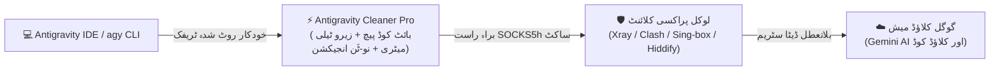

<div dir="rtl">

<p align="center">
  <a href="README.ur.md">🇵🇰 اردو</a> •
  <a href="README.md">🇺🇸 English</a> •
  <a href="README.fa.md">🇮🇷 فارسی</a> •
  <a href="README.ar.md">🇸🇦 العربية</a> •
  <a href="README.ru.md">🇷🇺 Русский</a> •
  <a href="README.es.md">🇪🇸 Español</a> •
  <a href="README.tr.md">🇹🇷 Türkçe</a> •
  <a href="README.zh.md">🇨🇳 简体中文</a>
</p>

<p align="center">
  
</p>

<h1 align="center">⚡ Antigravity Cleaner Pro (v5.3.1)</h1>

<p align="center">
  <strong>خودکار پابندی بائی پاس، زیرو ٹیلی میٹری انجن اور گوگل اینٹی گریویٹی کے لیے براہ راست نو-ٹَن (No-TUN) پراکسی انجیکٹر</strong>
</p>

<div align="center">

  [](https://github.com/tawroot/antigravity-cleaner/releases)
  [](https://golang.org)
  [](.github/workflows/security.yml)
  [](https://t.me/dallrep)
  [](docs/test-reports/benchmarks.log)
  [](docs/test-reports/benchmarks.log)
  []()

</div>

> *دل کی گہرائیوں سے ہر اس انسان، بچے، طالب علم، استاد، تخلیق کار اور آزاد ڈویلپر کے نام جو سیکھنے اور آگے بڑھنے کے لیے کوشاں ہے — خاص طور پر وہ جو اندرونی انٹرنیٹ فلٹرنگ اور بیرونی ڈیجیٹل پابندیوں کی دوہری چکی میں پس رہے ہیں۔ 🇰🇵 شمالی کوریا، 🇮🇷 ایران، 🇨🇳 چین، 🇷🇺 روس، 🇹🇷 ترکی، 🇨🇺 کیوبا، 🇸🇾 شام، 🇧🇾 بیلاروس، 🇸🇩 سوڈان، 🇻🇪 وینزویلا، 🇦🇫 افغانستان، 🇲🇲 میانمار اور دنیا کے ہر ترقی پذیر خطے میں۔ مصنوعی ذہانت (AI) پوری انسانیت کا مشترکہ علمی اثاثہ ہے۔ علم، تعلیم اور AI ٹولز تک رسائی ہر انسان کا بنیادی پیدائشی حق ہے، امیر ملکوں کی سرحدوں کا کوئی مخصوص استحقاق نہیں۔*  
> — **@dalroot کی طرف سے**

<div align="center">

[](https://github.com/tawroot/antigravity-cleaner/stargazers)
&nbsp;
[](https://t.me/dallrep)
&nbsp;
[](https://github.com/tawroot/antigravity-cleaner/network/members)

</div>

> 🌟 **اوپن AI رسائی کی حمایت کریں:**  
> اگر Antigravity Cleaner نے گوگل کی پابندیوں کو بائی پاس کرنے یا کوٹہ ایررز ٹھیک کرنے میں آپ کی مدد کی ہے، تو براہ کرم اس ریپوزٹری کو **Star دیں** — یہ پابندیوں کا شکار دیگر ڈویلپرز تک اس ٹول کو پہنچانے میں مدد دیتا ہے!

---

### 📑 فوری نیویگیشن
- [💾 براہ راست پورٹیبل ڈاؤن لوڈ (بغیر انسٹالیشن)](#-براہ-راست-پورٹیبل-ڈاؤن-لوڈ-بغیر-انسٹالیشن-کے)
- [⚡ Antigravity Cleaner کیا ہے؟](#-antigravity-cleaner-کیا-ہے)
- [🧬 بنیادی انجینئرنگ کی ۹ تہیں اور گہرے پیچز](#-بنیادی-انجینئرنگ-کی-۹-تہیں-اور-گہرے-پیچز)
- [🧭 مرحلہ وار گائیڈ: گوگل اکاؤنٹ ریجن چیک اور 1-کلک آٹو فکس](#-مرحلہ-وار-گائیڈ-گوگل-اکاؤنٹ-ریجن-چیک-سے-1-کلک-آٹو-فکس-تک)
- [❓ عمومی سوالات، سیکیورٹی اور بصری خرابیوں کا حل](#-عمومی-سوالات-سیکیورٹی-اور-بصری-خرابیوں-کا-حل)
- [🏛️ سسٹم کا معمارانہ خاکہ اور ٹریفک کا بہاؤ](#️-سسٹم-کا-معمارانہ-خاکہ-اور-ٹریفک-کا-بہاؤ)
- [🛡️ زیرو ٹیلی میٹری انجن اور پرائیویسی کی ضمانت](#️-زیرو-ٹیلی-میٹری-انجن-اور-پرائیویسی-کی-ضمانت)
- [📊 لائیو سسٹم بینچ مارکس اور آڈٹ لاگز](#-لائیو-سسٹم-بینچ-مارکس-اور-آڈٹ-لاگز)
- [🥊 جامع تقابلی جائزہ (ورژن 5.3.1)](#-جامع-تقابلی-جائزہ-ورژن-531)
- [🚀 فوری CLI انسٹالیشن (سنگل کمانڈ)](#-فوری-cli-انسٹالیشن-سنگل-کمانڈ)
- [💻 بصری انٹرفیس: ریٹرو KeyGen GUI اور ٹرمینل ڈیش بورڈ](#-بصری-انٹرفیس-ریٹرو-keygen-gui-اور-ٹرمینل-ڈیش-بورڈ)
- [🛠️ CLI ذیلی کمانڈز اور تشخیص](#️-cli-ذیلی-کمانڈز)
- [🤖 خودکار AI ایجنٹ اسکل](#-خودکار-ai-ایجنٹ-اسکل-skillsantigravity-cleaner)
- [🔬 کثیر ماحولیاتی اطلاقی AI سیکیورٹی لیب](#-کثیر-ماحولیاتی-اطلاقی-ai-سیکیورٹی-لیب-google-deepmind-openai-anthropic-cursor)
- [🚦 بگ اور مسائل رپورٹ کرنے کا معیاری طریقہ کار](#-بگ-اور-مسائل-رپورٹ-کرنے-کا-معیاری-طریقہ-کار)
- [👥 کریڈٹس اور اعترافات](#-کریڈٹس-اور-اعترافات)

---

## 💾 براہ راست پورٹیبل ڈاؤن لوڈ (بغیر انسٹالیشن کے)

> **⚡ بائنری کی تکنیکی تفصیلات:**  
> خالص **Go (Go 1.22+)** میں مرتب شدہ؛ **100% خود مختار اور پورٹیبل** (کسی پائتھون یا بیرونی رن ٹائم کی ضرورت نہیں)، **مکمل آف لائن کام کرنے کی صلاحیت**، بغیر روٹ یا ایڈمن مراعات کے، اور مکمل طور پر لوکل `127.0.0.1` پر چلتا ہے۔ بس ڈبل کلک کریں:

<div align="center">

<table style="width: 100%; border-collapse: collapse; text-align: center;" dir="rtl">
  <thead>
    <tr style="background: rgba(255, 255, 255, 0.05); border-bottom: 2px solid rgba(255, 255, 255, 0.1);">
      <th style="padding: 16px; width: 33%; text-align: center;">🪟 ونڈوز (Windows)</th>
      <th style="padding: 16px; width: 34%; text-align: center;">🍎 میک (macOS)</th>
      <th style="padding: 16px; width: 33%; text-align: center;">🐧 لینکس (Linux)</th>
    </tr>
  </thead>
  <tbody>
    <tr>
      <td style="padding: 20px 14px; vertical-align: top;">
        <span style="font-size: 40px;">🪟</span><br>
        <strong>Windows 10 & 11</strong><br>
        <small style="opacity: 0.75;">64-بٹ ایڈیشنز</small><br><br>
        <a href="https://github.com/tawroot/antigravity-cleaner/releases/latest/download/antigravity-cleaner-windows-amd64.exe">
          
        </a><br><br>
        <small style="opacity: 0.85;">⚡ GUI کھولنے کے لیے .exe فائل پر ڈبل کلک کریں</small>
      </td>
      <td style="padding: 20px 14px; vertical-align: top;">
        <span style="font-size: 40px;">🍎</span><br>
        <strong>Apple macOS</strong><br>
        <small style="opacity: 0.75;">ایپل سلیکون اور انٹیل سی پی یو</small><br><br>
        <a href="https://github.com/tawroot/antigravity-cleaner/releases/latest/download/antigravity-cleaner-darwin-arm64">
          
        </a><br><br>
        <a href="https://github.com/tawroot/antigravity-cleaner/releases/latest/download/antigravity-cleaner-darwin-amd64">
          
        </a>
      </td>
      <td style="padding: 20px 14px; vertical-align: top;">
        <span style="font-size: 40px;">🐧</span><br>
        <strong>لینکس ڈسٹروز</strong><br>
        <small style="opacity: 0.75;">Ubuntu, Debian, Fedora, Arch</small><br><br>
        <a href="https://github.com/tawroot/antigravity-cleaner/releases/latest/download/antigravity-cleaner-linux-amd64">
          
        </a><br><br>
        <a href="https://github.com/tawroot/antigravity-cleaner/releases/latest/download/antigravity-cleaner-linux-arm64">
          
        </a>
      </td>
    </tr>
  </tbody>
</table>

</div>

---

## ⚡ Antigravity Cleaner کیا ہے؟

<p align="center">
  
</p>

**Antigravity Cleaner Pro** ایک انتہائی مخصوص، اوپن سورس سسٹمز یوٹیلیٹی ہے جسے **خالص Go** زبان میں تیار کیا گیا ہے۔ یہ جغرافیائی پابندیوں، اکاؤنٹ کی اہلیت کی رکاوٹوں، ٹیلی میٹری بیکنز اور HTTP 429 کوٹہ لاکس کو درج ذیل پلیٹ فارمز پر جڑ سے غیر موثر بناتی ہے:
- **Google Antigravity 2.x**
- **Antigravity IDE**
- **Antigravity CLI (`agy`)**
- **سرکاری VS Code ایکسٹینشن (`google.google-antigravity`)**

### 🧠 `language_server` کیا ہے اور اسے پیچ کرنے کی ضرورت کیوں ہے؟

Antigravity IDE کا بیرونی انٹرفیس Electron / VS Code پر مبنی ہے، لیکن مصنوعی ذہانت کی تمام بنیادی صلاحیتیں، معنوی استدلال (Semantic reasoning)، جیمینائی ماڈلز سے رابطہ، کوٹہ کی منصفانہ تقسیم، لائسنس کی تصدیق، اور سب سے بڑھ کر **علاقائی پابندیوں (Geoblocking) کا نفاذ** ایک مخصوص کمپائلڈ بائنری کے ذریعے ہوتا ہے جس کا نام **`language_server`** ہے۔

سٹارٹ اپ کے وقت اور سٹریمنگ کے دوران، گوگل اس بائنری کے ذریعے صارف کا اصل IP ایڈریس، ٹائم زون اور ٹیلی میٹری چیک کر کے پابندی کے شکار ممالک (ایران، کیوبا، شام وغیرہ) کے ڈویلپرز کا کنکشن کاٹ دیتا ہے۔ اس لیے اس بائنری گیٹ کو پیچ کرنا IDE کو مکمل طور پر آزاد کرنے کا سنگ میل ہے۔

---

### 🧬 بنیادی انجینئرنگ کی ۹ تہیں اور گہرے پیچز

<details open>
<summary><strong>🔍 تمام ۹ تکنیکی تہوں کا جائزہ لینے کے لیے کلک کریں:</strong></summary>
<br>

1. **بنیادی انجن بائنری کو غیر موثر بنانا (`language_server`)**  
   مشین کوڈ کی سطح پر تصدیقی منطق کی ازسرنو تحریر (`RAX+8 hasValidAuth = true`)، جس سے 403 پابندیاں اور `User location is not supported` جیسے ایررز ہمیشہ کے لیے ختم ہو جاتے ہیں۔
2. **CLI اہلیت کی پابندی کو بائی پاس کرنا (`agy`)**  
   آفیشل کمانڈ لائن ٹول میں کلائنٹ سائیڈ کی علاقائی اور اکاؤنٹ اہلیت کی رکاوٹوں کو جڑ سے ختم کرتا ہے۔
3. **IDE فرنٹ اینڈ صلاحیتوں کو فعال کرنا (`main.js`)**  
   الیکٹران فرنٹ اینڈ میں `isGoogleInternal` فلیگ کو آن کر کے پیش نظارہ فیچرز اور جدید ایجنٹ ٹول کٹس کو کھولتا ہے، اور پرانے V8 کمپائل کیش کو صاف کرتا ہے۔
4. **زیرو لاگ اور پائپ فیلیر شیلڈ (`app.asar`)**  
   گوگل کے غیر ضروری ٹیلی میٹری لاگز کو خاموش کرتا ہے (`level: 'silly'` کو `level: false` میں بدل کر) اور کنسول پائپ فیلیر کے کریشز (`Broken pipe / write EIO`) کو قابو کرتا ہے۔
5. **خودکار ری ڈاؤن لوڈ کا دفاعی گارڈ**  
   ایکسٹینشن اپ ڈیٹ چینل کو لاک کر کے ہیش چیک کو روکتا ہے، تاکہ IDE آپ کی پیچ شدہ بائنری کو خاموشی سے واپس پرانی مقفل حالت پر اوور رائٹ نہ کر سکے۔
6. **انٹرپرائز ریپر (8 فلیگز کا رن ٹائم)**  
   بنیادی بائنری کو 8 پروڈکشن فلیگز کے ساتھ محفوظ کرتا ہے، جس میں `--disable_telemetry=true` نافذ ہوتا ہے اور `--allow_all_sidecars=true` کے ذریعے MCP سرورز ان لاک ہوتے ہیں۔
7. **100% پرائیویسی تحفظ اور ڈیٹا آئسولیشن**  
   پرامپٹس، ٹرمینل کمانڈ ہسٹری، گٹ کمٹس، سیشن آئی ڈیز اور اصلی IP ایڈریسز کے بیک گراؤنڈ اخراج کو مکمل روکتا ہے۔ یہ خالصتاً لوکل مشین پر `127.0.0.1` پر کام کرتا ہے۔
8. **HTTP 429 کوٹہ کی جراحی ری سیٹ**  
   پروجیکٹ فائلوں یا چیٹ ہسٹری کو چھوئے بغیر، صرف 0.002 سیکنڈ کے اندر 16 مقامات سے کرپٹ ریٹ لمٹ کوکیز اور ٹوکن کیش کو فوری صاف کرتا ہے۔
9. **براہ راست بغیر TUN کے اسمارٹ پراکسی انجیکٹر**  
   پورے سسٹم کو TUN موڈ میں ڈالے بغیر، پورٹس 10808 / 7890 پر لوکل پراکسیز (Xray, Clash, Sing-box, Hiddify) پر IDE ٹریفک کو فوراً موڑتا ہے، اور DPI ڈراپس کے خلاف 15 سیکنڈ کے TCP KeepAlive ساکٹ سے کنکشن برقرار رکھتا ہے۔

</details>

---

### 🔄 1-کلک مکمل بحالی (Clean Rollback) کی ضمانت

> [!TIP]
> **تمام تبدیلیاں اور پیچز 100% واپس پلٹائے جا سکتے ہیں۔**  
> ایک بائٹ بھی تبدیل کرنے سے پہلے کلینر خودکار طور پر اصل فیکٹری بائنریز کا بیک اپ `.agybak` ایکسٹینشن کے ساتھ تیار کرتا ہے۔ آپ کسی بھی وقت اپنے سسٹم کو اصل حالت میں لا سکتے ہیں:
> * **ریٹرو GUI میں:** بس **`[Restore]`** کے بٹن پر کلک کریں۔
> * **ٹرمینل CLI میں:** کمانڈ **`ag-cleaner restore`** چلائیں۔

---

## 🧭 مرحلہ وار گائیڈ: گوگل اکاؤنٹ ریجن چیک سے 1-کلک آٹو فکس تک

### 1. گوگل اکاؤنٹ کی ملک سے وابستگی چیک کریں (Country Association Check)
گوگل اکاؤنٹ کی پرانی ہسٹری کی بنیاد پر علاقائی پابندیاں لاگو کرتا ہے:
👉 **صرف 30 سیکنڈ میں اپنے ملک کی وابستگی چیک کریں:**  
[Google Country Association Form](https://policies.google.com/country-association-form?hl=en-US&source=policies-site)

* **اگر ملک کسی سپورٹ شدہ خطے (امریکہ، جرمنی وغیرہ) کے طور پر ظاہر ہو:** تو آپ کا اکاؤنٹ بالکل تیار ہے۔
* **اگر ملک کسی پابندی والے خطے کے طور پر ظاہر ہو:**
  * **آپشن A (ملک تبدیل کریں):** اپنا VPN آن کریں، فارم کو دوبارہ کھولیں، `I frequently use a Virtual Private Network (VPN)` کے آپشن کو منتخب کریں اور Submit پر کلک کریں۔
  * **آپشن B (نیا اکاؤنٹ بنائیں):** VPN کنیکٹ کر کے کسی سپورٹ شدہ ملک سے ایک نیا Gmail اکاؤنٹ رجسٹر کریں۔

---

### 2. کلینر چلائیں: چند سیکنڈ میں آٹو فکس لاگو کریں
جب آپ کے اکاؤنٹ کے خطے کی تصدیق ہو جائے، تو کلینر کو دو انتہائی آسان طریقوں (گرافیکل ونڈو یا ٹرمینل کنسول) کے ذریعے چلایا جا سکتا ہے:

#### 🖥️ آپشن 1: اسٹینڈ اکیلا ریٹرو GUI (Win95 اسٹائل — سب سے آسان، ٹرمینل کی کوئی ضرورت نہیں)
پرانی یادیں تازہ کرنے والی GUI ونڈو شروع کرنے کے لیے صرف اسٹینڈ اکیلی ایگزیکیوٹیبل فائل پر ڈبل کلک کریں۔ یہ ورک فلو ایک آسان اور خودکار 3 مرحلہ وار سلسلہ ہے:
1. **مرحلہ 1 — `[ ① ⚡ Auto-Fix ]` پر کلک کریں:**  
   اس بٹن پر کلک کریں اور چند سیکنڈ انتظار کریں۔ کلینر خودکار طور پر بنیادی انجن، CLI، آئی ڈی ای فرنٹ اینڈ، ایکسٹینشن گارڈ اور Zero-Log ASAR شیلڈ کو پیچ کر دیتا ہے۔ تکمیل پر، اسٹیٹس باکس میں سبز رنگ میں `✔ STEP 1 DONE! Next: Click [ ② 🚀 Launch IDE ]` کا پیغام ظاہر ہوتا ہے اور دوسرے مرحلے کا بٹن فعال ہو جاتا ہے۔
2. **مرحلہ 2 — `[ ② 🚀 Launch IDE ]` پر کلک کریں:**  
   گوگل اینٹی گریوٹی کو اسمارٹ ڈائریکٹ پراکسی انجیکشن کے ساتھ لانچ کرتا ہے (پورے سسٹم کے TUN موڈ کی ضرورت کے بغیر)۔ آئی ڈی ای فوری طور پر تمام AI صلاحیتوں کے ساتھ تیار ہو جاتا ہے۔
3. **مرحلہ 3 — `[ ③ 📌 Shortcut ]` پر کلک کریں:**  
   پراکسی روٹنگ کے ساتھ پہلے سے ترتیب شدہ ایک مستقل ڈیسک ٹاپ شارٹ کٹ اور ایپلیکیشن مینو لانچر بناتا ہے۔ آئندہ کوڈنگ سیشنز کے لیے، آپ کلینر کو دوبارہ کھولے بغیر اسی شارٹ کٹ سے براہ راست اینٹی گریوٹی چلا سکتے ہیں!

---

#### ⌨️ آپشن 2: ٹرمینل CLI ڈیش بورڈ (پاور صارفین اور ڈویلپرز کے لیے)
اگر آپ کمانڈ لائن ماحول میں کام کرنے کو ترجیح دیتے ہیں:
* **انٹرایکٹو فل اسکرین TUI:**  
  انٹرایکٹو Lipgloss ڈیش بورڈ کھولنے کے لیے `antigravity` (یا `ag-cleaner`) چلائیں۔ آپشن `1` (**Auto-Fix**) منتخب کریں۔ کلینر ہر جزو کی تصدیق کرے گا اور سبز رنگ کے `🎉 AUTO-FIX COMPLETED SUCCESSFULLY!` باکس کے ذریعے کامیابی کی تصدیق کرے گا۔
* **براہ راست اسکرپٹ ایبل کمانڈز:**
  * **ونڈوز (CMD یا PowerShell):**
    ```cmd
    # 1. تمام پیچز لاگو کریں اور خودکار پراکسی لانچر تیار کریں
    antigravity-cleaner.exe patch all

    # 2. اسمارٹ No-TUN پراکسی کے ساتھ براہ راست اینٹی گریوٹی چلائیں
    antigravity-cleaner.exe launch

    # 3. (اختیاری) مستقل ڈیسک ٹاپ شارٹ کٹ بنائیں
    antigravity-cleaner.exe create-launcher
    ```
  * **لینکس اور میک او ایس (ٹرمینل):**
    ```bash
    # 1. تمام پیچز لاگو کریں اور خودکار پراکسی لانچر تیار کریں
    ./antigravity-cleaner patch all

    # 2. اسمارٹ No-TUN پراکسی کے ساتھ براہ راست اینٹی گریوٹی چلائیں
    ./antigravity-cleaner launch

    # 3. (اختیاری) مستقل ڈیسک ٹاپ شارٹ کٹ بنائیں
    ./antigravity-cleaner create-launcher
    ```

---

## ❓ عمومی سوالات، سیکیورٹی اور بصری خرابیوں کا حل

<details>
<summary><strong>🛡️ کیا Antigravity Cleaner چلانا مکمل طور پر محفوظ ہے؟</strong></summary>
<br>

**جی ہاں، بالکل۔ سیکیورٹی کی 100% تصدیق براہ راست اوپن سورس کوڈ میں کی جا سکتی ہے:**
1. **مکمل آف لائن آپریشن:** پیچنگ اور صفائی کے دوران کلینر کو انٹرنیٹ کی قطعی ضرورت نہیں ہوتی۔ یہ سختی سے `127.0.0.1` پر کام کرتا ہے۔
2. **خالص Go (کوئی بیرونی انحصار نہیں):** سنگل کمپائلڈ بائنری جس میں کوئی مشتبہ DLLs یا پائتھون کی حرکیاتی امپورٹس شامل نہیں۔
3. **گٹ ہب سیکیورٹی آڈٹ میں 100% پاسنگ:** باقاعدہ خودکار CodeQL اور Govulncheck اسکینز [`.github/workflows/security.yml`](.github/workflows/security.yml) میں دستیاب ہیں۔
4. **چیٹس اور کوڈ کی مکمل حفاظت:** کوٹہ ری سیٹ کے دوران `User/globalStorage` اور پروجیکٹ کوڈ کو بالکل ہاتھ نہیں لگایا جاتا۔
5. **قابل تصدیق اور شفاف آرکیٹیکچر:** دستاویزات [`.github/SECURITY.md`](.github/SECURITY.md) اور [`docs/ARCHITECTURE.md`](docs/ARCHITECTURE.md) میں ملاحظہ کریں۔

</details>

<details>
<summary><strong>⚡ آٹو فکس کیا کرتا ہے اور یہ تبدیلیاں مستقل کیوں رہتی ہیں؟</strong></summary>
<br>

جب آپ **`[Auto-Fix]`** پر کلک کرتے ہیں یا `ag-cleaner patch all` چلاتے ہیں:
1. **بنیادی انجن:** مشین کوڈ میں `RAX+8 hasValidAuth = 1` سیٹ ہوتا ہے ([`pkg/patcher/manager.go`](pkg/patcher/manager.go))۔
2. **CLI (`agy`):** اہلیت کی جانچ پڑتال کے گیٹس کو غیر فعال کیا جاتا ہے ([`pkg/patcher/cli.go`](pkg/patcher/cli.go))۔
3. **IDE (`main.js`):** `isGoogleInternal` کو ان لاک کرتا ہے اور V8 کیش کو صاف کرتا ہے ([`pkg/patcher/ide.go`](pkg/patcher/ide.go))۔
4. **VS Code ایکسٹینشن:** خودکار ری ڈاؤن لوڈ کا دفاعی گارڈ داخل کرتا ہے ([`pkg/patcher/vscode.go`](pkg/patcher/vscode.go))۔
5. **ASAR شیلڈ:** فالتو لاگز کو خاموش کرتا ہے اور `write EIO` پائپ ایررز کو ہینڈل کرتا ہے ([`pkg/patcher/asar.go`](pkg/patcher/asar.go))۔
6. **انٹرپرائز ریپر:** 8 اہم فلیگز لاگو کرتا ہے جن میں `--disable_telemetry=true` اور `--allow_all_sidecars=true` شامل ہیں ([`pkg/patcher/flags.go`](pkg/patcher/flags.go))۔
7. **No-TUN پراکسی لانچر:** بغیر روٹ TUN کے لوکل پراکسی کے ذریعے ٹریفک روانہ کرتا ہے ([`pkg/proxy/launcher.go`](pkg/proxy/launcher.go))۔

</details>

<details>
<summary><strong>🔄 خودکار بیک اپ اور بحالی کا نظام کیسے کام کرتا ہے؟</strong></summary>
<br>

* **فیکٹری بیک اپ (`.agybak`):** کسی بھی تبدیلی سے پہلے اصل غیر ترمیم شدہ بائنریز کو محفوظ کرتا ہے ([`pkg/patcher/atomic.go`](pkg/patcher/atomic.go))۔
* **1-کلک فیکٹری ری سیٹ:** فیکٹری فائلز کو فوراً بحال کرنے کے لیے **`[Restore]`** پر کلک کریں یا `ag-cleaner restore` چلائیں۔
* **صفر باقیات:** سنگل فائل کو ڈیلیٹ کرنے سے کلینر آپ کے سسٹم سے مکمل طور پر ان انسٹال ہو جاتا ہے۔

</details>

<details>
<summary><strong>1. Agent Terminated Due to Error (پائپ کی ناکامی / write EIO)</strong></summary>
<br>


```text
Agent terminated due to error
You can prompt the model to try again or start a new conversation if the error persists.
See our troubleshooting guide for more help.

Dismiss  Copy debug info  Retry
```

* **وجہ:** سٹریمنگ کے دوران کثرت سے لاگنگ (`write EIO`) کی وجہ سے پائپ کا ٹوٹ جانا یا کنکشن ٹائم آؤٹ کا شکار ہو جانا۔
* **حل:** **`[Auto-Fix]`** پر کلک کریں؛ ASAR زیرو لاگ شیلڈ پائپ ایکسیپشنز کو خاموش کرتی ہے اور کنکشن کو قائم رکھنے کے لیے 15 سیکنڈ کے TCP KeepAlive کو فعال کرتی ہے۔

</details>

<details>
<summary><strong>2. سرور سے کنکشن میں نیٹ ورک کا مسئلہ (Network Issue Connecting to Server)</strong></summary>
<br>


```text
Worked for 1s >

Error Unknown: There was a network issue connecting to the server, please try again. ˅
Error ID: 95ea05dd-6419-4bf0-a8ce-8faf25687606-108
Unknown: There was a network issue connecting to the server, please try again.

12:24 AM
```

* **وجہ:** ڈیپ پیکٹ انسپیکشن (DPI) کی جانب سے gRPC سٹریمز کا کاٹ دیا جانا یا گفتگو کے دوران ٹیلی میٹری کی جانب سے اصل IP کا لیک ہو جانا۔
* **حل:** `ag-cleaner launch` (یا GUI میں **Launch IDE**) کے ذریعے شروع کریں؛ یہ بغیر کسی ٹیلی میٹری کے براہ راست SOCKS5h ساکٹ پر سٹریمز کو محفوظ بناتا ہے۔

</details>

<details>
<summary><strong>3. لاگ ان سیکیورٹی رکاوٹ اور 403 ممنوع (403 Forbidden /auth-success)</strong></summary>
<br>


```text
Google

403. That’s an error.

Your client does not have permission to get URL /auth-success from this server. That’s all we know.
```

* **وجہ:** براؤزر لاگ ان کے دوران گوگل ریجنل چیک کا پابندی زدہ علاقے کے IP کو شناخت کر کے راستہ روک دینا۔
* **حل:** **`[Auto-Fix]`** چلائیں؛ یہ `hasValidAuth = true` سیٹ کرتا ہے، انٹرپرائز لائسنسنگ فلیگ `--stubby_auth_mode=business_licensed_enterprise` پاس کرتا ہے اور آلودہ ٹوکنز کو صاف کرتا ہے۔

</details>

<details>
<summary><strong>4. پراکسی کنکشن مسترد ہونا (Proxy Connection Refused: 127.0.0.1:10808)</strong></summary>
<br>


```text
There was an unexpected issue setting up your account.

failed to get load code assist response: Post "https://cloudcode-pa.googleapis.com/v1internal:loadCodeAssist": proxyconnect tcp: dial tcp 127.0.0.1:10808: connect: connection refused

Continue with different account
Having trouble? Let us know
```

* **وجہ:** لوکل پراکسی کلائنٹ (Xray, Clash, NekoBox) بند ہے یا کسی مختلف پورٹ پر ٹریفک سن رہا ہے۔
* **حل:** `ag-cleaner doctor` چلائیں؛ یہ خودکار طور پر کھلی ہوئی پورٹس کو اسکین کر کے پراکسی سیٹنگز کو اپ ڈیٹ کر دیتا ہے۔

</details>

<details>
<summary><strong>5. اکاؤنٹ سیٹ اپ میں خرابی (Initial Setup: Failed to fetch)</strong></summary>
<br>


```text
There was an unexpected issue setting up your account.

Failed to fetch

Continue with different account
Having trouble? Let us know
```

* **وجہ:** DIPS ڈیٹا بیس ریکارڈز کا خراب ہو جانا اور ایپلیکیشن میموری میں پرانے WebSocket کیش کا پھنس جانا۔
* **حل:** `ag-cleaner clean` چلائیں (یا GUI میں **Clean 429** پر کلک کریں)؛ یہ چیٹ ہسٹری کو محفوظ رکھتے ہوئے 0.002 سیکنڈ میں 16 کیشڈ کوٹہ فائلوں کو صاف کرتا ہے۔

</details>

---

## 🏛️ سسٹم کا معمارانہ خاکہ اور ٹریفک کا بہاؤ



---

## 🛡️ زیرو ٹیلی میٹری انجن اور پرائیویسی کی ضمانت

### 🛑 گوگل ٹیلی میٹری کیا ہے اور یہ کیوں خطرناک ہے؟
پہلے سے طے شدہ طور پر، Google Antigravity مسلسل گوگل کے سرورز (`googleapis.com`, `cloudcode-pa.googleapis.com`) کو بیک گراؤنڈ ٹیلی میٹری پیکٹس بھیجتا ہے:
- **اصل IP اور جغرافیائی مقام کا اخراج:** ٹیلی میٹری کے ذریعے آپ کے نیٹ ورک کی غیر محفوظ معلومات پہنچ جاتی ہیں جس سے `User location is not supported` جیسے بلاک لگتے ہیں۔
- **Git میٹا ڈیٹا اور ورک اسپیس کی نگرانی:** یہ کمٹ ہیشز، ریموٹ گٹ یو آر ایلز اور کوڈ فائلز کی ایکسٹینشنز کو گوگل تک پہنچاتا ہے۔
- **ایرر اور کریش رپورٹس:** سسٹمز کی خرابی کا ڈیٹا مسلسل کلاؤڈ کوڈ کے لاگنگ سرورز پر براڈکاسٹ ہوتا رہتا ہے۔

### 🛡️ Antigravity Cleaner Pro آپ کی حفاظت کیسے کرتا ہے؟
ہمارے **8-فلیگ زیرو ٹیلی میٹری انجن** کے ذریعے:
- **100% کٹے ہوئے رابطے کے راستے:** رن ٹائم میں خودکار طور پر `--disable_telemetry=true` اور کارپوریٹ تنہائی کے فلیگز داخل کیے جاتے ہیں۔ گوگل کو آپ کی مشین سے **کوئی ٹیلی میٹری پیکٹ، کوئی گٹ ڈیٹا، اور کوئی IP بیکن** موصول نہیں ہوتا۔
- **100% لوکل ایگزیکیوشن:** یہ بغیر کسی بیرونی انٹرنیٹ ریکویسٹ کے مکمل طور پر `127.0.0.1` پر کام کرتا ہے۔
- **گفتگو کی مکمل حفاظت:** جراحی کوٹہ صفائی (`ag-cleaner clean`) صرف کرپٹ ریٹ لمٹ کوکیز کو ختم کرتی ہے۔ آپ کے کوڈ پرامپٹس اور پروجیکٹ کی تاریخ کو کبھی نہیں چھیڑا جاتا۔
- **POSIX ایٹامک سیفٹی:** ایٹامک انوڈ متبادل (`os.Rename`) کے ذریعے بائنریز کو تبدیل کیا جاتا ہے، جس کی بدولت چلتے ہوئے پروگرامز میں کبھی `ETXTBSY` یا اچانک کریش کا سامنا نہیں ہوتا۔

---

## 📊 لائیو سسٹم بینچ مارکس اور آڈٹ لاگز

| پیمانہ | ریکارڈ شدہ رفتار | تصدیقی لاگ |
| :--- | :--- | :--- |
| **میموری میں پیٹرن اسکیننگ** | **1,901.84 MB/s (~1.9 GB/s)** | [`benchmarks.log`](docs/test-reports/benchmarks.log) |
| **171MB بائنری پر پیچ کا دورانیہ** | **0.23 سیکنڈ** | [`benchmarks.log`](docs/test-reports/benchmarks.log) |
| **ڈاکٹر متوازی آڈٹ (Concurrent Audit)** | **~2.5 سیکنڈ** | [`live_system_test.log`](docs/test-reports/live_system_test.log) |
| **جراحی 429 کیش کی صفائی** | **16 آرٹفیکٹس صاف (0 چیٹ ضائع)** | [`live_system_test.log`](docs/test-reports/live_system_test.log) |
| **یونٹ ٹیسٹ کی کامیابی کی شرح** | **100% (تمام پیکجز کامیاب)** | [`benchmarks.log`](docs/test-reports/benchmarks.log) |

> [!NOTE]
> تمام بینچ مارکس آفیشل ٹیسٹ سویٹس پر لائیو مانیٹرنگ کی عکاسی کرتے ہیں۔ اصل رفتار سی پی یو اور NVMe اسٹوریج کی رفتار کے مطابق مختلف ہو سکتی ہے۔ چونکہ تمام تر عمل میموری میں ایٹامک طریقے سے انجام پاتا ہے، اس لیے پیچنگ سیکنڈ کے دسویں حصے میں مکمل ہو جاتی ہے۔

---

## 🥊 جامع تقابلی جائزہ (ورژن 5.3.1)

| فیچر | روایتی سنگل پرپز پیچرز (`open-antigravity-patcher`, `QNIX`) | پروسیس اور DLL انجیکٹرز (`antigravity-proxy`) | **⚡ Antigravity Cleaner Pro (v5.3.1)** |
| :--- | :---: | :---: | :---: |
| **پروگرامنگ زبان اور معماری** | پائتھون 3 (اضافی رن ٹائم اور `pip` درکار) | صرف ونڈوز C++ / DLL انجیکشن | **خالص Go (بغیر کسی بیرونی ضرورت کے، سنگل فائل بائنری)** |
| **صارف کا انٹرفیس (UI)** | بنیادی ٹیکسٹ آؤٹ پٹ | سادہ کنسول | **کلاسیک Win95 ریٹرو GUI + جدید 2026 Lipgloss TUI ڈیش بورڈ** |
| **بغیر TUN کے پراکسی لانچر** | ❌ (روٹ TUN موڈ پر مجبور کرتا ہے) | ❌ موجود نہیں | ✅ **خودکار طور پر Xray/Clash/NekoBox کو پہچان کر جوڑتا ہے** |
| **زیرو لاگ ASAR شیلڈ (`write EIO`)** | ❌ موجود نہیں | ❌ موجود نہیں | ✅ **`app.asar` میں پائپ کریشز کو مکمل خاموش کرتا ہے** |
| **سٹریم کیپ الائیو ٹیونر** | ❌ (سٹریمنگ کے دوران بار بار کٹنا) | ❌ موجود نہیں | ✅ **15 سیکنڈ کے TCP KeepAlive کو نافذ کرتا ہے** |
| **429 کوٹہ کی جراحی ری سیٹ** | ❌ (ساری چیٹس اور سیٹنگز مٹا دیتا ہے) | ❌ (سب کچھ ڈیلیٹ کر دیتا ہے) | ✅ **ٹوکن کیش صاف کرتا ہے، چیٹ اور کوڈ بالکل محفوظ رہتے ہیں!** |
| **کور بائنری کا پیچ** | بنیادی x86_64 / ARM64 | ❌ موجود نہیں | ✅ **ملٹی گیٹ IDA طرز کا گہرا مشین کوڈ پیچ** |
| **IDE فرنٹ اینڈ پیچ (`main.js`)** | ✅ بنیادی ریجیکس | ❌ موجود نہیں | ✅ **خودکار پیچ + V8 کمپائل کیشے کی صفائی** |
| **ری ڈاؤن لوڈ روکنے کا گارڈ** | ✅ بنیادی | ❌ موجود نہیں | ✅ **مکمل گارڈ + اپ ڈیٹ چینل کو لاک کرنا** |
| **تشخیصی ڈاکٹر ٹول (Doctor)** | ❌ موجود نہیں | ⚠️ محدود | ✅ **2 سیکنڈ میں متوازی تاخیر اور DNS لیک کا معائنہ** |
| **POSIX ایٹامک تبدیلی** | عارضی پائتھون فائلز | ❌ موجود نہیں | ✅ **ایٹامک Inode سویپ (چلتے ہوئے ایپ پر `ETXTBSY` کا نہ آنا)** |

---

## 🚀 فوری CLI انسٹالیشن (سنگل کمانڈ)

### 🐧 لینکس اور 🍎 میک (ایپل سلیکون M1–M4 اور انٹیل)
```bash
curl -fsSL https://raw.githubusercontent.com/tawroot/antigravity-cleaner/main/install.sh | bash
```

### 🪟 ونڈوز (PowerShell)
```powershell
irm https://raw.githubusercontent.com/tawroot/antigravity-cleaner/main/install.ps1 | iex
```

---

## 💻 بصری انٹرفیس: ریٹرو KeyGen GUI اور ٹرمینل ڈیش بورڈ

### 💾 ریٹرو KeyGen ڈیسک ٹاپ GUI (v5.3.1)
اسے آزادانہ طور پر یا `ag-cleaner gui` کے ذریعے چلائیں تاکہ 3 مراحل والا آسان طریقہ کار (`① Auto-Fix ➔ ② Launch IDE ➔ ③ Shortcut`)، ریئل ٹائم زیرو ٹیلی میٹری سوئچ اور لائیو پروسیس مانیٹرنگ حاصل ہو سکے:

<div align="center">
  
</div>

---

### 🖥️ انٹرایکٹو ٹرمینل TUI اور تشخیصی ڈاکٹر
اپنے ٹرمینل میں `ag-cleaner` چلائیں تاکہ جدید Lipgloss ڈیش بورڈ کھل سکے، اور فوری نیٹ ورک ٹیسٹ کے لیے آپشن `7` منتخب کریں:

<div align="center">
  
  <br>
  
</div>

---

## 🛠️ CLI ذیلی کمانڈز

```bash
# انٹرایکٹو مینو شروع کریں
ag-cleaner

# ریٹرو KeyGen ونڈو کھولیں (Classic Win95 Desktop Window)
ag-cleaner gui

# سسٹم اور نیٹ ورک کی صحت کی فوری جانچ (مختصر کارڈ)
ag-cleaner doctor

# ٹریسز اور تفصیلی لاگز کے ساتھ تشخیصی رپورٹ
ag-cleaner doctor --verbose

# تمام پیچز کا اطلاق کریں (بنیادی بائنری، CLI، IDE، ASAR شیلڈ)
ag-cleaner patch all

# اسمارٹ پراکسی انجیکشن کے ساتھ Antigravity چلائیں (بغیر TUN موڈ کے!)
ag-cleaner launch

# چیٹ ہسٹری ضائع کیے بغیر HTTP 429 کوٹہ ری سیٹ کریں
ag-cleaner clean

# تمام فائلوں کو اصل فیکٹری حالت میں بحال کریں
ag-cleaner restore

# چلتے ہوئے تمام Antigravity اور language_server کے زومبی پروسیسز کو بند کریں
ag-cleaner kill

# پہلے سے تیار کردہ پراکسی کے ساتھ ڈیسک ٹاپ شارٹ کٹ بنائیں
ag-cleaner create-launcher

# پروجیکٹ کے ڈویلپرز اور کریڈٹس کی تفصیلات دیکھیں
ag-cleaner about
```

---

## 🤖 خودکار AI ایجنٹ اسکل (`skills/antigravity-cleaner`)

Antigravity Cleaner ایک مقامی **ایجنٹ اسکل** ([`skills/antigravity-cleaner/SKILL.md`](skills/antigravity-cleaner/SKILL.md)) فراہم کرتا ہے جو AI کوڈنگ اسسٹنٹس (Google Antigravity, Claude Code, Cursor, Codex) کو نیٹ ورک ٹائم آؤٹ، کوٹہ کی حدود، یا پابندیوں کا سامنا ہونے پر اپنے ماحول کو خود ٹھیک کرنے کے قابل بناتا ہے:

- **خودکار سیلف آڈٹ**: کنکشن ٹوٹنے پر ایجنٹ فوراً `ag-cleaner doctor` چلاتا ہے۔
- **خودکار کوٹہ بحالی**: HTTP 429 خرابی پر ایجنٹ بغیر انسانی مداخلت کے جراحی صفائی سرانجام دیتا ہے۔
- **زیرو کنفیگریشن**: خودکار دریافت کے لیے پروجیکٹ کی جڑ میں براہ راست شامل۔

---

## 🔬 کثیر ماحولیاتی اطلاقی AI سیکیورٹی لیب (Google DeepMind, OpenAI, Anthropic, Cursor)

**Antigravity Cleaner Pro** کے پیچھے ایک فعال ریورس انجینئرنگ اور سیکیورٹی ریسرچ کا اقدام موجود ہے۔ ہماری نجی سیکیورٹی لیب میں، ہم دنیا کے بڑے AI ایکو سسٹمز کے ڈویلپر ٹولز کا گہرائی سے تجزیہ کرتے ہیں: **Google DeepMind (Antigravity & Gemini), OpenAI, Anthropic (Claude Code), اور Cursor**۔

- **100+ اندرونی پیچز اور پروٹوکول برجز:** ہماری نجی لیب میں 100 سے زائد لو لیول بائٹ کوڈ پیچز، ٹیلی میٹری نیوٹرلائزرز، سstubby RPC برجز اور BYOM ماڈل کنیکٹرز کی ایک بڑی لائبریری موجود ہے۔
- **بنیادی فلیگ شپ ریلیز:** Antigravity Cleaner Pro اس ریسرچ کا پہلا اہم اور بنیادی پبلک پروجیکٹ ہے، جس کے بعد دیگر AI سسٹمز کے لیے بھی ٹولز جاری کیے جائیں گے۔
- **پروڈکشن ہارڈننگ پائپ لائن:** جدید ریسرچ کے نتائج کو ونڈوز، میک اور لینکس پر وسیع فزنگ اور مطابقت کے امتحانات سے گزارا جاتا ہے، جس کے بعد ہی انہیں اوپن سورس کیا جاتا ہے۔
- **عالمی ڈویلپرز کا تحفظ:** ایک پختہ اور آزمودہ انجینئرنگ پروجیکٹ جو پابندیوں اور انٹرنیٹ قدغنوں کے شکار کوڈرز کو طویل مدتی استحکام فراہم کرتا ہے۔
- **پروجیکٹ کی حمایت کریں:** اگر ہمارے کام نے آپ کے IDE کو فعال رکھا ہے، تو براہ کرم **اس ریپوزٹری کو Star دیں ⭐**۔ آپ کی دلچسپی ہماری نجی لیب سے مزید ریلیزز کو یقینی بناتی ہے!

---

## 🚦 بگ اور مسائل رپورٹ کرنے کا معیاری طریقہ کار

فوری جانچ اور بروقت حل کے لیے:
1. **گٹ ہب کے انٹرایکٹو ایشو فارمز:** اگر آپ کو کسی غیر متوقع مسئلے کا سامنا ہو، تو ہمارے مخصوص [Bug Report Form](https://github.com/tawroot/antigravity-cleaner/issues/new?template=bug_report.yml) کے ذریعے مسئلہ درج کریں۔
2. **کمیونٹی سوالات اور پراکسی سیٹ اپ:** عمومی رہنمائی، سوالات اور پراکسی کنفیگریشن کے لیے [GitHub Discussions](https://github.com/tawroot/antigravity-cleaner/discussions) پر رجوع کریں۔
3. **سیکیورٹی سے متعلق کمزوریاں:** ہماری [SECURITY.md](.github/SECURITY.md) پالیسی پر عمل کریں اور GitHub Security Advisories کے ذریعے نجی رپورٹ بھیجیں۔

---

## 👥 کریڈٹس اور اعترافات

- **لیڈ آرکیٹیکٹ اور پروجیکٹ مینٹینر:** **[@dalroot](https://github.com/dalroot)**
- **کو پائلٹ اور پیئر پروگرامنگ:** **Antigravity AI (Google DeepMind)** — *ایک معنی خیز اور دلچسپ شراکت: خود گوگل کے AI ایجنٹ کے ساتھ مل کر کام کیا گیا تاکہ دنیا بھر کے مظلوم ڈویلپرز کے لیے گوگل کے ٹولز کو آزاد کرایا جا سکے!* 🤖
- **لائسنس:** اپاچی لائسنس 2.0 (Apache License 2.0)
- یہ پروجیکٹ ہر اس شخص کے نام ہے جو سنسرشپ سے پاک ٹیکنالوجی، اوپن سورس رسائی اور کوڈنگ کی آزادی پر یقین رکھتا ہے۔

---

## 🗺️ پروجیکٹ روڈ میپ

آنے والے فیچرز، معیاری ایرر نارملائزرز اور لیب پروٹو ٹائپس کے بارے میں جاننا چاہتے ہیں؟  
منصوبہ بندی کے اہداف جاننے کے لیے ہمارا آفیشل [**ROADMAP.md**](ROADMAP.md) (یا [فارسی روڈ میپ ROADMAP.fa.md](ROADMAP.fa.md)) دیکھیں۔

---

## 📈 گٹ ہب اسٹار ہسٹری (Star History)

اگر اس ٹول نے آپ کے کوڈنگ فلو کو بلاک ہونے سے بچایا ہے، تو ایک ⭐ اسٹار دوسرے پروگرامرز تک اسے پہنچانے میں مدد دے گا۔

<a href="https://star-history.com/#tawroot/antigravity-cleaner&Date">
 <picture>
   <source media="(prefers-color-scheme: dark)" srcset="https://api.star-history.com/svg?repos=tawroot/antigravity-cleaner&type=Date&theme=dark" />
   <source media="(prefers-color-scheme: light)" srcset="https://api.star-history.com/svg?repos=tawroot/antigravity-cleaner&type=Date" />
   
 </picture>
</a>

---

## 💬 کمیونٹی اور تبادلہ خیال (Discussions)

سوالات، نئی خصوصیات کی درخواستیں، یا اپنے پراکسی سیٹ اپ کا تبادلہ کرنا چاہتے ہیں؟  
[**ڈسکشن فورم میں شامل ہوں →**](https://github.com/tawroot/antigravity-cleaner/discussions)

</div>
