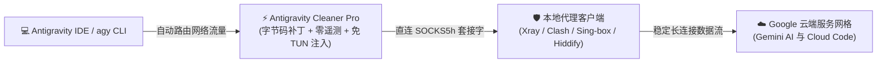

<p align="center">
  <a href="README.zh.md">🇨🇳 简体中文</a> •
  <a href="README.md">🇺🇸 English</a> •
  <a href="README.fa.md">🇮🇷 فارسی</a> •
  <a href="README.ar.md">🇸🇦 العربية</a> •
  <a href="README.ru.md">🇷🇺 Русский</a> •
  <a href="README.es.md">🇪🇸 Español</a> •
  <a href="README.tr.md">🇹🇷 Türkçe</a> •
  <a href="README.ur.md">🇵🇰 اردو</a>
</p>

<p align="center">
  
</p>

<h1 align="center">⚡ Antigravity Cleaner Pro (v5.3.1)</h1>

<p align="center">
  <strong>面向 Google Antigravity 的全自动制裁绕过、零遥测引擎与免 TUN 模式直连代理注入器</strong>
</p>

<div align="center">

  [](https://github.com/tawroot/antigravity-cleaner/releases)
  [](https://github.com/tawroot/antigravity-cleaner/releases)
  [](https://golang.org)
  [](.github/workflows/security.yml)
  [](https://t.me/dallrep)
  [](docs/test-reports/benchmarks.log)
  [](docs/test-reports/benchmarks.log)
  []()

</div>

> *谨以此作由衷献给每一位渴望学习、探索与成长的普通人、孩子、学生、教师、创作者以及独立开发者——尤其是那些身处内部网络限制与外部数字制裁夹缝之中的同仁。无论你身在 🇰🇵 朝鲜、🇮🇷 伊朗、🇨🇳 中国、🇷🇺 俄罗斯、🇹🇷 土耳其、🇨🇺 古巴、🇸🇾 叙利亚、🇧🇾 白俄罗斯、🇸🇩 苏丹、🇻🇪 委内瑞拉、🇦🇫 阿富汗、🇲🇲 缅甸，还是全球任何处于发展中的角落。人工智能是全人类共同创造的文明成果。自由获取知识、教育与 AI 工具是每一位地球公民与生俱来的基本权利，绝不应沦为少数富裕国度的专属特权。*  
> — **@dalroot**

<div align="center">

[](https://github.com/tawroot/antigravity-cleaner/stargazers)
&nbsp;
[](https://t.me/dallrep)
&nbsp;
[](https://github.com/tawroot/antigravity-cleaner/network/members)

</div>

> 🌟 **支持 AI 开放获取：**  
> 如果 Antigravity Cleaner 帮助你成功绕过了 Google 的区域封锁或解决了配额限制错误，请为本仓库**点亮一颗 Star**——这能帮助更多处于受限地区的开发者发现本工具！

---

### 📑 快速导航
- [💾 便携版免安装直接下载](#-便携版免安装直接下载)
- [⚡ 什么是 Antigravity Cleaner？](#-什么是-antigravity-cleaner)
- [🧬 9 重核心工程层与底层补丁剖析](#-9-重核心工程层与底层补丁剖析)
- [🧭 逐步实战指南：从 Google 账号地区排查到一键修复](#-逐步实战指南从-google-账号地区排查到一键修复)
- [❓ 常见问题、安全性与可视化排错指南](#-常见问题安全性与可视化排错指南)
- [🏛️ 系统架构设计与流量流向](#️-系统架构设计与流量流向)
- [🛡️ 零遥测引擎与隐私保护承诺](#️-零遥测引擎与隐私保护承诺)
- [📊 实机基准测试性能与审计日志](#-实机基准测试性能与审计日志)
- [🥊 全方位方案对比矩阵 (v5.3.1)](#-全方位方案对比矩阵-v531)
- [🚀 命令行一键极速安装](#-命令行一键极速安装)
- [💻 可视化界面：复古 KeyGen GUI 与终端仪表盘](#-可视化界面复古-keygen-gui-与终端仪表盘)
- [🛠️ CLI 子命令与诊断指令](#️-cli-子命令)
- [🤖 自主 AI Agent 技能集成](#-自主-ai-agent-技能集成-skillsantigravity-cleaner)
- [🔬 多生态应用级 AI 安全实验室](#-多生态应用级-ai-安全实验室-google-deepmind-openai-anthropic-cursor)
- [🚦 标准 Bug 报告与反馈渠道](#-标准-bug-报告与反馈渠道)
- [👥 致谢与署名](#-致谢与署名)

---

## 💾 便携版免安装直接下载

> **⚡ 二进制程序技术规格：**  
> 采用**纯 Go 语言 (Go 1.22+)** 编译；**100% 独立且免安装运行**（无需 Python 环境或任何外部运行时），**完全离线可用**，无需 root / 管理员权限，无需复杂的终端配置，所有操作严格在本地 `127.0.0.1` 运行。双击即可直接使用：

<div align="center">

<table style="width: 100%; border-collapse: collapse; text-align: center;">
  <thead>
    <tr style="background: rgba(255, 255, 255, 0.05); border-bottom: 2px solid rgba(255, 255, 255, 0.1);">
      <th style="padding: 16px; width: 33%; text-align: center;">🪟 Windows</th>
      <th style="padding: 16px; width: 34%; text-align: center;">🍎 macOS</th>
      <th style="padding: 16px; width: 33%; text-align: center;">🐧 Linux</th>
    </tr>
  </thead>
  <tbody>
    <tr>
      <td style="padding: 20px 14px; vertical-align: top;">
        <span style="font-size: 40px;">🪟</span><br>
        <strong>Windows 10 & 11</strong><br>
        <small style="opacity: 0.75;">64 位版本</small><br><br>
        <a href="https://github.com/tawroot/antigravity-cleaner/releases/latest/download/antigravity-cleaner-windows-amd64.exe">
          
        </a><br><br>
        <small style="opacity: 0.85;">⚡ 双击 .exe 即可直接启动 GUI 界面</small>
      </td>
      <td style="padding: 20px 14px; vertical-align: top;">
        <span style="font-size: 40px;">🍎</span><br>
        <strong>Apple macOS</strong><br>
        <small style="opacity: 0.75;">支持 Apple Silicon 与 Intel 芯片</small><br><br>
        <a href="https://github.com/tawroot/antigravity-cleaner/releases/latest/download/antigravity-cleaner-darwin-arm64">
          
        </a><br><br>
        <a href="https://github.com/tawroot/antigravity-cleaner/releases/latest/download/antigravity-cleaner-darwin-amd64">
          
        </a>
      </td>
      <td style="padding: 20px 14px; vertical-align: top;">
        <span style="font-size: 40px;">🐧</span><br>
        <strong>Linux 发行版</strong><br>
        <small style="opacity: 0.75;">Ubuntu, Debian, Fedora, Arch</small><br><br>
        <a href="https://github.com/tawroot/antigravity-cleaner/releases/latest/download/antigravity-cleaner-linux-amd64">
          
        </a><br><br>
        <a href="https://github.com/tawroot/antigravity-cleaner/releases/latest/download/antigravity-cleaner-linux-arm64">
          
        </a>
      </td>
    </tr>
  </tbody>
</table>

</div>

---

## ⚡ 什么是 Antigravity Cleaner？

<p align="center">
  
</p>

**Antigravity Cleaner Pro** 是一款使用**纯 Go** 语言深度开发的开源系统级效能工具。它能彻底消除地区封锁、账户资格审查限制、后台遥测上报信标以及 HTTP 429 配额锁死问题，完美覆盖：
- **Google Antigravity 2.x**
- **Antigravity IDE**
- **Antigravity CLI (`agy`)**
- **官方 VS Code 插件 (`google.google-antigravity`)**

### 🧠 什么是 `language_server`？为什么必须对其打补丁？

Antigravity IDE 外部虽然采用了 Electron / VS Code 前端架构，但其所有底层的核心 AI 功能、代码语义推理、Gemini 模型通讯、配额仲裁、授权验证以及**制裁与地理封锁检测**，均完全由一个名为 **`language_server`** 的独立预编译二进制程序所控制。

在启动及代码生成流式传输过程中，Google 会通过该二进制文件对真实 IP 地址、时区和遥测特征进行交叉探测，一旦侦测到受限制国家或地区（伊朗、古巴、叙利亚等）即会强行阻断连接。因此，对该二进制网关进行机器码级补丁，是彻底解放 IDE 限制的核心基石。

---

### 🧬 9 重核心工程层与底层补丁剖析

<details open>
<summary><strong>🔍 点击展开查看完整的 9 大技术工程层：</strong></summary>
<br>

1. **核心引擎二进制中和 (`language_server`)**  
   在机器码级别重写认证验证逻辑（`RAX+8 hasValidAuth = true`），彻底终结 403 权限拒绝与 `User location is not supported` 错误。
2. **CLI 准入资格绕过 (`agy`)**  
   中和官方命令行执行程序中的客户端区域与资格封锁判定。
3. **IDE 前端能力完全解锁 (`main.js`)**  
   在 Electron 前端中激活 `isGoogleInternal` 标志，解锁预览版功能与智能体工具链，并同步清除过期的 V8 编译缓存。
4. **ASAR 零日志与管道断裂防护盾 (`app.asar`)**  
   静音 Google 冗余的遥测日志（将 `level: 'silly'` 替换为 `level: false`），拦截并优雅捕获终端控制台管道异常（`Broken pipe / write EIO`），杜绝流式输出崩溃。
5. **反静默重下载防御守卫 (Anti Re-Download Guard)**  
   锁定插件升级通道并屏蔽文件哈希二次复验，阻止 IDE 在后台静默覆盖已打补丁的无限制二进制文件。
6. **企业级运行时封装器 (8-Flag Runtime Wrapper)**  
   为核心二进制包装 8 个生产级企业参数，强制启用 `--disable_telemetry=true` 阻断遥测，并通过 `--allow_all_sidecars=true` 安全放行 MCP 服务。
7. **100% 隐私保护与数据本地隔离**  
   全面切断代码 Prompt、终端命令历史、Git 提交记录、会话 ID 和真实 IP 地址的后台外发通道。严格在本地 `127.0.0.1` 闭环运行。
8. **HTTP 429 额度外科级精准重置**  
   仅需 0.002 秒瞬间清洗 16 处受污染的速率限制 Cookie 与令牌桶缓存，且**绝对不损坏**任何项目工程文件与对话历史。
9. **免 TUN 模式直连智能代理注入器**  
   无需开启繁重且影响全系统的 TUN 虚拟网卡模式，直接将 IDE 流量引导至本地代理客户端（Xray、Clash、Sing-box、Hiddify 等）的 10808 / 7890 端口，并辅以 15 秒 TCP KeepAlive 心跳保活机制，抵御深度包检测（DPI）造成的连接中断。

</details>

---

### 🔄 一键无损还原保证 (Clean Rollback)

> [!TIP]
> **所有修改与补丁均 100% 完全可逆。**  
> 在修改任何字节前，Cleaner 会自动在同级目录为原始文件生成 `.agybak` 后缀的纯净出厂备份。你随时可以一键恢复至初始状态：
> * **在复古 GUI 中：** 直接点击 **`[Restore]`** 按钮。
> * **在终端 CLI 中：** 运行指令 **`ag-cleaner restore`**。

---

## 🧭 逐步实战指南：从 Google 账号地区排查到一键修复

### 1. 检查 Google 账号归属国家/地区 (Country Association)
Google 会根据账号历史活动位置判定归属区域，从而实施制裁封锁：
👉 **30 秒内自查账号关联国家：**  
[Google 账号国家关联查询与变更表单](https://policies.google.com/country-association-form?hl=en-US&source=policies-site)

* **若关联国家属于支持地区（如美国、德国等）：** 你的账号完全合规，可直接使用。
* **若关联国家属于受限/受制裁地区：**
  * **方案 A（更新归属国家）：** 开启代理/VPN，重新打开该表单，勾选 `I frequently use a Virtual Private Network (VPN)`（我经常使用虚拟专用网络），点击提交。
  * **方案 B（注册全新账号）：** 在保持支持地区代理连接的状态下，重新注册一个干净的 Gmail 账号。

---

### 2. 运行 Cleaner：数秒内完成全自动修复
在确认账号归属地后，您可以通过两种极为简便的方式运行 Cleaner（独立图形窗口或终端控制台）：

#### 🖥️ 方案 1：独立复古图形界面（Win95 风格 —— 最简单，无需使用终端）
只需双击下载的独立可执行文件，即可打开经典的怀旧 GUI 窗口。整体工作流为直观且全自动的三步操作：
1. **第 1 步 —— 点击 `[ ① ⚡ Auto-Fix ]`：**  
   点击该按钮并静候数秒。Cleaner 将自动修补核心底层引擎、CLI、IDE 前端、扩展防护守卫以及 Zero-Log ASAR 静音盾。完成后，状态框将显示绿色的 `✔ STEP 1 DONE! Next: Click [ ② 🚀 Launch IDE ]` 提示，并自动激活第二步按钮。
2. **第 2 步 —— 点击 `[ ② 🚀 Launch IDE ]`：**  
   直接启动 Google Antigravity，并通过智能定向注入本地代理端口（完全无需开启占用系统全局网卡的 TUN 模式）。IDE 启动后即可无限制享受完整 AI 功能。
3. **第 3 步 —— 点击 `[ ③ 📌 Shortcut ]`：**  
   在桌面和系统应用菜单中生成预先配置好代理路由规则的永久快捷方式。日后进行编码时，只需双击该快捷方式即可直接启动 Antigravity，无需每次重新打开 Cleaner！

---

#### ⌨️ 方案 2：终端 CLI 命令行（面向高级用户与开发者）
如果您更偏好在终端环境中操作：
* **全屏交互式 TUI 菜单：**  
  运行 `antigravity`（或 `ag-cleaner`）打开基于 Lipgloss 的终端交互面板。选择选项 `1`（**Auto-Fix**）。Cleaner 将逐项校验各组件，并弹出绿色提示框 `🎉 AUTO-FIX COMPLETED SUCCESSFULLY!`。
* **直接运行自动化脚本命令：**
  * **Windows (CMD 或 PowerShell)：**
    ```cmd
    # 1. 应用全部补丁并自动生成代理启动器
    antigravity-cleaner.exe patch all

    # 2. 直接以智能 No-TUN 代理模式启动 Antigravity
    antigravity-cleaner.exe launch

    # 3. (可选) 创建永久桌面快捷方式
    antigravity-cleaner.exe create-launcher
    ```
  * **Linux 与 macOS (Terminal)：**
    ```bash
    # 1. 应用全部补丁并自动生成代理启动器
    ./antigravity-cleaner patch all

    # 2. 直接以智能 No-TUN 代理模式启动 Antigravity
    ./antigravity-cleaner launch

    # 3. (可选) 创建永久桌面快捷方式
    ./antigravity-cleaner create-launcher
    ```

---

## ❓ 常见问题、安全性与可视化排错指南

<details>
<summary><strong>🛡️ 运行 Antigravity Cleaner 安全吗？</strong></summary>
<br>

**绝对安全。所有安全性均可在开源代码中进行 100% 审计：**
1. **完全离线工作：** 打补丁与清理缓存期间，Cleaner 不需要任何互联网访问权限，严格运行在 `127.0.0.1` 本地回环。
2. **纯 Go 语言编写（零外部依赖）：** 单一编译二进制文件，无任何隐藏的可疑 DLL 注入，无动态 Python 脚本引入。
3. **100% 通过 GitHub 安全审查：** 在 [`.github/workflows/security.yml`](.github/workflows/security.yml) 中配置了自动化的 CodeQL 与 Govulncheck 漏洞扫描。
4. **对话与项目安全：** 配额重置过程中完好保留 `User/globalStorage` 与全部工程文件。
5. **架构透明开放：** 详细设计可查阅 [`.github/SECURITY.md`](.github/SECURITY.md) 与 [`docs/ARCHITECTURE.md`](docs/ARCHITECTURE.md)。

</details>

<details>
<summary><strong>⚡ Auto-Fix 具体执行了什么？为什么具有持久性？</strong></summary>
<br>

点击 **`[Auto-Fix]`** 或执行 `ag-cleaner patch all` 时，程序将自动完成：
1. **核心引擎：** 机器码热补丁注入 `RAX+8 hasValidAuth = 1` ([`pkg/patcher/manager.go`](pkg/patcher/manager.go))。
2. **CLI (`agy`)：** 中和客户端资格判定逻辑 ([`pkg/patcher/cli.go`](pkg/patcher/cli.go))。
3. **IDE (`main.js`)：** 启用 `isGoogleInternal` 特性并清除 V8 缓存 ([`pkg/patcher/ide.go`](pkg/patcher/ide.go))。
4. **VS Code 插件：** 植入自动更新防护守卫 ([`pkg/patcher/vscode.go`](pkg/patcher/vscode.go))。
5. **ASAR 防护盾：** 关闭冗余日志并拦截 `write EIO` 管道异常 ([`pkg/patcher/asar.go`](pkg/patcher/asar.go))。
6. **企业级封装器：** 注入 8 大运行参数（`--disable_telemetry=true` 与 `--allow_all_sidecars=true`） ([`pkg/patcher/flags.go`](pkg/patcher/flags.go))。
7. **免 TUN 代理启动器：** 无需 root 权限与 TUN 网卡即可引导本地代理流量 ([`pkg/proxy/launcher.go`](pkg/proxy/launcher.go))。

</details>

<details>
<summary><strong>🔄 自动备份与还原机制是如何运作的？</strong></summary>
<br>

* **出厂级备份 (`.agybak`)：** 在执行任何改动前，自动保存原始文件的纯净备份 ([`pkg/patcher/atomic.go`](pkg/patcher/atomic.go))。
* **一键无损复原：** 点击 **`[Restore]`** 或运行 `ag-cleaner restore`，立刻将所有文件复原至官方原始状态。
* **零系统残留：** 直接删除该单一可执行文件，即可完全卸载 Cleaner，不残留任何服务或注册表垃圾。

</details>

<details>
<summary><strong>1. Agent 异常终止错误 (Agent Terminated / write EIO 管道中断)</strong></summary>
<br>


```text
Agent terminated due to error
You can prompt the model to try again or start a new conversation if the error persists.
See our troubleshooting guide for more help.

Dismiss  Copy debug info  Retry
```

* **产生原因：** 大量冗余日志输出导致标准管道断裂（`write EIO`），或在代码流式传输过程中中间路由节点发生网络超时。
* **解决方案：** 点击 **`[Auto-Fix]`**；ASAR 零日志盾将自动静音管道异常，并启用 15 秒 TCP KeepAlive 心跳保活机制以稳固长连接。

</details>

<details>
<summary><strong>2. 无法连接服务器网络故障 (Network Issue Connecting to Server)</strong></summary>
<br>


```text
Worked for 1s >

Error Unknown: There was a network issue connecting to the server, please try again. ˅
Error ID: 95ea05dd-6419-4bf0-a8ce-8faf25687606-108
Unknown: There was a network issue connecting to the server, please try again.

12:24 AM
```

* **产生原因：** 深度包检测防火墙（DPI）切断了空闲的 gRPC 长连接，或会话中途遥测信标泄露了真实 IP 地址导致服务端主动拒接。
* **解决方案：** 使用 `ag-cleaner launch`（或 GUI 中的 **Launch IDE**）启动；流量将通过专用 SOCKS5h 本地套接字完全隔离，零遥测外泄。

</details>

<details>
<summary><strong>3. 网页登录鉴权受阻与 403 权限拒绝 (/auth-success)</strong></summary>
<br>


```text
Google

403. That’s an error.

Your client does not have permission to get URL /auth-success from this server. That’s all we know.
```

* **产生原因：** 浏览器端完成授权重定向时，Google 的区域风控拦截了来自受制裁 IP 的回调请求。
* **解决方案：** 运行 **`[Auto-Fix]`**；系统将强制注入 `hasValidAuth = true`，传递企业授权模式 `--stubby_auth_mode=business_licensed_enterprise` 并清理污染的授权令牌。

</details>

<details>
<summary><strong>4. 代理连接被拒绝错误 (Proxy Connection Refused: 127.0.0.1:10808)</strong></summary>
<br>


```text
There was an unexpected issue setting up your account.

failed to get load code assist response: Post "https://cloudcode-pa.googleapis.com/v1internal:loadCodeAssist": proxyconnect tcp: dial tcp 127.0.0.1:10808: connect: connection refused

Continue with different account
Having trouble? Let us know
```

* **产生原因：** 本地代理客户端（Xray、Clash、NekoBox 等）未处于运行状态，或代理客户端监听的入站端口与配置不匹配。
* **解决方案：** 运行 `ag-cleaner doctor`；该命令会自动全面扫描本机已开启的有效代理端口并同步更新配置。

</details>

<details>
<summary><strong>5. 账号初始安装获取失败 (Failed to fetch)</strong></summary>
<br>


```text
There was an unexpected issue setting up your account.

Failed to fetch

Continue with different account
Having trouble? Let us know
```

* **产生原因：** 应用内部状态中的 DIPS 数据库记录受损，或积累了失效的孤立 WebSocket 本地缓存。
* **解决方案：** 运行 `ag-cleaner clean`（或点击 GUI 的 **Clean 429**）；仅需 0.002 秒清理 16 处配额缓存数据，同时完整保留对话记录。

</details>

---

## 🏛️ 系统架构设计与流量流向



---

## 🛡️ 零遥测引擎与隐私保护承诺

### 🛑 什么是 Google 遥测？为什么它极具隐患？
在默认状态下，Google Antigravity 会持续不断地向 Google 节点（`googleapis.com`, `cloudcode-pa.googleapis.com`）发送后台遥测数据：
- **真实 IP 与地理位置泄露：** 遥测探测包会上报本地未被代理包裹的网络延迟与原始网络指纹，直接触发 `User location is not supported` 封锁。
- **Git 仓库与工作区监控：** 收集并上报本地 Commit Hash、代码仓库 Remote 地址以及文件拓展名结构。
- **错误与崩溃回传信标：** 运行时发生的诊断跟踪信息会自动广播至 Google Cloud Code 的集中日志服务。

### 🛡️ Antigravity Cleaner Pro 如何为你提供保护
依托于我们的 **8-Flag 企业级零遥测引擎**：
- **100% 斩断回传通道：** 在底层运行时直接注入 `--disable_telemetry=true` 与企业隔离参数。Google 将**无法从你的设备获取到任何遥测数据包、任何 Git 仓库元数据、以及任何 IP 追踪信标**。
- **100% 本地运算：** 完全在 `127.0.0.1` 本地回环运行，不产生任何外网请求。
- **完整保留工作成果：** 外科级配额清理（`ag-cleaner clean`）精准定位于损坏的限流标记与 DIPS 缓存。你的代码 Prompt 与项目上下文将受到绝对保护。
- **POSIX 原子级安全机制：** 对核心可执行文件的替换采用基于 Inode 的原子替换（`os.Rename`），杜绝运行中进程崩溃或触发 `ETXTBSY` 资源繁忙死锁。

---

## 📊 实机基准测试性能与审计日志

| 测试指标 | 实测数值 | 验证日志来源 |
| :--- | :--- | :--- |
| **内存特征码扫描吞吐量** | **1,901.84 MB/s (~1.9 GB/s)** | [`benchmarks.log`](docs/test-reports/benchmarks.log) |
| **171MB 二进制文件补丁耗时** | **0.23 秒** | [`benchmarks.log`](docs/test-reports/benchmarks.log) |
| **Doctor 并发网络与系统自检** | **~2.5 秒** | [`live_system_test.log`](docs/test-reports/live_system_test.log) |
| **429 额度缓存外科级清洗** | **清除 16 处垃圾（0 对话丢失）** | [`live_system_test.log`](docs/test-reports/live_system_test.log) |
| **单元测试通过率** | **100%（所有测试包全绿）** | [`benchmarks.log`](docs/test-reports/benchmarks.log) |

> [!NOTE]
> 以上所有基准测试数据均基于官方测试套件的实际运行采集。实际速度可能因 CPU 性能与 NVMe 硬盘读写速度产生细微波动。由于核心操作均在内存中原子化完成，打补丁过程仅需不到一秒，且不会带来任何界面卡顿。

---

## 🥊 全方位方案对比矩阵 (v5.3.1)

| 特性维度 | 单一功能补丁脚本 (`open-antigravity-patcher`, `QNIX`) | 进程与 DLL 注入器 (`antigravity-proxy`) | **⚡ Antigravity Cleaner Pro (v5.3.1)** |
| :--- | :---: | :---: | :---: |
| **实现语言与底层架构** | Python 3（依赖环境与 `pip` 库） | 仅限 Windows 的 C++ / DLL 注入 | **原生纯 Go 编写（零外部依赖、单文件运行）** |
| **用户界面体验** | 简陋终端文本输出 | 简陋黑框控制台 | **Win95 复古 KeyGen 桌面 GUI + 2026 现代 Lipgloss TUI 仪表盘** |
| **免 TUN 直连代理启动** | ❌ 无（强制开启系统全局 TUN） | ❌ 无 | ✅ **自动识别 Xray/Clash/NekoBox 并直接注入** |
| **ASAR 零日志管道盾 (`write EIO`)** | ❌ 无 | ❌ 无 | ✅ **彻底消除 `app.asar` 管道断裂崩溃** |
| **数据流心跳保活调优** | ❌ 无（代码生成中途频发断连） | ❌ 无 | ✅ **强制注入 15 秒 TCP KeepAlive 套接字调优** |
| **HTTP 429 配额外科手术重置** | ❌（清空全部用户配置与历史对话） | ❌（暴力删除所有文件） | ✅ **清除令牌缓存，100% 完整保留历史对话！** |
| **核心二进制文件打补丁** | 基础 x86_64 / ARM64 | ❌ 无 | ✅ **深度 MultiGate IDA 风格机器码热补丁** |
| **IDE 前端补丁 (`main.js`)** | ✅ 基础正则匹配 | ❌ 无 | ✅ **全自动补丁注入 + V8 编译缓存彻底清理** |
| **防静默重下载守卫** | ✅ 简易处理 | ❌ 无 | ✅ **完整安全守卫 + 固化扩展更新通道** |
| **内置诊断健康检查 (Doctor)** | ❌ 无 | ⚠️ 功能有限 | ✅ **2 秒内并发检测网络延迟与 DNS 泄漏** |
| **POSIX 原子化文件替换** | Python 临时文件 | ❌ 无 | ✅ **原子化 Inode 替换（运行中不报 `ETXTBSY`）** |

---

## 🚀 命令行一键极速安装

### 🐧 Linux 与 🍎 macOS（支持 Apple Silicon M1–M4 与 Intel 平台）
```bash
curl -fsSL https://raw.githubusercontent.com/tawroot/antigravity-cleaner/main/install.sh | bash
```

### 🪟 Windows (PowerShell)
```powershell
irm https://raw.githubusercontent.com/tawroot/antigravity-cleaner/main/install.ps1 | iex
```

---

## 💻 可视化界面：复古 KeyGen GUI 与终端仪表盘

### 💾 复古 KeyGen 风格桌面 GUI (v5.3.1)
独立运行或输入 `ag-cleaner gui` 唤出经典 3 步工作流（`① 自动修复 ➔ ② 启动 IDE ➔ ③ 生成快捷方式`），具备实时零遥测开关与动态进程状态监控：

<div align="center">
  
</div>

---

### 🖥️ 交互式终端 TUI 与诊断工具 (Doctor)
在终端中直接运行 `ag-cleaner` 即可进入基于 Lipgloss 渲染的交互式仪表盘，输入数字 `7` 即可一键进行网络全方位健康诊断：

<div align="center">
  
  <br>
  
</div>

---

## 🛠️ CLI 子命令

```bash
# 启动交互式终端菜单
ag-cleaner

# 启动复古 KeyGen 桌面 GUI（经典 Win95 风格窗口）
ag-cleaner gui

# 执行网络与系统健康度诊断（卡片式简洁输出）
ag-cleaner doctor

# 执行包含完整追踪堆栈的深度详细诊断
ag-cleaner doctor --verbose

# 一键应用所有补丁（核心二进制、CLI、IDE 前端、ASAR 盾）
ag-cleaner patch all

# 搭载智能代理注入启动 Antigravity（无需开启 TUN 模式！）
ag-cleaner launch

# 外科级重置 HTTP 429 限制，同时完整保留会话对话历史
ag-cleaner clean

# 将所有受修改文件瞬间还原至官方出厂状态
ag-cleaner restore

# 一键清理所有残留的 Antigravity 与 language_server 僵尸进程
ag-cleaner kill

# 在桌面生成已预置代理注入的专属启动快捷方式
ag-cleaner create-launcher

# 查看项目主创人员与致谢信息
ag-cleaner about
```

---

## 🤖 自主 AI Agent 技能集成 (`skills/antigravity-cleaner`)

Antigravity Cleaner 原生提供了面向智能体的 **Agent Skill** ([`skills/antigravity-cleaner/SKILL.md`](skills/antigravity-cleaner/SKILL.md))，能够赋能 AI 编程助手（Google Antigravity, Claude Code, Cursor, Codex）在遭遇 API 限制、配额封锁或网络断连时实现环境自主自愈：

- **自动化自检**：在检测到网络断开时，智能体自动调用 `ag-cleaner doctor`。
- **自主配额修复**：触发 HTTP 429 限制时，智能体自动执行外科级缓存清理，无需人工介入。
- **零配置开箱即用**：直接内置于项目根目录，供智能体无感知即时调用。

---

## 🔬 多生态应用级 AI 安全实验室 (Google DeepMind, OpenAI, Anthropic, Cursor)

**Antigravity Cleaner Pro** 的背后依托着一项长期的逆向工程与安全研究计划。在我们的专属安全实验室中，我们持续对全球主流 AI 开发工具栈进行底层解构与系统分析，覆盖：**Google DeepMind (Antigravity 与 Gemini)、OpenAI、Anthropic (Claude Code) 以及 Cursor**。

- **100+ 内部补丁与协议网桥：** 我们的私有实验室仓库沉淀了超过 100 个底层字节码热补丁、遥测消除器、Stubby RPC 网桥以及本地私有模型连接器 (BYOM)。
- **基石级旗舰开源发布：** Antigravity Cleaner Pro 作为该计划的开源基石旗舰项目发布，后续更多针对其他 AI 工具栈的专属解除限制套件正在筹划开源。
- **严苛的工业级加固测试：** 所有前沿研究成果必须在 Windows、macOS 与 Linux 平台历经高强度的模糊测试（Fuzzing）与兼容性测试，方可脱密并合并进入开源主线。
- **服务于全球开发者：** 这是一项经过实战检验的高可靠度工程项目，旨在为身处数字壁垒与网络封锁中的开发者提供长期稳定的技术支撑。
- **支持本项目：** 如果我们的工具为你的编码生产力保驾护航，请**为本仓库点亮 Star ⭐**。社区的每一次支持，都在直接加速私有实验室中更多研究成果的对外开源！

---

## 🚦 标准 Bug 报告与反馈渠道

为了确保问题得到最高效的分类与解决：
1. **GitHub 交互式 Issue 表单：** 若你遇到了特殊边缘情况，请通过我们规范的 [Bug 报告表单](https://github.com/tawroot/antigravity-cleaner/issues/new?template=bug_report.yml) 提交问题。
2. **社区问答与代理配置：** 遇到关于代理规则配置、VPN 使用建议等常规疑问，请前往 [GitHub Discussions](https://github.com/tawroot/antigravity-cleaner/discussions)。
3. **安全漏洞反馈：** 请参阅 [SECURITY.md](.github/SECURITY.md) 的安全准则，通过 GitHub Security Advisories 进行私密安全提报。

---

## 👥 致谢与署名

- **首席架构师与项目维护者：** **[@dalroot](https://github.com/dalroot)**
- **结对编程副驾驶：** **Antigravity AI (Google DeepMind)** — *充满戏剧性与幽默感：使用 Google 自己的 AI 智能体，亲手打造了解除 Google 自身限制的工具，献给全世界受制裁的开发者们！* 🤖
- **开源协议：** Apache License 2.0 (Apache-2.0)
- 谨以此作献给所有追求无审查技术、开放源码无障碍访问与自由编程的开发者们。

---

## 🗺️ 项目路线图 (Roadmap)

想了解更多即将推出的新功能、标准错误归一化工具与实验室原型？  
欢迎查阅我们官方的 [**ROADMAP.md**](ROADMAP.md)（或 [波斯语版本 ROADMAP.fa.md](ROADMAP.fa.md)）追踪计划中的重要里程碑。

---

## 📈 Star 历史曲线

如果此工具为你的日常开发工作扫清了障碍，请留下你的 ⭐ Star，帮助更多处于困境中的开发者发现它。

<a href="https://star-history.com/#tawroot/antigravity-cleaner&Date">
 <picture>
   <source media="(prefers-color-scheme: dark)" srcset="https://api.star-history.com/svg?repos=tawroot/antigravity-cleaner&type=Date&theme=dark" />
   <source media="(prefers-color-scheme: light)" srcset="https://api.star-history.com/svg?repos=tawroot/antigravity-cleaner&type=Date" />
   
 </picture>
</a>

---

## 💬 社区与交流 (Discussions)

有任何疑问、功能提议，或是想分享你的代理配置文件？  
[**欢迎加入 GitHub 讨论区 →**](https://github.com/tawroot/antigravity-cleaner/discussions)
