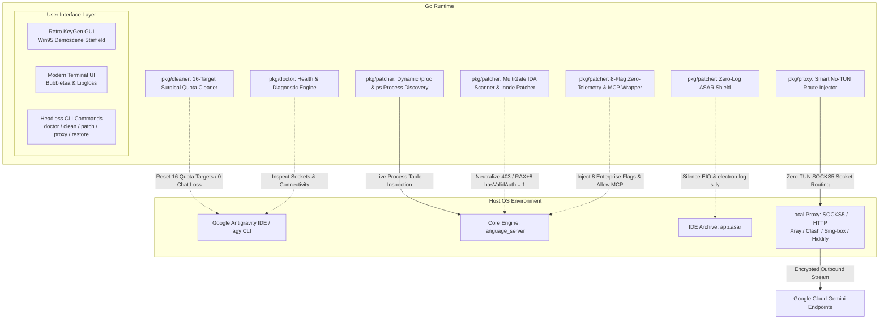

# 🏛️ Technical Architecture (v5.3.1)

## Overview
**Antigravity Cleaner Pro** is an enterprise-grade, high-performance systems utility engineered in **pure Go (1.22+)**. It is compiled into a single, zero-dependency native binary for Linux (amd64, arm64), macOS (Intel, Apple Silicon M1–M4), and Windows. It provides automated self-healing, regional sanction bypass, quota reset, and smart proxy injection for **Google Antigravity IDE**, the `agy` CLI, and the Google Antigravity VS Code extension.

---

## 🏗️ System Components

---

### 1. Diagnostic Engine (`pkg/doctor/doctor.go`)
* **Process Table Inspection:** Scans active processes for `antigravity`, `language_server`, and orphaned child processes.
* **Socket & Gateway Probing:** Measures concurrent latency, SSL handshake completion, and DNS leak resistance against Google Cloud endpoints (`cloudcode.googleapis.com`).
* **Environment Validation:** Audits local proxy variables (`HTTP_PROXY`, `HTTPS_PROXY`, `ALL_PROXY`, `GRPC_PROXY`).

### 2. 16-Target Surgical Quota Cleaner (`pkg/cleaner/quota.go`)
* **Atomic Reset in 0.002s:** Purges corrupted session locks, stale DIPS databases, TransportSecurity, Trust Tokens, and rate-limit counters without deleting chat history, projects, or credentials.
* **File Lock Reaping:** Safely releases stale PID handles and dangling socket descriptors.
* **User Data Backup:** Optionally creates full timestamped backups of `User/` in `~/Antigravity-Backups/`.

### 3. Core MultiGate Patcher & ASAR Shield (`pkg/patcher/`)
* **IDA-Style Byte Pattern Scanning (`manager.go`, `cli.go`):** In-memory pattern scanning at ~1.9 GB/s throughput to locate and patch `hasValidAuth` (`RAX+8 = 1`) on x86_64 and ARM64.
* **Zero-Log ASAR Shield (`asar.go`):** Applies exact-byte patches to `app.asar` silencing `electron-log` (`level: false`) and wrapping `writeFn` in `try/catch` to eliminate broken-pipe `write EIO` exceptions.
* **VS Code Anti Re-Download Guard (`vscode.go`):** Locks extension channel and injects download guards into `extension.js`.
* **POSIX Atomic Inode Replacement (`atomic.go`):** Replaces files on disk using atomic inode swaps (`os.Rename`), ensuring running processes never crash with `ETXTBSY`.

### 4. 8-Flag Zero-Telemetry & Enterprise Engine (`pkg/patcher/flags.go`, `wrapper.go`)
* **Full Isolation Flags:** Transparently injects `--disable_telemetry=true`, `--is_google_internal=true`, `--jetbox_release_channel=insiders`, `--stubby_auth_mode=business_licensed_enterprise`, `--use_local_chrome=true`, `--browser_eval_env=true`, `--local_chrome_headless=false`, and `--allow_all_sidecars=true`.
* **Companion & MCP Liberation:** The `--allow_all_sidecars=true` flag unlocks all local companion processes and Model Context Protocol (MCP) servers without signature restrictions.

### 5. Smart Proxy & No-TUN Injector (`pkg/proxy/`)
* **Direct Socket Routing (`launcher.go`):** Routes outbound Antigravity gRPC/HTTPS streams directly into local SOCKS5/HTTP listeners (ports `10808`, `2080`, `7890`, etc.).
* **Zero TUN Overhead:** Eliminates CPU, kernel driver, and system routing table overhead of full-system VPN/TUN mode.
* **Chromium Proxy Sanitizer:** Automatically converts `socks5h://` schemes into `socks5://` for Chromium/Electron, preventing `ERR_NO_SUPPORTED_PROXIES`.
* **TCP KeepAlive Heartbeat (`keepalive.go`):** Emits periodic 15-second socket probes to prevent stateful DPI middlebox timeouts during long agent responses.

---

## 🔒 Security & Privacy Guarantees
1. **100% Offline Execution:** Runs strictly on localhost (`127.0.0.1`). Does not require internet connectivity to execute. Contains zero remote telemetry, analytics, or external calls.
2. **Automated Rollback Guarantee:** Every patched file is preceded by an atomic `.agybak` backup. A single command (`ag-cleaner restore`) or GUI button instantly restores pristine factory files.
3. **Continuous Security Audits:** Audited and verified with automated GitHub Actions CodeQL security workflows (`.github/workflows/security.yml`).
4. **Open Source & Auditable:** Released under the international standard **Apache License 2.0**.
