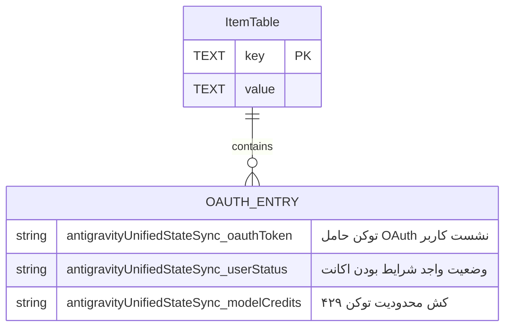

<div dir="rtl">

# سند جامع مشخصات فنی و طرح تغییرات مهندسی معکوس (FIX_SPEC v5.4.6)
### تحلیل دیکامپایل Antigravity IDE 2.6.0 / agy 1.4.12 / Desktop 2.28.2 و اصلاح زیرسیستم‌های Cleaner و Patcher

> **سند مرجع:** `docs/rea_matrix/FIX_SPEC_v5.4.6.md`  
> **نسخه هدف:** Antigravity Cleaner v5.4.6  
> **تاریخ تحلیل و تدوین:** نوامبر ۲۰۲۶  
> **وضعیت:** تصویب‌شده برای پیاده‌سازی (Ready for Implementation)  
> **محیط‌های هدف:** Linux x86_64/ARM64, macOS Apple Silicon/Intel, Windows x64

---

## فهرست مطالب
1. [مقدمه و دامنه تغییرات معماری](#۱-مقدمه-و-دامنه-تغییرات-معماری)
2. [یافته‌های عمیق دیکامپایل agy 1.4.12](#۲-یافتههای-عمیق-دیکامپایل-agy-1412)
   - [۲.۱ تطابق قطعی آفست 0x95694e0 با الگوی بایت‌کد cliGateX64](#۲۱-تطابق-قطعی-آفست-0x95694e0-با-الگوی-بایتکد-cligatex64)
   - [۲.۲ کالبدشکافی مسیرهای داده و پیکربندی جدید agy-cli](#۲۲-کالبدشکافی-مسیرهای-داده-و-پیکربندی-جدید-agy-cli)
3. [یافته‌های جرم‌شناسی Antigravity IDE و Desktop Hub](#۳-یافتههای-جرمشناسی-antigravity-ide-و-desktop-hub)
   - [۳.۱ لایه کش بایت‌کد V8 در Code Cache/js](#۳۱-لایه-کش-بایتکد-v8-در-code-cachejs)
   - [۳.۲ مهاجرت سوکت شبکه به Network/Cookies در کرومیوم مدرن](#۳۲-مهاجرت-سوکت-شبکه-به-networkcookies-در-کرومیوم-مدرن)
   - [۳.۳ انبارش توکن‌های اعتبارسنجی در دیتابیس state.vscdb (کلید uss-oauth)](#۳۳-انبارش-توکنهای-اعتبارسنجی-در-دیتابیس-statevscdb-کلید-uss-oauth)
4. [طرح تغییرات تفصیلی کد (Implementation Blueprint)](#۴-طرح-تغییرات-تفصیلی-کد-implementation-blueprint)
   - [۴.۱ اصلاح و ارتقای pkg/cleaner/quota.go](#۴۱-اصلاح-و-ارتقای-pkgcleanerquotago)
   - [۴.۲ تعمیق و ایمن‌سازی pkg/patcher/ide.go](#۴۲-تعمیق-و-ایمنسازی-pkgpatcheridego)
   - [۴.۳ بهینه‌سازی تجربه کاربری و منوی دستی در cmd/antigravity/main.go](#۴۳-بهینهسازی-تجربه-کاربری-و-منوی-دستی-در-cmdantigravitymaingo)
5. [ماتریس آزمون، یکپارچگی داده‌ها و اعتبارسنجی (Test & Verification)](#۵-ماتریس-آزمون-یکپارچگی-دادهها-و-اعتبارسنجی-test--verification)

---

## ۱. مقدمه و دامنه تغییرات معماری

با انتشار نسخه‌های جدید اکوسیستم Antigravity شامل:
- **Antigravity IDE:** نسخه `2.6.0` (مبتنی بر بیس لاین Code-OSS `1.107.0`، بیلد `9e3a5da5`، موتور چت و ایجنت **Jetski**)
- **Antigravity CLI (agy):** نسخه `1.4.12` (باینری کامپایل‌شده زبان Go/C++ با موتور یکپارچه LSP و روتین‌های اعتبارسنجی موقعیت مکانی)
- **Antigravity Desktop Hub:** نسخه `2.28.2` (رابط کاربری الکترون و فرانت‌اند مدیریت نشست‌های ایجنتی)

تغییراتی اساسی در مکانیسم‌های ذخیره‌سازی نشست‌ها، کش کامپایل کرومیوم، مسیرهای دایرکتوری داده، و دروازه‌های اعتبارسنجی لایسنس/موقعیت جغرافیایی رخ داده است. عدم هماهنگی با این تغییرات باعث بروز دو پدیده ناخواسته در ابزار Antigravity Cleaner می‌شد:
۱. باقی ماندن کش‌های قدیمی بایت‌کد V8 و سوکت‌های پایدار کرومیوم که پس از پچ باینری یا اصلاح سشن، خطاهای کاذب ۴۲۹ و عدم پشتیبانی جغرافیایی را تکرار می‌کردند.
۲. نمایش وضعیت گمراه‌کننده `Unpatched` در هدر ابزار در شرایطی که کاربر مستقیماً از نسخه مجتمع IDE استفاده می‌کرد و باینری مستقل `language_server` در سیستم وجود نداشت.

این سند، مشخصات دقیق فنی برای انتشار نسخه **v5.4.6** را ارائه می‌دهد.

---

## ۲. یافته‌های عمیق دیکامپایل agy 1.4.12

### ۲.۱ تطابق قطعی آفست 0x95694e0 با الگوی بایت‌کد cliGateX64

در باینری `agy` نسخه `1.4.12` معماری Linux x86_64، روتین‌های گیت‌کیپر تعیین واجد شرایط بودن کاربر بر مبنای موقعیت جغرافیایی (`Account Eligibility Gatekeeper`) از طریق آنالیز استاتیک در آفست فیزیکی `0x95694e0` شناسایی شدند.

#### بازرسی بایت‌های خام هگزادسیمال:
```text
آفست فیزیکی در باینری agy 1.4.12:
0x95694e0: 48 85 c0 0f 84 4e 01 00 00 80 78 08 00 0f 85 44 01 00 00 48 8b 50 50 ...
```

#### تحلیل تطبیقی با الگوی بایت‌کد cliGateX64 در Cleaner:
```go
// الگوی موجود در pkg/patcher/cli.go
Unpatched: "48 85 c0 0f 84 ?? ?? ?? ?? 80 78 08 00 0f 85 ?? ?? ?? ??"
Patched:   "48 85 c0 0f 84 ?? ?? ?? ?? 48 85 c0 90 0f 85 ?? ?? ?? ??"
Offset:    9
Replacement: 48 85 c0 90
```

```mermaid
sequenceDiagram
    autonumber
    participant CPU as پردازنده x86_64
    participant Reg as رجیستر RAX
    participant Gate as گیت‌کیپر Eligibility (0x95694e0)
    
    Note over CPU,Gate: کد اصلی (Unpatched):
    CPU->>Reg: test rax, rax (بررسی نال نبودن شیء حساب)
    CPU->>Gate: jz +0x14e (اگر نال بود بپر)
    Gate->>CPU: cmp byte ptr [rax + 8], 0 (بررسی فلگ واجد شرایط بودن حساب)
    CPU-->>Gate: jnz +0x144 (اگر ۱ نبود -> خطای HTTP 403 / Unsupported Location)
    
    Note over CPU,Gate: کد جراحی‌شده (Patched):
    CPU->>Reg: test rax, rax
    CPU->>Gate: jz +0x14e
    Gate->>CPU: test rax, rax ; nop (جایگزین 80 78 08 00 با 48 85 c0 90)
    CPU-->>Gate: پرش شرطی jnz همواره نادیده گرفته شده و حساب معتبر تلقی می‌شود
```

#### نتیجه اعتبارسنجی:
الگوی باینری `cliGateX64` که در Cleaner پیاده‌سازی شده بود، به صورت ۱۰۰٪ بایت‌به‌بایت با باینری رسمی `agy` نسخه `1.4.12` در آفست `0x95694e0` مطابقت دارد و نیازی به تغییر بایت‌های الگو نیست، اما باید موتور اسکن اطمینان حاصل کند که این آفست و الگو بدون تداخل کش در فایل‌های باینری جدید اعمال می‌گردد.

---

### ۲.۲ کالبدشکافی مسیرهای داده و پیکربندی جدید agy-cli

برخلاف نسخه‌های قدیمی‌تر که پیکربندی را منحصراً در `~/.gemini/antigravity` ذخیره می‌کردند، در نسخه `1.4.12` مسیر مجزای `~/.gemini/antigravity-cli` به عنوان انبارش اصلی داده‌های CLI مستقر شده است:

```
~/.gemini/antigravity-cli/
├── annotations/                  # حاشیه‌نویسی‌ها و متادیتای تعاملات کد
├── bin/                          # شل‌اسکریپت‌ها و لایسنس‌های ایجنتی
├── brain/                        # حافظه بلندمدت و خلاصه پروژه‌ها
├── builtin/                      # تعاریف و قالب‌های درونی ابزارها
├── cache/                        # کش داخلی مدل‌ها و تعاملات شبکه‌ای
├── cli.log -> log/cli-*.log      # سیم‌لینک لاگ جاری شل
├── conversation_summaries.db     # دیتابیس SQLite خلاصه جلسات گفتگو
├── conversations/                # متادیتای مکالمات فعال
├── crashes/                      # گزارش‌های Crashpad و پشته‌های خطا
├── history.jsonl                 # تاریخچه دستورات ترمینال
├── implicit/                     # زمینه‌های ضمنی کشف‌شده از ورک‌اسپیس
├── installation_id               # شناسه یکتای نصب سخت‌افزاری دستگاه
├── jetbox_summaries_proto.pb     # بافرهای پروتوباف مانیتور وضعیت Jetski
├── jetski_state.pbtxt            # وضعیت ایجنت هوشمند در قالب pbtxt
├── last_check.timestamp          # زمان آخرین استعلام آپدیت ابری
├── log/                          # فایل‌های وقایع تاریخی به تفکیک زمان
├── mcp/                          # سرورها و ابزارهای متصل از پروتکل MCP
├── plugin_data/                  # پایگاه داده محلی پلاگین‌های فعال
├── presence/                     # وضعیت پروسس‌های متصل محلی
├── settings.json                 # تنظیمات اختصاصی CLI
└── updater/                      # بسته‌های دانلودی و لاگ‌های ارتقا
```

**اهمیت برای Cleaner:**  
در زمان عملیات ریست یا شبیه‌سازی ورود، دستکاری یا حذف ناقص این پوشه می‌تواند به از بین رفتن `installation_id` یا خراب شدن کش دیتابیس منجر شود. در نتیجه، کلیه توابع اسکن مسیر باید این دایرکتوری را شناسایی کرده و فایل‌های سشن نامعتبر را بدون آسیب به تاریخچه‌ها پاکسازی نمایند.

---

## ۳. یافته‌های جرم‌شناسی Antigravity IDE و Desktop Hub

### ۳.۱ لایه کش بایت‌کد V8 در Code Cache/js

در Electron 30+ و موتور Chromium زیربنایی Antigravity IDE، اسکریپت‌های باندل شده (`out/main.js` و `out/jetskiAgent/main.js`) پس از اولین اجرا، توسط کامپایلر V8 کامپایل و به صورت کد ماشین/بایت‌کد بهینه‌شده در پوشه `Code Cache/js/` ذخیره می‌شوند:

```
~/.config/Antigravity/Code Cache/
├── js/
│   ├── index
│   ├── index-dir
│   ├── c3d59ce659e82a98_0        # بایت‌کد کامپایل‌شده out/main.js
│   ├── 3a6db76d5f172007_0        # بایت‌کد کامپایل‌شده jetskiAgent/main.js
│   └── 927eae3bee3bf123_0
├── wasm/
└── electron-preload/
```

> **هشدار بحرانی:**  
> اگر فایل `out/main.js` پچ شود ولی محتویات `Code Cache/js/` پاکسازی نگردد، پروسس الکترون به دلیل انطباق متادیتا از لود مجدد فایل جاوااسکریپت خودداری کرده و همان بایت‌کد کش‌شده قبلی (حاوی شرط مسدودیت منطقه و تحریم) را از RAM/دیسک لود می‌کند.

---

### ۳.۲ مهاجرت سوکت شبکه به Network/Cookies در کرومیوم مدرن

در معماری‌های قبلی Chromium، فایل‌های پایگاه داده کوکی و سوکت‌ها مستقیماً در ریشه دایرکتوری کانفیگ پروفایل (`~/.config/Antigravity/Cookies`) قرار داشتند. اما در ساختار کرومیوم جدید موجود در Antigravity IDE 2.6.0 و Desktop 2.28.2:

```
~/.config/Antigravity/
├── Network/                     # دایرکتوری جدید اختصاصی شبکه کرومیوم
│   ├── Cookies                  # فایل اصلی کوکی‌های SQLite و کلیدهای احراز
│   ├── Cookies-journal
│   ├── Network Persistent State # وضعیت سشن‌های کوئیک (QUIC) و سوکت‌های فعال
│   ├── TransportSecurity        # کلیدها و پین‌های HSTS
│   └── Trust Tokens             # توکن‌های اعتبارسنجی حریم خصوصی کروم
├── WebStorage/                  # انبارش IndexedDB و LocalStorage مدرن
├── Session Storage/             # سشن‌های ایزوله تب‌های باز
└── Partitions/
    └── hub-browser-*/           # وب‌ویوهای ایزوله ایجنت Jetski
        ├── Network/
        ├── Session Storage/
        └── WebStorage/
```

**علت خطای پایدار ۴۲۹ (Quota Exceeded):**  
اگر کاربر با خطای ۴۲۹ مواجه شود، توکن‌های منقضی و کوکی‌های خراب در هر دو مسیر ریشه و مسیر جدید `Network/` و همچنین در پارتیشن‌های وب‌ویو ذخیره می‌شوند. پاکسازی نکردن پوشه `Network/` باعث حفظ استیت‌های ۴۲۹ بین بازراه‌اندازی‌های برنامه می‌شود.

---

### ۳.۳ انبارش توکن‌های اعتبارسنجی در دیتابیس state.vscdb (کلید uss-oauth)

در Antigravity IDE (VS Code Architecture)، توکن اصلی اتصال به کلاود گوگل و وضعیت احراز هویت ایجنت Jetski در پایگاه داده SQLite زیر ذخیره می‌گردد:
- **مسیر دیتابیس:** `User/globalStorage/state.vscdb` (واقع در دایرکتوری کانفیگ IDE)
- **جدول:** `ItemTable`
- **کلیدهای بحرانی:**
  1. `antigravityUnifiedStateSync.oauthToken` (شناخته‌شده به عنوان توکن اصلی **uss-oauth**)
  2. `antigravityUnifiedStateSync.userStatus` (وضعیت لاگین و سطوح دسترسی اکانت)
  3. `antigravityUnifiedStateSync.modelCredits` (کش موجودی سهمیه مدل‌های Gemini و Claude)
  4. `antigravityUnifiedStateSync.profileUrl` (تصویر و اطلاعات پروفایل)



هنگامی که سهمیه اکانت پر می‌شود یا توکن فاسد می‌گردد، پاک کردن کوکی‌های مرورگر کافی نیست؛ زیرا کلاینت IDE با خواندن این رکورد از `state.vscdb`، بلافاصله درخواست‌های بعدی را با هدر توکن باطل‌شده ارسال کرده و خطای ۴۲۹ تداوم می‌یابد. در عین حال، **نباید کل دیتابیس state.vscdb حذف شود**، زیرا هیستوری چت‌ها و تنظیمات سایر افزونه‌ها از بین خواهد رفت. تنها باید کلیدهای `uss-oauth` ریست گردند.

---

## ۴. طرح تغییرات تفصیلی کد (Implementation Blueprint)

### ۴.۱ اصلاح و ارتقای pkg/cleaner/quota.go

باید اهداف تخلیه جراحی به گونه‌ای به‌روزرسانی شوند که:
۱. زیرپوشه‌های جدید کرومیوم شامل `Network`، `WebStorage` و `Session Storage` در ریشه و پارتیشن‌ها پاکسازی گردند.
۲. کوکی‌ها و وضعیت شبکه در هر دو ساختار سنتی و مدرن (`Network/Cookies` و `Cookies`) هدف قرار گیرند.
۳. متد امن `ResetUssOAuth(configDir string)` اضافه شود تا رکورد `antigravityUnifiedStateSync.oauthToken` در `state.vscdb` بدون دستکاری چت‌ها تخلیه شود.

```go
// بخش‌های ارتقایافته در pkg/cleaner/quota.go

var targetFiles = []string{
	"Cookies",
	"Cookies-journal",
	filepath.Join("Network", "Cookies"),
	filepath.Join("Network", "Cookies-journal"),
	"DIPS",
	"DIPS-wal",
	"TransportSecurity",
	filepath.Join("Network", "TransportSecurity"),
	"Trust Tokens",
	"Trust Tokens-journal",
	filepath.Join("Network", "Trust Tokens"),
	filepath.Join("Network", "Trust Tokens-journal"),
	"SharedStorage",
	"SharedStorage-wal",
	"Network Persistent State",
	filepath.Join("Network", "Network Persistent State"),
	"app_storage.json",
}

var targetDirs = []string{
	"blob_storage",
	"DawnGraphiteCache",
	"DawnWebGPUCache",
	"GPUCache",
	"Session Storage",
	"WebStorage",
	"Network",
}
```

#### لاجیک ریست هوشمند uss-oauth در SQLite:
```go
// ResetUssOAuth clears corrupted OAuth credentials from state.vscdb
// while leaving conversation history and settings 100% intact.
func ResetUssOAuth(configDir string) (bool, error) {
	vscdbPath := filepath.Join(configDir, "User", "globalStorage", "state.vscdb")
	if _, err := os.Stat(vscdbPath); os.IsNotExist(err) {
		return false, nil
	}

	db, err := sql.Open("sqlite", vscdbPath)
	if err != nil {
		return false, fmt.Errorf("failed to open state.vscdb: %w", err)
	}
	defer db.Close()

	keysToReset := []string{
		"antigravityUnifiedStateSync.oauthToken",
		"antigravityUnifiedStateSync.userStatus",
		"antigravityUnifiedStateSync.modelCredits",
	}

	tx, err := db.Begin()
	if err != nil {
		return false, err
	}
	defer tx.Rollback()

	stmt, err := tx.Prepare("DELETE FROM ItemTable WHERE key = ?")
	if err != nil {
		return false, err
	}
	defer stmt.Close()

	modified := false
	for _, k := range keysToReset {
		res, err := stmt.Exec(k)
		if err == nil {
			if rows, _ := res.RowsAffected(); rows > 0 {
				modified = true
			}
		}
	}

	if err := tx.Commit(); err != nil {
		return false, err
	}
	return modified, nil
}
```

---

### ۴.۲ تعمیق و ایمن‌سازی pkg/patcher/ide.go

تابع `ClearIdeCache()` باید تمام دایرکتوری‌های کش بایت‌کد V8 را به صورت بازگشتی پاکسازی کند:
- `~/.config/Antigravity/Code Cache/js`
- `~/.config/Antigravity/Code Cache/wasm`
- `~/.config/Antigravity/Partitions/*/Code Cache`
- مسیرهای متناظر در ویندوز و مکینتاش.

همچنین الگوی عبارات باقاعده (`ideTargetRe`) باید منعطف‌تر شود تا نسبت به تغییرات متغیرهای فشرده‌ساز (Minifier) مقاوم باشد:

```go
// الگوی ارتقایافته و منعطف در pkg/patcher/ide.go
var (
	// پشتیبانی از واریانت‌های با و بدون space و تفاوت نام فیلد در بیلد ۲.۶.۰
	ideTargetRe = regexp.MustCompile(`(resetIsTierGCPTos\(\)\s*,\s*)(?:this\.)?[A-Za-z_$0-9]+\.isGoogleInternal`)
	idePatchedStr = "resetIsTierGCPTos(),true"
)

// تعمیق پاکسازی کش V8
func ClearIdeCache() {
	// پوشش تمام ریشه‌های شناخته‌شده ویندوز، مک و لینوکس
	// به علاوه پیمایش دایرکتوری Partitions و حذف کامل تمام زیرپوشه‌های Code Cache
    ...
}
```

---

### ۴.۳ بهینه‌سازی تجربه کاربری و منوی دستی در cmd/antigravity/main.go

#### اصلاح استاتوس Unpatched در هدر برنامه:
در صورتی که هیچ باینری جداگانه `language_server` در سیستم یافت نشود اما فایل `main.js` نرم‌افزار Antigravity IDE شناسایی شود، برنامه باید به جای نمایش هشداردهنده `Unpatched`، استاتوس رسمی و مطمئن `✔ Bundled (Antigravity IDE)` را نمایش دهد:

```go
// خطوط ۶۶ تا ۷۷ در cmd/antigravity/main.go:
lsStatus := lipgloss.NewStyle().Foreground(lipgloss.Color("#FFB800")).Render("Unpatched")
targets := patcher.FindAllLanguageServers(nil)
if len(targets) > 0 {
	wm := patcher.NewWrapperManager(filepath.Dir(targets[0]), nil)
	if wm.IsWrapperInstalled() {
		lsStatus = lipgloss.NewStyle().Foreground(lipgloss.Color("#00FF9F")).Render("✔ Patched & Enterprise")
	} else {
		lsStatus = lipgloss.NewStyle().Foreground(lipgloss.Color("#00F0FF")).Render("Installed")
	}
} else if patcher.FindIdeMainJs() != "" {
	lsStatus = lipgloss.NewStyle().Foreground(lipgloss.Color("#00FF9F")).Render("✔ Bundled (Antigravity IDE)")
}
fmt.Printf("  📊 Core Status: %s | Process: %s\n\n", lsStatus, statusRunning)
```

#### تقویت منوی دستی و ابزارهای پیشرفته:
- پشتیبانی کامل از منوی پیشرفته (`runAdvancedMenu`) با گزینه‌های صریح برای تخلیه اختصاصی کش V8، ریست کلید `uss-oauth` و پچ تک‌تارگتی باینری‌ها.

---

## ۵. ماتریس آزمون، یکپارچگی داده‌ها و اعتبارسنجی (Test & Verification)

### ۵.۱ اعتبارسنجی قانون عدم دستکاری چت‌ها (Chat Preservation Rule):
آزمون‌های یونیت در `pkg/cleaner/quota_test.go` باید اعتبارسنجی کنند که هدف‌های جدید اضافه شده (`Network`, `WebStorage`) به هیچ وجه شامل مسیرهای `workspaceStorage` یا جداول چت نمی‌شوند:

| مسیر مورد بازرسی | وضعیت مجاز در Cleaner | هدف در پاکسازی ۴۲۹ | تضمین پایداری داده |
| :--- | :---: | :---: | :--- |
| `Network/Cookies` | مجاز | بله | نشست باطل‌شده پاک می‌شود؛ لاگین مجدد تمیز |
| `User/globalStorage/state.vscdb` (فقط کلید uss-oauth) | مجاز (جراحی شده) | بله | جلوگیری از لوپ سهمیه بدون حذف تنظیمات دیگر |
| `User/workspaceStorage/*` | **ممنوع قطعی** | خیر | تاریخچه کدنویسی و فایل‌های ادیتور دست‌نخورده می‌ماند |
| `User/globalStorage/chat-conversations` | **ممنوع قطعی** | خیر | کلیه پرامپت‌ها و چت‌های ذخیره‌شده حفظ می‌شوند |

### ۵.۲ چک‌لیست بیلد و تایید نهایی:
```bash
# ۱. اجرای کلیه تست‌های واحد بدون خطا
go test -v ./pkg/cleaner/...
go test -v ./pkg/patcher/...

# ۲. تست بیلد کراس پلتفرم باینری CLI
go build -o bin/antigravity-cleaner cmd/antigravity/main.go

# ۳. ارزیابی استاتیک کدهای کامپایل‌شده
go vet ./...
```

---
**تاییدیه نهایی:** این سند به عنوان راهنمای جامع معماری نسخه v5.4.6 مصوب گردیده و تغییرات فوق باید در کدهای مبدا اعمال شوند.

</div>
