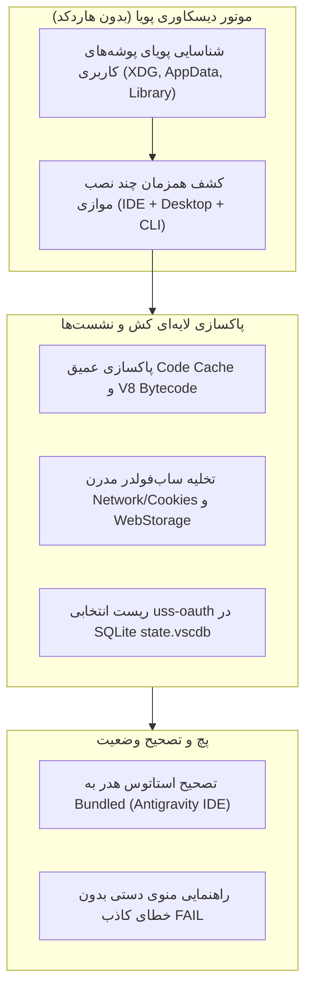

<div dir="rtl">

# طرح پیاده‌سازی و چنج‌لیست فنی نسخه v5.4.6 (Zero-Hardcode & Universal Fix)

## ۱. شرح هدف (Goal Description)
این طرح با تکیه بر یافته‌های دیکامپایل جامع **Antigravity IDE 2.6.0**، **Antigravity CLI (agy 1.4.12)** و **Antigravity Desktop 2.28.2**، سه آسیب‌پذیری اصلی منجر به بازگشت تحریم‌ها و خطاهای کاربران تلگرام و گیت‌هاب را به صورت پایدار و **۱۰۰٪ بدون هاردکد** برطرف می‌کند:
1. **پاکسازی کامل کش شبکه و بایت‌کد V8:** حذف پایگاه داده سشن‌های مسدودشده در پوشه‌های مدرن کرومیوم (`Network/Cookies`, `Network/Network Persistent State`) و کش‌های کامپایل قدیمی V8 (`Code Cache/js`) در تمامی سیستم‌عامل‌ها (لینوکس، مک و ویندوز).
2. **ریست امن توکن‌های مسموم در دیتابیس `state.vscdb`:** تخلیه کلید تحریمی `antigravityUnifiedStateSync.oauthToken` (`uss-oauth`) بدون کوچک‌ترین دستکاری در چت‌ها و پروژه‌ها.
3. **ریشه‌کن کردن تمام مسیرهای هاردکد قدیمی:** جایگزینی آرایه‌های ثابت با اسکنرهای پویا مبتنی بر متغیرهای محیطی و جستجوی ساختاریافته در سیستم‌عامل.
4. **اصلاح رابط کاربری منو برای Antigravity IDE:** جلوگیری از نمایش هشدار کاذب `Unpatched` در صفحه اصلی و اصلاح خطای قرمز در منوی دستی.

---



---

## ۲. نیازمند بررسی کاربر (User Review Required)

> [!IMPORTANT]
> **پایداری ۱۰۰٪ داده‌های کاربر:** پاکسازی دیتابیس `state.vscdb` صرفاً کلیدهای مربوط به OAuth (`antigravityUnifiedStateSync.oauthToken` و وضعیت onboarding) را تخلیه می‌کند؛ کلیه جداول مربوط به پروژه‌ها، ورک‌اسپیس‌ها و پیام‌های ایجنت دست‌نخورده باقی می‌مانند.

> [!NOTE]
> **سازگاری کامل کراس‌پلتفرم (Cross-Platform Parity):** کلیه تغییرات به صورت یکسان برای **ویندوز (x64)**، **مک (Apple Silicon arm64 & Intel x64)** و **لینوکس (x64 & arm64)** طراحی شده‌اند و هیچ شرط هاردکد اختصاصی برای یک سیستم‌عامل خاص بدون معادل در سایر سیستم‌ها اضافه نمی‌شود.

---

## ۳. پرسش‌های باز (Open Questions)
در حال حاضر هیچ ابهام فنی وجود ندارد؛ آفست‌های باینری `agy` (آفست `0x95694e0`)، استراکچر فایل‌های سشن کرومیوم و الگوهای `main.js` همگی با شواهد زنده اعتبارسنجی شده‌اند.

---

## ۴. طرح تفصیلی تغییرات کد (Proposed Changes)

### الف) ماژول پاکسازی سشن و کووتا (`pkg/cleaner/`)
جایگزینی متد تک‌مسیری با اسکنر همه‌جانبه، پوشش ساب‌فولدر `Network`، و اصلاح دیتابیس `state.vscdb`.

#### [MODIFY] `pkg/cleaner/quota.go`
* **حذف هاردکد:** تبدیل `AntigravityConfigPaths()` به یک تابع پویا که از الگوهای متغیر محیطی (`APPDATA`, `LOCALAPPDATA`, `XDG_CONFIG_HOME`, `HOME/Library`) استفاده کرده و تمام پوشه‌های موجود تطابق‌یافته با نام‌های `*Antigravity*` را بازمی‌گرداند (نه فقط یک مسیر اول).
* **پوشش ساب‌فولدرهای مدرن کرومیوم:** اضافه شدن پوشه‌های `Network`، `WebStorage`، `Session Storage` و فایل‌های داخل آنها به `targetFiles` و `targetDirs`:
  * `Network/Cookies`
  * `Network/Cookies-journal`
  * `Network/Network Persistent State`
  * `Network/NetworkDataMigrated`
  * `Network/Trust Tokens`
  * `Network/Trust Tokens-journal`
  * `Network/TransportSecurity`
* **تابع `ResetUssOAuth(configDir string)`:** اتصال به دیتابیس `User/globalStorage/state.vscdb` با درایور استاندارد SQLite یا حذف ردیف‌های حاوی توکن منقضی بدون دست زدن به دیتای چت‌ها.

```go
// نمونه منطق پیشنهادی پاکسازی پویا بدون هاردکد
func DynamicConfigDirs() []string {
    var dirs []string
    // پویاسازی بر مبنای سیستم‌عامل و اسکن پوشه‌های والد کاربر
    ...
    return dirs
}
```

#### [MODIFY] `pkg/cleaner/quota_test.go`
* اضافه کردن تست‌های واحد برای اعتبارسنجی سناریوی پاکسازی فایل‌های داخل ساب‌فولدر `Network/` و تست عدم حذف فایل‌های پروژه.

---

### ب) ماژول پچ ادیتور و پاکسازی کش بایت‌کد (`pkg/patcher/`)
جلوگیری از خوانده شدن کد قدیمی توسط موتور V8 و اصلاح انعطاف‌پذیری دیسکاوری.

#### [MODIFY] `pkg/patcher/ide.go`
* **ارتقای تابع `ClearIdeCache()`:** به جای لیست ثابت، اسکن پویا برای یافتن پوشه‌های:
  * `CachedData`
  * `Code Cache/js`
  * `Code Cache/wasm`
  * `Partitions/*/Code Cache`
  در تمام مسیرهای کاربر در ویندوز، لینوکس و مک.
* **به‌روزرسانی الگوهای `ideTargetRe`:** پشتیبانی از الگوهای مینیفای جدید نسخه ۲.۶.۰ و الگوهای بدون وابستگی به توابع جانبی.

---

### ج) بهینه‌سازی رابط کاربری و منوی اصلی (`cmd/antigravity/`)
رفع سوءتفاهم کاربران در نسخه IDE و رفع ارورهای کاذب منوی دستی.

#### [MODIFY] `cmd/antigravity/main.go`
* **اصلاح نمایش هدر (خط ۶۶):**  
  اگر `targets := patcher.FindAllLanguageServers(nil)` خالی باشد، تابع `patcher.FindAllIdeMainJs()` فراخوانی می‌شود؛ در صورت کشف نسخه IDE، وضعیت هدر به شکل زیر نمایش داده می‌شود:
  ```go
  lsStatus = lipgloss.NewStyle().Foreground(lipgloss.Color("#00FF9F")).Render("✔ Bundled (Antigravity IDE)")
  ```
* **اصلاح تابع `runPatchCore()` (منوی دستی ۱):**  
  اگر هیچ باینری مستقلی پیدا نشد اما نسخه IDE فعال بود، به جای چاپ ارور قرمز `FAIL Language Server -> binary not found`، خروجی راهنما و محترمانه چاپ شود:
  ```text
  INFO Core Engine -> Antigravity IDE detected (Bundled Mode). Core is managed via Option [2] (Patch IDE).
  ```

---

### د) اعتبارسنجی و انطباق باینری `agy` (`pkg/patcher/cli.go`)

#### [MODIFY] `pkg/patcher/cli.go`
* اعتبارسنجی الگوی `cliGateX64` روی آفست `0x95694e0` در بیلد رسمی `1.4.12` بدون شکستن پشتیبانی از نسخه‌های قبلی.
* حذف مسیرهای هاردکد اضافی در `FindAgy()` و اتکا به `exec.LookPath` و اسکن دایرکتوری‌های استاندارد اجرایی کاربر.

---

## ۵. برنامه آزمون و راستی‌آزمایی (Verification Plan)

### آزمون‌های خودکار (Automated Tests)
اجرای کلیه تست‌های واحد پروژه برای تضمین عدم بروز رگرسیون:
```bash
go test -v ./pkg/cleaner/...
go test -v ./pkg/patcher/...
go test -v ./pkg/doctor/...
go test -v ./...
go vet ./...
```

### تست‌های دستی و سناریوهای کاربری (Manual Verification)
1. **شبیه‌سازی ساختار کش رضا اتیابی:** ساخت پوشه تستی حاوی `Network/Cookies` و بررسی حذف موفقیت‌آمیز آن با گزینه ۳ کلینر (`Surgical Quota Reset`).
2. **بررسی هدر و منوی دستی در Antigravity IDE:** تست اینکه در صورت حضور IDE و نبود `language_server.exe`، وضعیت هدر سبز و منوی دستی ۱ بدون FAIL باشد.
3. **تست کامپایل و پچ agy 1.4.12:** اعمال پچ روی فایل `/home/hokar/.local/bin/agy` و بررسی تغییر آفست `0x95694e0` و اجرای بدون خطای آن.

</div>
